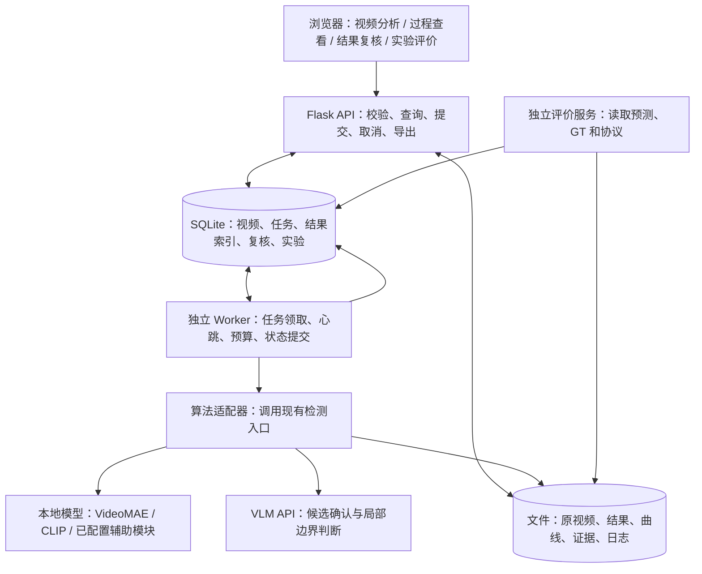
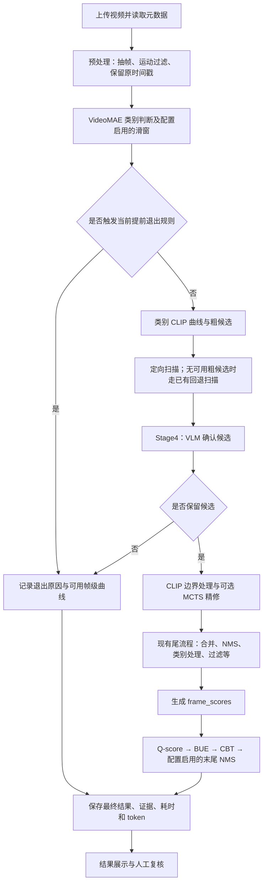
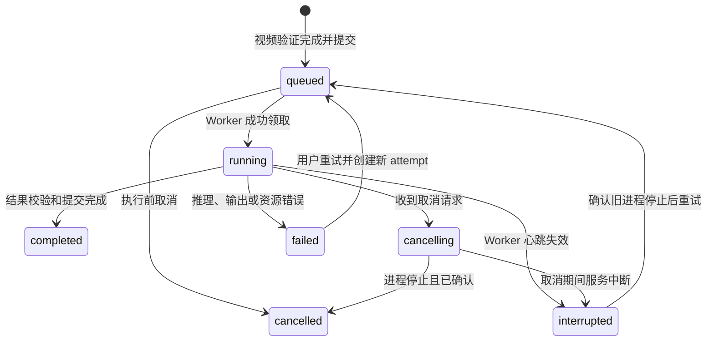

# 视频异常检测与时序定位辅助分析系统：硕士毕业项目完整建设方案

编制日期：2026 年 11 月 11 日  
适用项目：`mcts_vad`  
工程基础：现有视频异常检测流水线与 `vad_v3/webapp`  
文档性质：设计基线，保留实施前盘点。2026-11-11 已完成单机核心工程接入，当前能力与验收边界以 [系统实施与验收记录](系统实施与验收记录.md) 和 [操作手册](../vad_v3/webapp/README.md) 为准。

用户调整：不要求 VLM 使用中文描述，保留发现阶段原文。系统部署限本机单用户；P2 功能不计入一个月交付范围。真实 CUDA 推理验收目前受 Windows 应用控制策略阻塞，不能标为全量验收完成。

阅读导航：

- 项目范围与功能：[建设目标](#1-项目定位与建设目标)、[已有基础](#2-现有基础与建设差距)、[功能模块](#5-功能模块设计)。
- 技术实施：[总体架构](#4-总体技术架构)、[算法接入](#6-算法接入与处理流程)、[数据模型](#7-数据模型与文件存储)、[接口](#9-后端接口设计)、[任务调度](#10-任务调度可靠性与执行恢复)。
- 研究验证：[时间轴规范](#8-时间轴帧号与-fps-规范)、[评价与现有数据](#12-统一评价体系与现有数据基础)、[问题整改](#14-针对现有问题的整改路线)。
- 开发与交付：[四周计划](#15-开发计划与工作量估计)、[测试验收](#16-测试方案与验收标准)、[部署](#17-部署依赖与运行维护)、[论文与答辩](#18-论文组织创新表达与答辩演示)、[交付清单](#20-最终交付清单与完成判定)。

## 1. 项目定位与建设目标

本项目拟建设一个面向监控录像的视频异常检测与时序定位辅助分析系统。用户上传本地视频后，系统自动执行异常分析，给出异常类别、发生时间和相关视觉描述；用户可以直接跳转到异常片段，查看检测依据，复核结果，并在有真实标注的数据集上开展实验评价。

建议系统名称为 **“视频异常检测与时序定位辅助分析系统”**，论文题目可采用 **“基于视觉语言模型与蒙特卡洛树搜索的视频异常检测与时序定位方法及系统”**。系统承担算法落地、过程展示、结果复核和实验管理四项任务，研究贡献由算法设计及受控实验支撑。

系统建设沿用现有 Flask 后端、视频播放器和检测算法，优先补齐任务管理、数据持久化、过程可视化及评价闭环。硕士阶段交付一个稳定的单机系统即可；实时摄像头接入、多人协作和分布式推理列为扩展方向。

### 1.1 需要回答的核心问题

| 问题 | 系统应提供的结果 |
| --- | --- |
| 视频中是否发现异常？ | 检测状态、异常区间数量、未检出原因或待复核提示 |
| 异常是什么？ | 最终类别、初始类别依据、必要的类别复核记录 |
| 异常发生在哪里？ | 起止时间、时间轴高亮、定位播放、边界变化对比 |
| 为什么得到这个结果？ | 类别 CLIP 曲线、实际送入 VLM 的关键帧、阶段结果和结构化判断 |
| 检测是否可靠？ | 人工复核入口，以及有 GT 时的分类、定位、帧级评价 |
| 为此付出多少计算成本？ | 各阶段耗时、模型请求次数、输入和输出 token、预算使用情况 |

### 1.2 建设目标与可衡量成果

1. 形成“上传—排队—检测—定位回看—复核—导出”的完整操作流程。
2. 保存每次检测的输入标识、完整有效配置、结果、过程记录与评价协议，支持复查。
3. 将 MCTS 和 Q-score、BUE、CBT 的作用通过真实的前后数据展示出来。
4. 建立统一评价入口，区分视频分类、事件区间定位与帧级异常检测。
5. 提供部署说明、测试记录、演示案例和可用于论文系统章节的图表。

算法精度提升是需要验证的研究目标。系统功能完成、任务执行稳定或增加搜索次数，都不能直接作为精度提升的证据。

## 2. 现有基础与建设差距

本节依据当前工作区源码与实验归档整理。产品和论文正文统一称为同一个项目；源码目录中的版本号只用于定位实现与追溯实验。

### 2.1 实施前的已有功能盘点

| 已有能力 | 当前实现位置 | 当前边界 |
| --- | --- | --- |
| 本地视频上传、格式检查和预览 | `vad_v3/webapp/app.py`、`static/index.html` | 浏览器能否播放取决于编码；尚无自动转码 |
| 后台调用真实检测程序 | `webapp/app.py::JobManager` | 每次任务启动独立子进程；已有任务运行时拒绝新检测 |
| 异常时间轴、区间跳转和循环播放 | `webapp/static/app.js` | 属于定位回看，没有生成独立的视频片段文件 |
| 最近任务、结果 JSON 导出、删除和撤销 | `webapp/app.py` | 通过任务目录和 JSON 保存；列表当前最多返回 30 项 |
| 日志查看、超时和错误提示 | `webapp/app.py` | 重启后未完成任务标记失败；尚无持久化排队调度 |
| MCTS 关闭、观察和精修模式 | 检测入口、`mcts_refiner.py` | 网页默认关闭；选择 `refine` 才可能应用通过检查的边界 |
| CLIP、VideoMAE、VLM 及后处理 | `video_anomaly_detection/` | 已有算法能力，网页尚未完整展示中间证据 |
| 帧级曲线及部分阶段快照 | `models.py`、`pipeline.py` | 是否包含详细轨迹取决于配置；旧任务可能缺失 |
| token 记录与实验复算资料 | `llm_usage.py`、`experiments/` | 尚未形成统一的系统统计页面 |

### 2.2 设计基线中的待建能力（当前状态见验收记录）

| 待建能力 | 解决的问题 | 优先级 |
| --- | --- | --- |
| SQLite 持久化任务、视频和结果索引 | 任务目录检索不便，数据缺少统一关联 | P0 |
| 独立 Worker、排队、取消、重试 | 长任务管理与网页服务生命周期耦合 | P0 |
| 视频元数据及时间轴规范 | 防止 FPS、帧号、秒数混用 | P0 |
| 统一结果与证据接口 | 支持播放器、曲线和阶段对比联动 | P0 |
| 人工复核及修订记录 | 区分模型输出、用户判断和实验 GT | P1 |
| CLIP、MCTS、后处理可视化 | 让研究方法具备可观察的运行过程 | P1 |
| 统一实验评价与历史结果导入 | 防止 AP、AUC、类别准确率混淆 | P1 |
| 资源和 API 成本统计 | 评价精度、耗时和调用成本的关系 | P1 |
| 多用户权限、批量推理、自动转码 | 扩大应用场景 | P2 |

P0 为核心交付，P1 为论文和答辩展示重点，P2 在核心功能稳定后实施。

## 3. 用户、使用场景与范围

### 3.1 用户与操作

初期采用本地单用户模式。界面按操作需要组织为“分析工作台”和“研究分析”，无需先建立复杂账户体系。

- **分析使用者**：上传录像、发起检测、查看异常片段、标记误报或漏报、导出结果。
- **研究人员**：比较配置、查看曲线和搜索过程、导入 GT、运行评价、汇总耗时与成本。
- **维护人员**：配置模型和密钥、检查任务失败原因、管理存储和备份。单机阶段可以由同一人承担。

### 3.2 典型业务场景

**场景一：定位异常片段。** 用户上传一段录像，系统显示等待和运行阶段，完成后在时间轴上突出异常区间。点击区间后播放器跳转到相应位置，并可循环回看。

**场景二：解释边界变化。** 用户选择一个异常事件，在同一时间轴查看初始候选、MCTS 输出、BUE 扩展和 CBT 收紧的边界；同时查看实际使用的图像证据和曲线，判断修改是否合理。

**场景三：处理误报。** 用户发现一个 Normal 视频被检出异常，查看类别依据与 Stage4 关键帧，标记“正常行为误报”并填写原因，形成可分析的错误案例。

**场景四：开展受控实验。** 研究人员固定视频集合和模型配置，比较 MCTS 或后处理开关，统一计算 mAP、帧级 ROC-AUC、分类指标和计算成本，导出可复核的实验表格。

### 3.3 本期范围

本期支持已录制视频的离线分析，输出时间区间级结果。播放器展示精度受视频编码和浏览器定位机制影响。系统使用本地视觉模型与已配置的 VLM 服务；当前流程会向 VLM 服务发送抽取的图像，部署说明应如实说明这一点。

当前流程会统一同一视频中最终区间的异常类别。系统首先保留这一行为，同时记录各阶段类别来源。真正支持“同一视频包含多个不同异常类别”需要增加区间级分类与相应标注、评价，属于独立算法扩展。

## 4. 总体技术架构

### 4.1 推荐技术方案

| 层次 | 推荐实现 | 选择原因 |
| --- | --- | --- |
| 前端 | 延续 HTML、CSS、JavaScript，拆分页面模块 | 复用已有播放器和任务交互，减少重构成本 |
| 图表 | Apache ECharts，本地保存前端资源 | 绘制时序曲线、混淆矩阵和实验对比图 |
| Web 服务 | Flask，沿用 Waitress 启动方式 | 与现有接口和 Python 算法直接衔接 |
| 持久化 | SQLite 保存结构化数据，文件系统保存视频和大数组 | 适合单机、少量并发写入的毕业系统 |
| 调度 | 独立 Python Worker，从 SQLite 领取任务 | 将推理与 HTTP 请求解耦；单 GPU 首期并发为 1 |
| 算法运行 | 初期沿用 CLI 子进程；后续评估常驻模型 | 先保持原有推理行为，再优化模型重复加载 |
| 模型与数值计算 | 复用现有 PyTorch、VideoMAE、CLIP、NumPy 等 | 避免更换技术栈造成不可控的结果变化 |
| 导出 | JSON、CSV、PNG/SVG 图表，HTML 分析报告 | 满足复算、论文制图和答辩展示需求 |

Flask 官方建议将耗时操作交给后台任务执行，避免阻塞请求；本项目据此采用独立 Worker，任务存储选择轻量的 SQLite。若后期转为 Linux 多 Worker 部署，再评估 Redis/Celery 与服务型数据库。[Flask 后台任务说明](https://flask.palletsprojects.com/en/stable/patterns/celery/)

SQLite 适用于本地应用存储；本方案要求数据库位于本机磁盘，采用短事务、写入重试和串行推理。多节点共享数据库、持续高并发写入时应重新选型。[SQLite 适用场景](https://www.sqlite.org/whentouse.html)

图表交互由 ECharts 实现，播放器和原始数据仍由项目自行管理。[ECharts 官方入门](https://echarts.apache.org/handbook/en/get-started/)

### 4.2 系统架构图



推理接口不接收 GT。GT 只在评价或人工分析模块使用，避免搜索过程、候选筛选和实时参数调整读取测试答案。

### 4.3 代码组织建议

以下为目标结构。现有 `app.py` 和 `static/` 逐步拆分；新增目录先作为规划，不要求一次性重写。

```text
mcts_vad/
├─ docs/
│  ├─ 硕士毕业系统建设完整方案.md
│  └─ 视频异常定位关键模块与评分机制说明.md
├─ vad_v3/
│  ├─ video_anomaly_detection/      # 现有算法主体
│  ├─ experiments/                 # 原始实验归档，保持来源可追溯
│  ├─ webapp/
│  │  ├─ app.py                    # 应用创建与路由注册
│  │  ├─ api/                      # videos、jobs、results、reviews、experiments
│  │  ├─ services/                 # 上传、结果整理、评价、导出
│  │  ├─ persistence/              # SQLite 访问与迁移
│  │  ├─ schemas/                  # 请求、结果、事件的数据约束
│  │  ├─ worker.py                 # 独立调度进程
│  │  ├─ algorithm_adapter.py      # 参数映射、CLI 调用与输出校验
│  │  ├─ static/                   # 页面、播放器、图表模块
│  │  ├─ scripts/                  # 旧任务导入、环境检查、备份
│  │  └─ tests/
│  └─ web_data/                    # 运行数据，不纳入源码提交
│     ├─ system.sqlite3
│     ├─ videos/<video_id>/
│     ├─ jobs/<job_id>/attempts/<attempt_id>/
│     └─ experiments/<experiment_id>/
└─ requirement.txt
```

## 5. 功能模块设计

### 5.1 视频管理

上传完成后创建独立的 `video_id`，保存原始文件名、文件大小、内容哈希、时长、宽高、帧率和总帧数。上传阶段验证文件可解码，文件名仅用于显示，存储路径由服务端生成。

同一视频可以关联多次检测，避免修改配置时反复上传。按内容哈希识别重复文件，但检测结果是否复用还必须核对配置、代码、模型和提示模板。视频哈希相同不代表所有任务结果可以通用。

文件浏览器无法播放时，先提示原因；自动生成浏览器兼容副本列为 P2。若转码改变帧率或时间轴，保留原视频与预览副本映射，不能直接把预览文件的帧号用于原标注评价。

### 5.2 检测任务管理

支持任务创建、排队、运行状态查看、取消、失败后重试和历史检索。用户看到的是“视频预处理、候选定位、VLM 确认、边界优化、后处理、结果保存”等业务阶段。

优先显示真实阶段和已完成的候选数量。尚不能准确估算时，不显示伪造的精确百分比；可展示“正在确认第 3/8 个候选”和已耗时。

基础界面使用已验证的配置模板；研究界面允许修改 MCTS 模式、预算和后处理开关。每次任务创建时冻结有效配置，不随以后修改系统默认值而改变。

### 5.3 检测结果与定位回看

结果页面显示视频、最终类别、异常区间列表、时间轴、检测评分和来源描述。点击区间或曲线时间点后联动播放器。支持按时间顺序查看，以及切换按评分查看。

“界面显示阈值”只决定当前页面展示哪些记录；它不修改原始结果或实验指标。需要评价过滤后的结果时，应建立新的预测配置并保存过滤规则。

最终置信度显示为“检测评分”，并说明它用于排序，未做概率校准。不要将 `0.9` 直接显示为“90% 确定发生异常”。

### 5.4 研究过程分析

提供五个视图：

| 视图 | 主要内容 | 回答的问题 |
| --- | --- | --- |
| 类别依据 | VideoMAE 原始输出、候选类别、复核结果、最终类别 | 类别从哪里来，是否被修改？ |
| 粗定位 | 类别 CLIP 原曲线、平滑曲线、阈值、粗候选 | 为什么重点检查这些时间段？ |
| VLM 确认 | 实际输入帧及时间、结构化判断、来源区间 | 模型看到了什么，为什么保留或过滤？ |
| MCTS 精修 | 搜索节点、动作、奖励分量、选中提案、接受或回退原因 | 搜索怎样改变边界？ |
| 后处理 | Q-score 前后评分，BUE/CBT 前后边界，NMS 去留 | 哪一步修改了结果，修改了什么？ |

旧任务缺少数据时显示“此任务未记录”，不通过重新生成文本或猜测曲线补齐历史证据。

### 5.5 人工复核

人工复核支持：确认正确、标记误报、修正类别、调整区间、补充漏检和记录不确定原因。模型结果保持不可变，人工修改保存为独立修订。

复核状态建议为 `pending / confirmed / corrected / rejected`。每条修订记录操作者、时间、原值、新值和原因。人工补充区间也必须具备独立 ID，并标记来源为人工。

人工复核结果不自动成为正式测试 GT。只有经独立审核、标注规范检查和数据集版本冻结后，才进入专门的标注集合，避免利用已知模型输出反向修改测试答案。

### 5.6 实验与统计

支持导入既有预测、导入 GT、选择协议、计算指标、查看逐类和逐视频错误分析、导出表格。推理实验和离线复算分开记录，避免把“不调用模型的后处理重放”误写成重新运行了整个系统。

无 GT 的用户上传视频只展示检测结果、运行耗时和资源使用，不显示真实准确率、AP 或 AUC。

## 6. 算法接入与处理流程

### 6.1 主流程与系统输出



这是用于系统设计的主干图。实际调用顺序以 `pipeline.py` 为准，分支和配置均应写入任务快照。尤其不能把“有 CLIP 候选但全部被 VLM 否定”写成已经存在自动二次扫描；当前路径可能直接返回空检测。

### 6.2 VideoMAE 的接入

VideoMAE 提供类别先验，参与候选类别选择、后续类别相关 CLIP 曲线和提示构造。系统应同时保存原始类别分数与经过回退或复核后的类别，避免只显示最终类别而无法解释来源。

建议新增记录字段：`raw_topk`、`raw_normal_score`、`selected_category`、`selection_reason`、`classification_reviews`。字段必须来自真实执行结果，原有结果未记录时不能补造。

滑窗分支启用时，保存窗口对应的保留帧索引、原视频时间范围、窗口中心和异常分数。目前相关计算基于运动过滤后保留的 `all_frames`；保留帧之间的时间间隔可能不均匀，所以“固定数量的帧”不一定对应固定秒数。

### 6.3 CLIP 曲线与粗定位

类别相关曲线可概括为：

\[
r_c(t_i)=\frac{p_c(t_i)}{p_c(t_i)+p_{\mathrm{Normal}}(t_i)+\varepsilon}.
\]

这里的 `p` 来自图像与类别文本的相似度 softmax，`t_i` 对应保留帧。它表示类别相对于 Normal 的视觉匹配强度，不能直接视为经过校准的真实异常概率。

现有粗定位过程包含曲线有效性检查、多尺度平滑、自适应阈值、连续高分区域提取、间隔合并、边界填充和候选去重。部分运动相关类别还使用运动信息。粗候选用于引导后续检查哪些片段，并非最终异常输出。

界面应分别提供原曲线、实际使用的平滑曲线和候选覆盖层。若保存多类别曲线，按类别切换查看；不将插值后的曲线说成每个原始视频帧都重新执行了 CLIP。

### 6.4 Stage4 候选确认

Stage4 从待检查片段中选取关键帧，并非把片段内全部原始帧都送入 VLM。其异常判断、置信度和描述决定候选是否保留。通过的候选通常沿用被扫描片段的边界，此阶段不等同于精确边界回归。

系统需保存实际发送的图像 ID、时间戳、输入候选区间和结构化输出。VLM 描述与来源区间绑定；后续边界改变后，仍标注为“发现阶段描述”，不能伪装成对最终区间重新描述的结论。

**后续改进建议：** 将解析失败、证据不足和明确否定区分开来，形成“异常、未发现异常、证据不足、调用/响应错误”的结构化判定。该改进必须修改算法接口及门控逻辑，单纯新增网页提示无法修复原先已被过滤的候选。

### 6.5 MCTS 局部边界搜索

搜索状态为一个候选时间区间，动作改变起止边界。系统展示实际代码生成的动作及步长，不展示仅定义而未使用的操作。节点包含父节点、动作、区间、访问次数、平均价值、奖励分量和有效性状态。

当前奖励函数为：

\[
R=0.15P+0.35B+0.25E+0.20C+0.05F.
\]

| 分量 | 数据来源 | 含义 |
| --- | --- | --- |
| P | VLM 结构化判断 | 目标事件在区间内存在的置信评分 |
| B | VLM 的起止边界状态，经规则映射 | 边界是否适当，是否包含过多背景或截断事件 |
| E | VLM 的完整性判断，经规则映射 | 目标事件过程是否完整 |
| C | 类别 CLIP 曲线，由程序计算 | 区间内部与外部的时序视觉对比 |
| F | 区间时长和类别时长先验，由程序计算 | 候选时长与预设范围的符合程度 |

VLM 提供结构化视觉判断，程序计算奖励并进行选择、扩展和回传。当前过程不更新 VLM 参数，因此不应把它描述成已经通过强化学习训练模型。

MCTS 结束后，仍需通过证据覆盖、目标一致性、边界与完整性约束，以及最终提案比较。失败时保留原候选。界面应区分“搜索没找到可接受改进”和“未检测到异常”，不能将精修回退当作删除原异常。

模式含义必须保持一致：`off` 不运行局部搜索；`shadow` 运行并记录但不应用边界；`refine` 仅应用通过检查的提案。对比界面既显示被接受的案例，也显示回退案例。

### 6.6 frame_scores 的生成和展示

现有实现先在保留帧时间轴上构造分数，再用于后处理和帧级评价。可写成以下计算示意：

\[
b_i=w_c r_i+w_m\hat m_i+w_e\hat e_i,
\]

\[
z_i=\max\left(b_i,\;\max_{d:\,t_i\in[s_d,e_d)}q_d\right),
\qquad f_i=\operatorname{GaussianSmooth}(z)_i.
\]

其中，`r_i` 为 CLIP 基础信号；可选 `m` 为 VideoMAE 滑窗分数插值，可选 `e` 为归一化运动能量；`q_d` 是生成曲线时已有检测的置信度。无覆盖区间时保留 `b_i`。实际启用项和权重以冻结配置为准。

目前 VideoMAE 窗口中心按保留帧索引插值，随后通过 `timestamps` 对应原视频时间。高斯平滑也在样本序列上执行。因此系统必须保留真实时间戳，不把运动过滤后的点当成原视频等间隔连续帧。

`frame_scores` 表示融合后的帧级异常评分，不是独立分类器输出的校准概率。其数值范围还取决于融合权重和实现，接口验证应检查有限值与时间轴一致性，不凭字段名称强行裁剪改变历史数据。

该曲线在 Q-score、BUE、CBT 之前生成。它供 Q-score 读取，并通过插值用于帧级 ROC-AUC；BUE、CBT 主要读取类别 CLIP 曲线。当前三个后处理模块不会回写已生成的 `frame_scores`，所以边界变化后，曲线不一定与最终区间逐点贴合。

### 6.7 Q-score、BUE、CBT 与 NMS

| 模块 | 主要输入 | 直接修改 | 预期作用 | 展示内容 |
| --- | --- | --- | --- | --- |
| Q-score：定位质量评分重排 | 已有检测、`frame_scores`、时间戳 | `confidence` | 让排序参考边界及峰值形态 | 原评分、新评分、质量分量 |
| BUE：Boundary-Union Extension | 检测边界、类别 CLIP 曲线、长度约束 | `t_start`、`t_end`，向外扩展 | 补充可能被截断的异常过程 | 原边界、选中窗口、并集边界 |
| CBT：Category-conditioned Boundary Tightening | BUE 后边界、类别曲线、类别时长约束 | `t_start`、`t_end`，向内收紧 | 减少过宽区间中的背景 | 触发条件、峰值、候选子窗口、最终边界 |
| NMS：Non-Maximum Suppression | 区间、评分、重叠阈值 | 保留集合及顺序 | 减少重复检测 | 保留项、被抑制项、二者重叠与评分 |

Q-score 的当前核心形式为：

\[
Q_d=\frac{\operatorname{sharp}_d+\operatorname{contrast}_d+\operatorname{center}_d}{3},
\qquad q'_d=q_d\,[b+(1-b)\widetilde Q_d].
\]

`Q` 在同一视频的检测间做 min-max 归一化；仅有一个检测或质量没有差异时，当前实现将归一化值设为 1。该模块本身不删除检测，但修改评分可能影响后续 NMS 和整个评估集合的排序，从而改变 AP。

BUE 从类别曲线中选取满足条件的窗口，再与旧区间取并集；CBT 对满足类别和过宽条件的区间围绕峰值选择子窗口，并约束在输入边界以内。二者操作目标不同，先扩再收并不意味着相互抵消，也不保证每个样本都会改善。

**说明性示例，非实验记录：** 初始检测为 `[12,20]` 秒、评分 `0.80`；Q-score 后评分变为 `0.60`，边界不变；BUE 选出的参考窗口为 `[10,24]` 秒，取并集后变为 `[10,24]`；若满足 CBT 条件，再收紧为 `[11,22]`。上述三个阶段类别与检测数量保持不变，后续 NMS 才可能删除重复检测。

项目中的 BUE、CBT 名称用于描述具体实现，不自动等同于某篇论文原封不动的方法。论文引用应分别核验所借鉴的边界对比思想和本项目的规则设计。

### 6.8 Normal、异常、证据不足与失败的表达

系统应分别保存任务执行状态、模型原始结论和辅助复核状态：

| 情况 | 处理方式 |
| --- | --- |
| 正常完成，存在有效异常区间 | 展示异常及定位结果 |
| 正常完成，最终没有异常区间 | 显示“本次检测未检出异常”，保存具体退出或过滤原因 |
| 成功运行但存在冲突或证据不足 | 保留原始结论，另标记“建议复核”及实际触发依据 |
| API、解析、视频解码或输出校验失败 | 显示失败/不完整，不能当作 Normal 统计 |

建议复核规则包括类别证据冲突、强视觉候选被低证据否定、局部帧覆盖不足等，需要单独实现和验证。对历史空结果，如果缺少退出原因，只能标记“原因未记录”，不能事后认定为模型已经确认视频正常。

## 7. 数据模型与文件存储

### 7.1 数据设计原则

数据库保存可查询的元数据，视频、图像、曲线和详细轨迹保存在文件系统。数据库记录这些文件的相对路径、格式版本和校验哈希。原始预测与人工修订分开，原始实验与重算结果分开。

一个视频可以有多个任务，一个任务可以有多个执行尝试，但只指向一个有效的已提交结果。重新运行和重试都保留原执行记录。任何参数变更应产生新任务或新实验条件。

### 7.2 核心数据表

| 表 | 主要字段 | 关系与用途 |
| --- | --- | --- |
| `videos` | `id, sha256, original_name, storage_path, duration_sec, fps_num, fps_den, frame_count, width, height, timebase_json, deleted_at` | 输入视频及原时间轴 |
| `jobs` | `id, video_id, status, config_json, config_hash, code_hash, model_manifest_json, prompt_hash, created_at, current_attempt_id, result_attempt_id` | 用户提交的检测任务 |
| `job_attempts` | `id, job_id, attempt_no, state, worker_id, lease_token, heartbeat_at, started_at, finished_at, cancel_requested, exit_code, error_code, artifact_dir` | 每次真实执行、重试和中断记录 |
| `detections` | `id, job_id, attempt_id, candidate_id, class_name, start_sec, end_sec, score, source_ids_json, description, result_hash` | 最终模型区间，保持不可变 |
| `stage_events` | `id, attempt_id, sequence, stage, event_type, timestamp, payload_path` | 阶段开始/结束、进度、决策摘要 |
| `artifacts` | `id, attempt_id, kind, relative_path, sha256, schema_version, metadata_json` | 曲线、关键帧、搜索轨迹、结果等文件索引 |
| `reviews` | `id, job_id, detection_id, revision, action, before_json, after_json, reason, reviewer, created_at` | 人工复核和新增漏检；新增区间允许 detection_id 为空 |
| `experiments` | `id, name, dataset_manifest_hash, gt_manifest_hash, protocol_json, config_groups_json, status, metrics_path` | 固定评价集合和协议 |
| `experiment_items` | `experiment_id, video_id, config_group, job_id, prediction_hash, item_status, failure_reason` | 明确每个实验条件下所有视频的覆盖情况 |
| `usage_records` | `id, attempt_id, request_id, stage, model, call_status, input_tokens, output_tokens, total_tokens, usage_source, latency_sec` | 请求次数、用量及缺失情况 |

建议约束：外键有效；`attempt_no` 在任务内唯一；事件序号在尝试内唯一；检测满足 `0 ≤ start_sec < end_sec ≤ duration_sec`；所有数值必须有限；`experiment_items` 的“实验、视频、配置组”组合唯一。原视频哈希可以建索引；是否强制文件级去重取决于存储策略。

GT 以独立、不可变的标注文件及清单保存，通过 `gt_manifest_hash` 关联实验。若需要交互标注，可增加 `annotation_sets` 和 `annotations` 表，但不与 `reviews` 混用。

### 7.3 单次执行文件结构

```text
jobs/<job_id>/attempts/<attempt_id>/
├─ manifest.json                  # 输入、代码、配置、模型、提示模板及协议版本
├─ result.raw.json                # 算法原始输出
├─ result.normalized.json         # 系统读取结构，不改变原预测数值
├─ stage_events.jsonl             # 追加式阶段事件
├─ run.log                        # 原日志，异常排查使用
├─ token_usage.json               # 含统计覆盖程度
├─ curves.npz                     # 完整数值曲线及配套时间轴
├─ evidence/                      # 实际输入的关键帧或可恢复的帧引用
├─ mcts_trace.json                # 配置启用且实际运行时生成
├─ postprocess_trace.json         # NMS 前后候选及操作记录
└─ exports/                       # 导出报告和图表
```

`curves.npz` 中为每条曲线保存名称、类别、时间轴、数值及处理参数。可以保存 `clip_relative_raw`、`clip_smoothed`、`frame_scores`、`motion_energy` 和 `videomae_window_scores`；各曲线采样轴不相同，应分别声明，不能仅凭数组长度强行拼接。

### 7.4 统一结果示例

以下为拟新增的系统数据契约示例，数值用于说明字段，不代表真实推理结果。原始算法 JSON 保存在独立文件中。

```json
{
  "schema_version": "1.0",
  "job_id": "job-example",
  "attempt_id": "attempt-example",
  "status": "completed",
  "video": {
    "video_id": "video-example",
    "duration_sec": 60.0,
    "frame_count": 1800,
    "fps_num": 30,
    "fps_den": 1,
    "timebase": "source_video"
  },
  "algorithm_decision": {
    "is_normal": false,
    "final_category": "Fighting",
    "class_assignment_scope": "video",
    "exit_reason": "completed_with_detections"
  },
  "review_recommendation": {
    "status": "none",
    "reasons": []
  },
  "detections": [
    {
      "detection_id": "det-example",
      "candidate_id": "candidate-example",
      "t_start": 11.0,
      "t_end": 22.0,
      "anomaly_type": "Fighting",
      "confidence": 0.60,
      "score_semantics": "ranking_score_uncalibrated",
      "description_stage": "stage4",
      "source_candidate_ids": ["source-example"]
    }
  ],
  "artifacts": {
    "raw_result": "result.raw.json",
    "curves": "curves.npz",
    "postprocess_trace": "postprocess_trace.json"
  }
}
```

### 7.5 阶段记录与候选身份

稳定的候选 ID 是前后对比的基础。一个候选改变边界后仍保留身份；多个候选合并时记录全部来源；NMS 删除时记录被保留候选、被抑制候选及判定值。

建议后处理记录格式如下：

```json
{
  "stage": "bue",
  "candidate_id": "candidate-example",
  "applied": true,
  "before": {"t_start": 12.0, "t_end": 20.0, "confidence": 0.60},
  "after": {"t_start": 10.0, "t_end": 24.0, "confidence": 0.60},
  "reason_code": "union_with_selected_window",
  "evidence": {
    "curve_key": "clip_relative:Fighting",
    "selected_window_sec": [10.0, 24.0],
    "anchor_time_sec": 16.0
  }
}
```

应保存完整的末尾 NMS 前快照。只保存最终存活检测的 `pre_bue_boundaries` 或 `pre_cbt_boundaries`，无法恢复已经被 NMS 删除的候选，也无法完整重建任意后处理开关组合。

## 8. 时间轴、帧号与 FPS 规范

### 8.1 系统内部时间表示

区间主表示采用原视频时间轴上的浮点秒数 `[start_sec, end_sec)`，同时保留需要追溯的原帧索引。页面显示时可保留两位小数，但存储与评价使用原精度。

对于已核实为恒定帧率的视频，0 起始帧索引 `i` 对应时间 `i/fps`。若 GT 使用包含终点的整数区间 `[s,e]`，规范化为半开时间区间时对应 `[s/fps,(e+1)/fps)`；若 GT 原本为半开区间，则不加 1。必须先读取数据集约定，不能全局猜测。

对于可变帧率或有重新编码的视频，优先使用解码时间戳/PTS 建立映射；一个平均 FPS 不能保证每个帧号都准确对齐。当前预处理主要通过源 FPS 生成时间戳，扩展支持 VFR 时需同步修改并验证算法输入。

### 8.2 标注导入规范

每份标注清单至少保存：

```json
{
  "annotation_unit": "frame",
  "frame_index_origin": 0,
  "end_convention": "exclusive",
  "video_identity": "sha256_or_dataset_id",
  "fps_source": "verified_source_video",
  "normalization_policy": "frame_to_source_seconds"
}
```

如果源数据无法确认帧起点、终点或 FPS，评价任务应报告缺失和待确认项。对新实验不静默补成 30 fps；历史协议复算则保留原固定 30 fps 规则，并标记它是历史协议。

### 8.3 时间 IoU

预测区间 `P=[s_p,e_p)`，GT 区间 `G=[s_g,e_g)`：

\[
I=\max(0,\min(e_p,e_g)-\max(s_p,s_g)),
\]

\[
\operatorname{tIoU}(P,G)=\frac{I}{(e_p-s_p)+(e_g-s_g)-I}.
\]

只要使用同一视频正确的时间映射，并统一端点约定，恒定 FPS 下从帧号转换到秒数不会改变 IoU：

\[
\operatorname{tIoU}(P/f,G/f)=\operatorname{tIoU}(P,G),\quad f>0.
\]

区别来自错误的 FPS、标注与视频不对应、整数截断或端点约定，并非来自“使用秒数”本身。系统因此必须记录评价采用的映射规则。

## 9. 后端接口设计

### 9.1 已有接口兼容

当前已有 `/api/config`、`/api/jobs`、`/api/jobs/<id>`、任务删除/恢复、视频流及 JSON 下载接口。升级时保留旧界面可用，逐步引入独立的视频资源。

推荐新增 `POST /api/videos` 上传文件，再由 `POST /api/jobs` 接收 `video_id` 创建检测。现有 multipart 上传并创建任务的方式可以保留为兼容入口，内部调用相同服务。

### 9.2 目标 API

| 方法与路径 | 用途 | 主要约束 |
| --- | --- | --- |
| `POST /api/videos` | 上传并探测视频 | 返回 video_id 与元数据；不可解码返回明确错误 |
| `GET /api/videos` | 分页检索视频 | 按名称、时间和标签筛选 |
| `GET /api/videos/<id>/stream` | 预览视频 | 保持 Range/206 能力 |
| `POST /api/jobs` | 创建排队任务 | 冻结配置；支持请求幂等键 |
| `GET /api/jobs` | 查询任务 | 状态、分页、视频、配置条件 |
| `GET /api/jobs/<id>` | 查询状态与摘要 | 运行中不反复传输大型曲线 |
| `POST /api/jobs/<id>/cancel` | 请求取消 | 取消需由 Worker 确认，不能立即假定已停止 |
| `POST /api/jobs/<id>/retry` | 重试失败任务 | 新建 attempt，保留原错误和消费记录 |
| `GET /api/jobs/<id>/events?after=<seq>` | 增量阶段事件 | 顺序稳定；首期采用轮询 |
| `GET /api/jobs/<id>/result` | 下载原始结果 | 保留当前兼容行为 |
| `GET /api/jobs/<id>/analysis` | 统一结果和证据索引 | 返回 schema_version |
| `GET /api/jobs/<id>/curves` | 按曲线和时间范围获取数据 | 展示可降采样，原数据可导出 |
| `GET /api/jobs/<id>/evidence` | 查看关键帧与来源 | 只访问本任务已登记证据 |
| `GET /api/jobs/<id>/mcts` | 获取搜索摘要和节点明细 | 未启用时明确说明 |
| `POST /api/jobs/<id>/reviews` | 提交复核修订 | 使用 revision 防止覆盖旧编辑 |
| `POST /api/experiments` | 创建实验或导入预测集合 | 必须有完整协议和数据清单 |
| `POST /api/experiments/<id>/evaluate` | 触发离线评价 | GT 与预测覆盖检查通过后执行 |
| `GET /api/experiments/<id>/metrics` | 查询指标及匹配明细 | 标明类别、范围、阈值和汇总方式 |
| `GET /api/jobs/<id>/export` | 导出分析报告 | 标注机器预测与人工修订来源 |

创建任务返回 `202 Accepted` 和任务 ID。字段不合法、视频不可读取、任务不存在、状态冲突分别返回可区分的错误。服务端只接受受支持的参数及枚举，禁止前端提交任意 shell 命令或任意文件路径。

### 9.3 拟议配置结构

```json
{
  "video_id": "video-example",
  "profile_id": "research-default",
  "device": "cuda",
  "mcts": {
    "mode": "refine",
    "trace_enabled": true
  },
  "postprocess": {
    "qscore_enabled": true,
    "bue_enabled": true,
    "cbt_enabled": true,
    "final_nms_enabled": true
  },
  "evidence_level": "research"
}
```

这是目标 Web 配置结构，需由适配器映射到真实 CLI 参数。未在示例中列出的预算、阈值、模型和先验必须从配置模板展开保存。不能只保存这些开关，然后在重放时依赖可能已经改变的默认值。

当前网页没有暴露上述全部开关，现有末尾 NMS 也不是所有模式默认开启。新界面应显示实际生效配置，不把历史实验配置当成当前网页默认配置。

## 10. 任务调度、可靠性与执行恢复

### 10.1 任务状态机



上传状态属于视频上传资源；上传未完成时不进入可领取队列。任务状态与算法阶段分开，避免把 `stage4` 直接作为生命周期状态。

### 10.2 领取、心跳和结果提交

1. Worker 用短事务选取最早的 `queued` 任务，原子更新状态并创建唯一执行令牌。
2. 关闭数据库事务后启动算法子进程，避免推理期间长时间占用数据库写锁。
3. 轮询子进程时更新心跳、读取取消标记和处理阶段事件。单 GPU 首期只允许一个活动推理任务。
4. 算法向当前 attempt 的临时目录写结果，完成后执行结构、数值、路径及时间范围检查。
5. 文件在同一卷内完成原子替换，数据库提交结果索引。只有有效令牌对应的活动 attempt 可以提交最终结果。
6. 启动恢复时检查没有提交的临时文件和已提交文件，完成一致性核对。数据库和文件系统不是一个事务，需由恢复程序识别孤立产物。

队列可能出现中断和重试，不能宣称外部 VLM 请求绝对“只执行一次”。幂等键防止重复点击创建任务，执行令牌防止旧 Worker 覆盖新结果；API 调用失败重试仍可能产生实际费用，应记录可获得的每次请求信息。

### 10.3 取消、失败与恢复

排队任务可以直接取消。运行任务先标记 `cancelling`，优先在阶段边界检查；超出取消等待时间后终止算法进程及其必要的子进程，并确认退出，再标记 `cancelled`。远程已经发出的请求不保证可取消，消费统计可能稍后才可确定。

Worker 失联后不能立即把同一任务交给另一 Worker 并认为无重复风险。应先确认旧进程停止或隔离其提交权限。第一期采用“中断后人工点击重试”，比直接实现跨阶段自动恢复更容易验证。

允许缓存已完成的 CLIP 特征等中间产物时，缓存键应包含视频哈希、采样策略、预处理配置、模型和文本模板版本；缺少任一信息就重新计算。未记录完的半成品不进入有效缓存。

## 11. 页面与交互设计

### 11.1 页面划分

| 页面 | 核心内容 | 优先级 |
| --- | --- | --- |
| 视频分析工作台 | 上传、检测配置、播放器、区间和任务状态 | P0 |
| 任务中心 | 历史检索、排队顺序、失败原因、取消和重试 | P0 |
| 过程分析 | 曲线、关键帧、MCTS 和后处理对比 | P1 |
| 复核记录 | 原始预测、修订、错误类型和人工补充区间 | P1 |
| 实验中心 | 数据清单、指标、混淆矩阵、消融和成本 | P1 |
| 系统设置 | 模型可用状态、目录、预算和配置模板 | P1 |

### 11.2 工作台布局

```text
┌──────────────── 视频异常检测与时序定位辅助分析系统 ────────────────┐
│ 视频分析      任务中心      研究分析      实验中心      系统设置     │
├──────────────────┬────────────────────────┬──────────────────────┤
│ 视频与任务       │ 视频播放器             │ 当前结果             │
│ 上传 / 历史      │                        │ 类别 / 异常区间列表  │
│ 基础检测设置     │ 暂停 / 跳转 / 循环     │ 评分 / 来源描述      │
│ 开始 / 取消      ├────────────────────────┤ 播放 / 复核 / 导出   │
│ 排队与执行阶段   │ 异常时间轴与播放游标   │                      │
├──────────────────┴────────────────────────┴──────────────────────┤
│ 按需展开：CLIP 曲线 / frame_scores / 搜索过程 / 后处理对比         │
└─────────────────────────────────────────────────────────────────┘
```

普通操作区用“异常片段”“查看依据”“建议复核”等易懂名称。算法参数和搜索细节放入研究分析面板，避免影响定位播放。

### 11.3 图表与播放器联动

所有视图统一使用原视频秒数作为横轴。播放时更新游标；点击曲线跳转到对应时间；选择异常条带后显示该候选的证据和阶段变化。

长视频可以对展示数据按时间桶提取最小值和最大值，减少传输时保留明显峰值。降采样只用于展示，导出原数组和计算评价时使用完整数据。

MCTS 首屏仅展示被访问节点和最终路径摘要，点击后加载细节，避免一次绘制所有节点造成卡顿。节点状态使用颜色与文字共同表达，例如“有效”“拒绝：证据不足”“接受”“回退”，不能仅依赖颜色区分。

### 11.4 后处理对比页面

将同一候选在各阶段的区间排列在同一时间轴：

```text
处理前       12 ├────────┤ 20       评分 0.80
Q-score      12 ├────────┤ 20       评分 0.60
BUE       10 ├──────────────┤ 24    评分 0.60
CBT        11 ├───────────┤ 22      评分 0.60
```

上图为说明性示例。真实页面同时显示模块是否启用、是否触发、触发原因及输入曲线。未触发时显示“保持不变”及原因，而不是省略该阶段。

## 12. 统一评价体系与现有数据基础

### 12.1 三类评价任务必须分开

| 评价对象 | 输入 | 指标 | 反映的信息 |
| --- | --- | --- | --- |
| 视频类别识别 | 每个视频的最终类别与真实类别 | Accuracy、逐类 Precision/Recall/F1、宏平均 F1 | 整个视频的异常类别是否正确 |
| 时间区间定位 | 带类别、起止时间和评分的预测区间及 GT | AP、各阈值 mAP、跨阈值 AVG | 类别、时间重叠和排序共同决定的检测质量 |
| 帧级异常检测 | 对齐后的帧级分数和二值帧标签 | ROC-AUC，可另报明确约定的 PR 指标 | 异常帧相对于正常帧的评分区分能力 |

视频级“异常/正常”二分类可以另报 Precision、Recall、F1 和正常视频误报率。多类别识别正确、异常检出和定位正确是不同判断，应分别呈现。

### 12.2 项目报告采用的定位 AP 协议

本项目现有报告复算协议为：13 种异常类别、tIoU 阈值 `0.1、0.2、0.3、0.4、0.5`。主结果采用 140 个异常视频，另报包含 150 个 Normal 视频的全部 290 视频结果。Normal 视频产生的异常预测在全视频协议中计为相应异常类别的 FP，Normal 不参与 13 类宏平均。

在固定类别 `c`、固定 tIoU 阈值下：

1. 收集评价集合所有视频中预测为 `c` 的区间，按评分全局降序排列；相同评分使用确定性的次序。
2. 对每个预测，仅查找同一个视频、同一类别、尚未匹配的 GT。
3. 选择其中 IoU 最大的 GT。达到阈值则记为 TP 并锁定该 GT，否则为 FP。
4. 同一个 GT 最多匹配一个预测；同一视频有多个真实异常时，分别匹配。
5. 类别错误不能匹配真实类别的 GT；多次检测同一个事件时，多余预测可能成为 FP。

第 `k` 个排序位置的精确率及当前 AP 为：

\[
\operatorname{Precision}(k)=\frac{\sum_{j=1}^{k}\operatorname{TP}_j}{k},
\qquad
\operatorname{AP}_c=\frac{\sum_k \operatorname{Precision}(k)\operatorname{TP}_k}{N_{\mathrm{GT},c}}.
\]

\[
\operatorname{mAP}_{\tau}=\frac{1}{13}\sum_{c=1}^{13}\operatorname{AP}_{c,\tau},
\qquad
\operatorname{AVG}=\frac{1}{5}\sum_{\tau\in\{0.1,0.2,0.3,0.4,0.5\}}\operatorname{mAP}_{\tau}.
\]

这里是先汇总同类预测再计算 AP，不是先算每个视频的 AP 再平均。AP 也不是“超过 IoU 阈值的预测占比”，因为它还取决于预测排序和全部 GT 的数量。

该 AP 累积形式与已核对的 VadCLIP 公开匹配核心一致；候选生成、默认入口是否包含 Normal、类别数及数据范围仍需要单独核对。[VadCLIP 定位评价代码](https://github.com/nwpu-zxr/VadCLIP/blob/main/src/utils/ucf_detectionMAP.py)

ActivityNet 的公开评价器使用精确率包络后的积分规则，不能只因都使用 tIoU 就认为 AP 数值完全相同。系统应在协议中保存 `ap_integration` 和阈值列表。[ActivityNet 评价代码](https://github.com/activitynet/ActivityNet/blob/master/Evaluation/eval_detection.py)

### 12.3 帧级 ROC-AUC 协议

将保存的 `frame_scores` 按时间戳映射到评价帧轴，得到每帧评分；根据 GT 生成每帧异常/正常标签。按协议拼接所有视频的帧数据，再计算：

\[
\operatorname{TPR}(\theta)=\frac{\operatorname{TP}(\theta)}{\operatorname{TP}(\theta)+\operatorname{FN}(\theta)},
\qquad
\operatorname{FPR}(\theta)=\frac{\operatorname{FP}(\theta)}{\operatorname{FP}(\theta)+\operatorname{TN}(\theta)}.
\]

ROC 曲线描述评分阈值变化时 TPR 与 FPR 的关系，ROC-AUC 是该曲线下面积。它衡量分数的排序区分能力，不要求输入分数是概率，也不直接衡量异常类别或事件起止边界是否准确。

全局帧 AUC 与逐视频 AUC 再平均不是同一协议；长视频在全局帧汇总中贡献更多样本。一个全部正常的视频自身无法计算二分类 ROC-AUC，但其正常帧可以进入全局评价。

必须冻结插值方式、首尾补值、GT 端点处理和缺失曲线规则。新增规范评价不应静默用区间评分替代缺失曲线；如果需要兼容旧回退行为，应使用单独协议并明确标记。展示层降采样不得用于计算 AUC。

### 12.4 历史协议与新规范协议并存

建议至少登记两个明确的评价协议：

- `report_historical_v1`：保持既有归档中的固定 30 fps、取整和端点约定，用于复现报告数字。
- `source_timebase_v1`：依据已核验源视频 FPS/PTS 和标注端点规范进行评价，用于后续新实验。

不能在修正时间映射后覆盖旧结果；两套协议的指标并列保存，并注明差异来自评价规范还是预测本身。当前历史定位 AP 使用半开区间，历史帧级 AUC 标注生成包含 GT 终点，两者也应分别记录。

旧 `video_anomaly_detection/evaluate.py` 中还存在类别无关、11 点插值、默认不同阈值的定位评价路径。实验中心不能直接把其输出改名后当成报告协议，而应调用经过验证的类别相关评价模块。

### 12.5 可导入的现有结果

下表来自已保存预测的离线复算，作为系统实验中心的初始历史记录。它们不是本方案实施后获得的新实验成绩，也不单独证明 MCTS 有效。

| 指标 | 历史结果 | 范围或含义 |
| --- | ---: | --- |
| mAP@0.1 | 35.96% | 140 个异常视频，13 类 |
| mAP@0.2 | 28.38% | 同上 |
| mAP@0.3 | 18.25% | 同上 |
| mAP@0.4 | 12.81% | 同上 |
| mAP@0.5 | 8.11% | 同上 |
| 五阈值 AVG | 20.70% | 上述五个 mAP 的平均 |
| 全部视频五阈值 AVG | 19.73% | 包含 150 个 Normal 视频误报 |
| 14 类视频准确率 | 72.41% | 210/290，包含 Normal |
| 异常视频类别准确率 | 80.71% | 113/140，最终流程类别结果 |
| 正常视频误报率 | 35.33% | 53/150 |
| 全局帧级 ROC-AUC | 78.33% | 290 个视频，历史帧轴映射协议 |

来源：`vad_v3/experiments/classwise_ap_20261101/` 与 `vad_v3/experiments/category_auc_20261104/`；共同的预测来源为 `vad_v3/experiments/v217/results`。该最终类别准确率不能称为 VideoMAE 单模型准确率。

后处理配对结果可以导入为同一上游预测下的配置对比：

| 配置 | 异常视频 AVG | 全部视频 AVG |
| --- | ---: | ---: |
| 关闭 Q-score、BUE、CBT | 18.94% | 18.47% |
| 仅 Q-score | 18.81% | 18.12% |
| Q-score + BUE | 19.37% | 18.70% |
| Q-score + BUE + CBT | 20.70% | 19.73% |
| BUE + CBT，关闭 Q-score | 20.88% | 20.21% |

来源：`vad_v3/experiments/postprocess_ablation_20261103/`。这些配置统一重放末尾 NMS，属于已保存阶段数据上的重建，不能将其称为全部独立重跑。

完整组合相对关闭三项，异常视频 AVG 提高约 1.76 个百分点；但是 Q-score 在当前组合中的边际变化为负，也不是所有 tIoU 阈值都提高。系统应展示完整结果，避免只选择有利阈值或修改数据表达模块收益。

现有归档不足以证明所有源视频 FPS 都与固定 30 fps 假设一致；在完成源视频核验前，历史数据保持原协议标签。改用网页当前模型或新配置后，应单独记录新结果，不能沿用历史指标作为实时系统精度。

### 12.6 后续实验设计

| 实验 | 固定条件 | 对比变量 | 主要评价 |
| --- | --- | --- | --- |
| 系统接入一致性 | 同一输入、配置、模型和受控响应 | CLI 与 Web 适配器 | 参数、结果、曲线及阶段一致性 |
| MCTS 有效性 | 同一候选、评价器与预算定义 | off / refine；必要时 greedy / uniform | mAP、边界变化、调用量、耗时 |
| 后处理消融 | 同一上游候选与曲线、相同末尾 NMS | Q-score、BUE、CBT 组合 | 全阈值 mAP、逐类变化、候选变化 |
| Normal 误报改进 | 固定独立验证/测试集合 | 门控与冲突复核方案 | Normal FPR、异常召回、mAP、成本 |
| 易混淆类别 | 同一类别集合和视频划分 | 单一类别先验与受限多候选复核 | 混淆矩阵、宏 F1、类别相关 mAP |
| 幻觉与证据覆盖 | 固定有人工核验的候选 | 关键帧选择、证据不足机制 | 漏检、误报、人工可核验错误类型 |
| 成本与性能 | 同一硬件和代表性视频 | 搜索预算、采样与缓存 | 耗时分位数、峰值内存/显存、token |

调参使用开发集，最终配置冻结后在独立测试集评价。类别时长上限、CBT 先验和 Normal 门限应记录来源；若来自曾反复使用的测试集，历史实验标明探索性质，新实验重新建立独立验证流程。

未完成、失败或缺少预测的视频必须列入覆盖表，不能静默删除后计算指标。正式对比应达到预定覆盖率；达不到时标记为不完整实验，先分析失败影响。

## 13. token、耗时与资源统计

### 13.1 统计字段

每次 VLM 请求记录阶段、模型、请求标识、状态、重试次数、延迟、输入 token、输出 token 及服务端返回的总 token。历史缺失值使用 `null` 或“未记录”，不能当作 0。

在统计口径一致、服务端字段定义清楚时：

\[
T_{\mathrm{total}}=T_{\mathrm{input}}+T_{\mathrm{output}}.
\]

若服务端另外报告缓存、图像或其他计费字段，按其字段定义保存并检查是否属于输入/输出的子项，避免重复相加。失败请求可能没有 usage 返回，汇总需显示用量覆盖程度。

费用按保存的价格版本估算。例如仅有两个简单费率时：

\[
\operatorname{Cost}=\frac{T_{\mathrm{input}}}{10^6}P_{\mathrm{input}}+\frac{T_{\mathrm{output}}}{10^6}P_{\mathrm{output}}.
\]

实际存在阶梯、缓存或特殊计费时，应扩展计算规则。API 价格不写死在算法代码和报告中，配置保留模型、币种、费率单位、生效日期与来源；未配置价格时只报告 token。

### 13.2 时间指标

区分排队耗时、任务执行耗时、模型加载耗时、视频解码/编码耗时、VLM 等待和搜索耗时。首次运行与模型/特征缓存命中后的运行分别统计。

可报告处理时间比：

\[
\operatorname{RTF}=\frac{\text{处理耗时}}{\text{视频时长}}.
\]

RTF 小于 1 仅表示该录像处理速度快于其播放时长，不代表系统已经支持连续实时流处理。

### 13.3 预算策略

配置任务总超时、单请求超时、请求次数上限、MCTS 候选预算与证据帧数量上限。MCTS 耗尽自身预算时可以按现有回退机制保留原候选；任务级失败或关键阶段未完成时不得伪装为完整检测。

精度和成本同时报告。增加 MCTS 次数只扩大搜索机会，也会增加延迟与误判传播机会，需要通过实际配对实验确定合适预算。

## 14. 针对现有问题的整改路线

### 14.1 Normal 视频误报

首先建立误报案例库，按“类别先验错误、正常动作与异常动作相似、关键帧缺少上下文、VLM 判断错误、边界包含过多背景”等原因分类。

随后在开发集验证有限的改进：保存完整 Normal 证据；遇到类别先验与视觉证据冲突时增加一次受预算限制的复核；对证据不足的区间补充原视频上下文；把响应错误从语义否定中分离。不能简单提高全局阈值后只报告误报下降，必须同时检查异常召回和定位 mAP。

系统侧先交付错误归档与证据回看，算法侧再实现和验证门控。网页增加“人工复核”不会自动降低原始模型误报率。

### 14.2 对 VideoMAE 类别先验的依赖

保存 VideoMAE 完整候选分数与后续修改轨迹。研究受限的 Top-k 类别候选，在有冲突的局部区间进行视觉复核，并允许“证据不足”。Top-k 阈值与复核预算在开发集确定，避免无限增加类别和调用次数。

若替换类别模型，应在相同视频集合、类别定义和输入采样条件下比较纯分类指标，再固定其他阶段评价定位性能。文献中的帧级 AUC、二分类准确率或不同数据划分的高分类准确率，不能直接作为替换后系统收益。

### 14.3 VLM 幻觉与误判

将“与 GT 不一致”作为错误现象，再检查实际输入帧是否包含目标事件、是否丢失关键过程，以及输出描述是否受到图像支持。看不到关键事件造成的漏判、类别混淆和凭空描述应分别记录。

改进方向包括保留连续上下文、记录实际输入证据、使用结构化输出与严格解析、将描述作为待验证信息、对冲突情况做有限复核，以及在 MCTS 接受前比较公共证据。MCTS 反复调用同一 VLM 不构成独立验证，也不保证消除幻觉。

### 14.4 后处理收益不稳定

Q-score 属于启发式定位质量估计，其质量分数与真实 IoU 的相关性应在开发集分析。可以研究分量调整、评分校准或有条件应用，但新方案必须保存独立配置并做完整评价。

BUE 可能扩大背景，CBT 可能截断持续事件，需要展示低、高 IoU 阈值的变化，以及短事件、长事件的分组结果。类别时长先验应有独立来源，不能从当前测试 GT 直接调至最优后宣称泛化提升。

## 15. 开发计划与工作量估计

按用户“一个月以内”的约束，压缩为四周、约 20 个工作日，并冻结单机 P0/P1 范围。当前工程实现已提前完成；以下阶段用于安排剩余真实推理验收、研究实验和答辩材料，不代表需要重复开发。环境故障处理和真实 VLM 配额需留出余量。

| 阶段 | 时间 | 核心任务 | 完成条件 |
| --- | --- | --- | --- |
| 核心闭环 | 第 1 周 | SQLite、独立 Worker、配置冻结、上传与播放、队列、取消、重试、旧数据迁移 | 串行与恢复测试通过，完成真实异常/正常小样本验收 |
| 过程与复核 | 第 2 周 | 实际关键帧、曲线、阶段对比、MCTS、独立修订、报告 | 用真实新任务解释边界变化和一次回退 |
| 实验与统计 | 第 3 周 | 冻结 GT/预测/协议、历史指标复算、受控对照、耗时与用量 | 完整覆盖、指标一致、负向结果一并记录 |
| 验收与答辩 | 第 4 周 | 环境与部署演练、失败路径、备份恢复、截图、演示和论文系统章节 | 工程验收与真实推理记录齐全，实际能力与论文一致 |

### 15.1 建议实施顺序

先冻结数据结构和时间轴，再接入 Worker 和持久化；先保证原检测输出不被系统包装改变，再增加可视化和复核；最后构建统一实验页面与性能分析。

如果工期压缩，优先完成 P0，再交付“曲线与后处理对比、基本复核、历史指标导入”的精简 P1。多用户、实时视频、分布式 GPU、在线训练和复杂审批均不列为首期验收前提。

### 15.2 优先实施的开发任务

| 编号 | 任务 | 主要改动位置 | 依赖 | 完成条件 |
| --- | --- | --- | --- | --- |
| T01 | 冻结结果、任务和时间轴 schema | 新增 `webapp/schemas/` | 无 | 合法、非法及历史缺失字段均有明确处理 |
| T02 | 数据库初始化及旧任务导入 | 新增 `persistence/`、导入脚本 | T01 | 旧任务可查询，原文件和结果不被覆盖 |
| T03 | 独立调度与执行生命周期 | 新增 `worker.py`，拆分 JobManager | T02 | 队列、取消、中断和重试可验证 |
| T04 | 算法适配和配置清单 | 新增 `algorithm_adapter.py` | T01、T03 | 请求参数能完整映射，保存有效配置 |
| T05 | 新工作台与任务中心 | 现有 `static/` | T03、T04 | 原播放和 Range 能力保持正常 |
| T06 | 阶段事件及证据导出 | `pipeline.py`、相关评分与搜索模块 | T01、T04 | 新增记录不改变受控输入的算法结果 |
| T07 | 曲线和边界对比 | 新前端图表模块 | T05、T06 | 原时间轴联动，缺失轨迹明确显示 |
| T08 | 人工复核 | 新 reviews 服务及页面 | T02、T05 | 原始预测不变，所有修订可追溯 |
| T09 | 统一评价适配器 | 新评价服务，复用归档评价核心 | T01、T02 | 归档复算一致，协议差异清晰 |
| T10 | 系统验收与交付 | 测试、脚本、手册 | T01—T09 | 核心用例通过，部署和演示可复现 |

本阶段不以重写整个前端或更换检测模型作为前置条件。模型常驻、批处理和缓存加速在可靠性基线建立后测量收益，再决定是否实现。

## 16. 测试方案与验收标准

### 16.1 功能与可靠性验收

| 编号 | 用例 | 预期结果 |
| --- | --- | --- |
| F01 | 上传有效视频、损坏文件和不支持文件 | 有效文件可预览与提交，其余明确拒绝，不形成可运行任务 |
| F02 | 连续提交两个视频 | 按队列执行，单 GPU 不同时加载两个推理任务 |
| F03 | 重复点击同一次提交 | 同一幂等键只生成一个任务，不重复发起推理 |
| F04 | 页面刷新或关闭后重新打开 | 任务继续执行，状态和结果可恢复查看 |
| F05 | Worker 重启或算法子进程崩溃 | 状态变为可解释的中断/失败，不显示为正常视频 |
| F06 | 排队和运行期间取消 | 状态经过确认后终止，不提交被取消执行的结果 |
| F07 | 点击异常区间或曲线 | 播放器定位到相同时间轴；记录浏览器实际 seek 误差 |
| F08 | 删除和恢复历史任务 | 可恢复记录；不会删除仍被其他任务引用的视频 |
| F09 | 人工改类别和时间边界 | 产生修订记录，原始预测及历史评价不变 |
| F10 | VLM 超时、限流、无效 JSON | 有限重试或明确失败/证据不足；不得静默归为 Normal |
| F11 | 曲线缺失、为空或长度错位 | 显示不可用或拒绝错误结果，不伪造曲线 |
| F12 | 末尾 NMS 删除候选 | 过程页面仍能查到删除前记录及原因 |
| F13 | 导出含人工修订的报告 | 明确标注机器结果与复核结果，不混淆数据来源 |

F10 中“无效 JSON 不被当成 Normal”涉及拟议的算法门控改进；实施前必须与当前行为区分，并用专项测试证明已修复，不能只验证 HTTP 接口返回成功。

### 16.2 评价与数值验收

重点建立具有明确预期结果的小型评价用例：

- 一个视频一个 GT，多条预测竞争同一 GT，验证重复检测成为 FP。
- 一个视频两个 GT，验证独立的一对一匹配。
- 边界正确但类别错误，验证无法记为 TP。
- Normal 视频产生异常预测，验证进入全视频协议的 FP。
- 跨视频同类别预测按评分汇总，验证没有误算逐视频 AP 平均。
- FPS 为 25、30、30000/1001 的合成时间轴，验证正确变换下 IoU 等价。
- 包含终点与不包含终点的标注，验证明确的规范化转换。
- 评分相同、没有预测、没有 GT 的类别、缺失视频，验证协议规定的边界行为。
- 全正常帧集合的 ROC-AUC 无定义；正常视频帧与异常视频帧汇总后正常参与计算。
- Q-score、BUE、CBT 重放后曲线保持一致时，验证帧级 AUC 不因这些操作虚假改变。

对于既有归档，在保持同一输入和历史协议时，复算指标应在约定浮点容差内一致，可采用 `1e-9` 作为数值比较容差。若有差异，输出逐预测匹配明细定位原因，而不是调整显示位数掩盖差异。

### 16.3 算法接入回归

Web 与 CLI 一致性优先使用固定模型替身或已记录的受控响应，比较参数、边界、类别、评分、曲线和 token 归属。真实 VLM 可能具有非确定性，重复调用不一致不能直接证明适配器有错误。

真实推理验收至少覆盖异常视频、正常视频、容易混淆的视频和短事件案例。先完成本地接口与回归测试，再使用少量真实请求验证部署环境，最后按已批准的实验范围执行完整评测。

### 16.4 性能验收

功能验收与模型精度分开。性能指标以目标机器实测为准，记录硬件、视频时长、分辨率、采样、配置、冷启动/缓存状态和样本数量。

| 项目 | 建议验收口径 |
| --- | --- |
| 网页状态查询 | 本机测试中 P95 小于 1 秒；不包含上传、视频解码和模型推理 |
| 视频定位播放 | 使用代表性编码测量 seek 延迟与时间误差，不承诺逐帧精确剪辑 |
| 任务调度 | 并发为 1 时无重复执行提交，无长期停留的无主 running 任务 |
| 长任务稳定性 | 覆盖一次完整最长目标录像处理，以及取消、超时和重启场景 |
| 资源占用 | 记录峰值 RAM/显存、临时文件增长和清理行为 |
| 算法效率 | 报告中位数、P95 耗时和 token，说明视频长度分布及测试数量 |

以上是建议目标，不是已测量成绩。若条件不满足，应记录原因并调整方案，不能直接填入通过。

## 17. 部署、依赖与运行维护

### 17.1 部署形态

首期采用一台工作站部署：浏览器、Flask 服务、SQLite 和 Worker 位于同一机器，本地 GPU 执行视觉模型，网络用于已配置的 VLM API。默认仅监听本机地址。

算力配置以现有模型真实加载和目标视频试运行为依据。应测量模型权重、特征缓存和帧解码带来的内存/显存峰值，再确定资源上限，不仅根据模型名称预估需求。CPU 模式可以用于接口验证，但不预设其满足答辩现场推理速度。

若后期开放给局域网其他用户，需要同步建设登录、资源访问控制、请求来源防护和访问日志。当前本地单用户假设不能直接用于外网发布。

### 17.2 依赖整理

当前算法依赖位于项目根 `requirement.txt` 和 `vad_v3/requirement.txt`，Web 代码还使用 Flask、Waitress 和 python-dotenv。当前 Web README 提到的 `vad_v3/requirements-web.txt` 在本次工作区核查中未找到，应在实施阶段补齐并锁定经过验证的版本，修正安装说明。

交付前形成以下环境材料：

1. Python、PyTorch、CUDA/驱动及关键库版本清单。
2. 模型标识、权重来源、必要的本地文件及校验值。
3. `.env.example` 或等价配置示例，密钥使用占位符。
4. Web 与 Worker 启动脚本、环境检查脚本、数据库初始化脚本。
5. ECharts 等前端资源的本地副本及许可证说明。

当前已有界面的启动入口如下；它启动的是现有系统，不代表本方案中的新 Worker 和数据库已落地：

```powershell
conda activate common
python vad_v3/webapp/app.py --port 7860 --data-dir "D:\vad_system_data"
```

运行前须完成依赖安装、模型准备和服务端密钥配置。新系统实现后提供分别启动 Web 与 Worker 的脚本，并由统一启动脚本检查两者状态；本方案不提供尚不存在命令的伪运行步骤。

### 17.3 存储与备份

运行目录与源码分开。备份包括数据库一致性快照、被引用的视频及结果文件、配置模板、模型清单和实验协议。备份恢复至少进行一次实际演练。

删除任务先软删除。多个任务共享一个视频时，只有不存在有效引用且满足保留策略，才允许清理源文件。回收目录、证据图片和导出报告分别统计占用，避免认为删除列表记录就已经释放磁盘空间。

### 17.4 内容和访问处理

密钥仅在服务端读取，不写入任务 JSON、错误日志和导出报告。上传视频及 VLM 返回内容均按数据处理，前端显示文本时进行安全转义，不把描述直接当 HTML 执行。

文件访问只通过内部 ID 解析，不接受任意路径。上传大小、可解码性、结果数值和区间范围在服务端校验。用户可删除自己的本地分析资料，导出默认不包含密钥、绝对私有路径及无关日志。

## 18. 论文组织、创新表达与答辩演示

### 18.1 与研究内容的关系

系统章节建议按“需求分析—总体设计—数据与接口设计—关键功能实现—系统测试”组织。算法章节解释检测和搜索方法；实验章节展示精度与成本；系统章节展示这些方法如何形成可靠的分析流程。

系统实现可以体现工程贡献，但上传、数据库、播放器或可视化本身不宜单独写成算法创新。研究创新建议沿用以下表述，并根据实验证据限定结论：

1. **视觉证据约束的 MCTS 局部边界优化方法。** 利用结构化视觉判断与时序曲线评价候选边界，在共同证据和接受/回退规则下进行局部搜索。强调推理阶段无需额外训练；MCTS 优势和泛化能力仍需受控实验验证。
2. **基于 CLIP 时序曲线的候选定位与后置结果定位质量校正方法。** 通过类别相关时序证据引导候选检查，并结合定位质量评分、边界并集扩展和类别条件收紧处理已有检测，研究精度、召回和成本之间的关系。

“无需额外训练”指当前推理与搜索过程不再训练参数，不能抹去底层 VideoMAE 分类器或其他组件已有的监督训练来源。没有独立跨数据集或跨场景测试时，不直接宣称已经提升泛化能力。

### 18.2 建议用于论文的图表

| 图表 | 主要表达 | 数据来源 |
| --- | --- | --- |
| 系统总体架构图 | 前端、API、Worker、算法、存储与评价的关系 | 实际部署结构 |
| 检测业务流程图 | 上传到定位复核的完整流程 | 实际功能 |
| 数据关系图 | 视频、任务、执行、检测、复核与实验 | 最终数据库 schema |
| 系统工作台截图 | 视频输入、结果区间与回看 | 真实运行界面 |
| 曲线与区间对比图 | CLIP、frame_scores、阶段边界及 GT | 可追溯的同一视频记录 |
| MCTS 案例图 | 节点、动作、奖励分量和接受/回退 | 实际搜索轨迹 |
| 后处理消融表 | 不同开关下各阈值 mAP 和成本 | 固定协议与受控输入 |
| 分类混淆矩阵 | Normal 误报和易混淆类别 | 完整预测集合 |

同一张图中的模型输出和 GT 使用清楚图例；示意数据明确标注“示意”。论文使用高分辨率或矢量图，屏幕交互图与论文导出图分别适配字号和图例。

### 18.3 建议答辩演示流程

建议准备约 5—7 分钟的系统演示：

1. **约 1 分钟：场景与输入。** 展示一段视频及检测配置，说明系统输出类别和时间区间。
2. **约 1 分钟：定位回看。** 打开真实完成任务，点击高亮片段，展示起止时间和来源描述。
3. **约 2 分钟：研究方法。** 展示 CLIP 粗定位、一次 MCTS 接受或回退、BUE/CBT 前后边界与评分变化。
4. **约 1 分钟：错误与复核。** 展示一个误报或证据不足案例，说明如何查因和保留人工修订。
5. **约 1—2 分钟：实验与成本。** 展示固定协议的指标、消融表及 token/耗时，说明改进和现有限制。

准备已完成的真实历史任务用于稳定回放，明确标注为历史结果；如进行现场短视频推理，则显示真实等待状态。历史回放和实时检测在界面上区分，不使用预存结果冒充即时推理。

## 19. 主要风险与应对

| 风险 | 对交付的影响 | 处理方案 |
| --- | --- | --- |
| 系统重构改变算法行为 | 原实验无法对照 | 先用适配器调用原入口，增加记录时做受控回归 |
| API 延迟、配额或失败 | 检测耗时不稳定 | 请求预算、有限重试、状态区分、真实结果回放 |
| 图像证据记录不足 | 无法解释过滤或边界变化 | 关键阶段增加结构化记录，缺失历史数据不猜测 |
| FPS/端点混用 | 定位指标及播放位置不可靠 | 原始时间轴与协议冻结、转换专项测试 |
| 把模型评分当概率 | 用户误解输出可信度 | 使用“检测评分”，显示来源和校准状态 |
| 系统功能过多 | 论文和研究时间被挤占 | 按 P0/P1/P2 分期，保留明确范围 |
| 反复使用测试集调参 | 实验结论缺少泛化依据 | 记录数据使用历史，设置独立开发/测试集合 |
| Q-score 等模块局部退化 | 创新论证过度 | 报告全阈值与负向结果，分析适用条件 |
| 类别先验或 VLM 错误 | 漏检、误报、搜索方向错误 | 证据回看、冲突复核、独立验证和失败案例库 |
| 队列中断与重复提交 | 重复调用与结果覆盖 | 幂等键、尝试记录、心跳与提交令牌 |

## 20. 最终交付清单与完成判定

| 交付物 | 内容 |
| --- | --- |
| 可运行系统源码 | 复用检测算法，完成工作台、任务管理、过程分析和实验模块 |
| 环境与启动材料 | 依赖清单、配置模板、初始化/启动/停止脚本及故障说明 |
| 数据契约与接口说明 | 数据表、结果 schema、事件 schema、API 与错误码 |
| 真实演示数据 | 至少包含正常、典型异常、易混淆、搜索回退和后处理变化案例 |
| 评价实现与协议 | 类别、区间、帧级评价，历史协议与源时间轴协议清晰区分 |
| 实验归档 | 输入清单、配置、模型、预测、匹配审计、指标与成本 |
| 测试报告 | 功能、状态恢复、评价、性能和人工复核测试结果 |
| 使用与维护手册 | 上传、查看、复核、导出、备份和历史任务迁移 |
| 论文与答辩素材 | 架构图、流程图、界面截图、对比图、实验表和演示脚本 |

完成判定：P0 全部通过验收；P1 中过程展示、基本人工复核和统一评价能够运行；原始预测可追溯，失败与 Normal 不混淆，历史指标可在原协议下复算，实际能力与论文描述一致。P2 的完成情况单独列出，不影响核心系统交付。

## 附录 A：现有代码与证据索引

以下路径相对于项目根目录，便于后续实施时定位。

| 路径 | 用途 |
| --- | --- |
| `vad_v3/webapp/app.py` | 现有 Web 服务、任务管理、CLI 子进程和视频流 |
| `vad_v3/webapp/static/index.html` | 现有上传、播放器、结果与日志布局 |
| `vad_v3/webapp/static/app.js` | 上传、轮询、区间播放和历史任务交互 |
| `vad_v3/webapp/static/style.css` | 现有视觉样式 |
| `vad_v3/webapp/README.md` | 当前界面说明及使用限制 |
| `vad_v3/webapp/tests/test_app.py` | 当前接口与任务行为测试 |
| `vad_v3/video_anomaly_detection/run.py` | 单视频推理参数与入口 |
| `vad_v3/video_anomaly_detection/pipeline.py` | 检测主流程、CLIP 粗定位、Q-score/BUE/CBT |
| `vad_v3/video_anomaly_detection/video_preprocessor.py` | 解码、源 FPS、采样和时间戳 |
| `vad_v3/video_anomaly_detection/videomae_classifier.py` | VideoMAE 类别与滑窗处理 |
| `vad_v3/video_anomaly_detection/anomaly_discovery.py` | 候选扫描、关键帧选择与 VLM 确认 |
| `vad_v3/video_anomaly_detection/frame_scorer.py` | 类别曲线与融合 frame_scores |
| `vad_v3/video_anomaly_detection/mcts_refiner.py` | 当前局部精修、证据校验、接受与回退 |
| `vad_v3/video_anomaly_detection/boundary_search.py` | 局部边界搜索策略 |
| `vad_v3/video_anomaly_detection/mcts_boundary_scorer.py` | 边界质量、时间加权曲线与证据约束 |
| `vad_v3/video_anomaly_detection/mcts_config.py` | 搜索模式、预算与相关开关 |
| `vad_v3/video_anomaly_detection/models.py` | 检测结果和区间结构 |
| `vad_v3/video_anomaly_detection/llm_usage.py` | token 用量记录 |
| `vad_v3/video_anomaly_detection/evaluate.py` | 帧级与旧区间评价；使用时注意协议差异 |
| `vad_v3/experiments/classwise_ap_20261101/` | 报告类别相关 AP 复算及协议 （当前工作区未找到此归档，不能作为已复核证据；需补充源文件。） |
| `vad_v3/experiments/category_auc_20261104/` | 视频分类与帧级 AUC 归档 （当前工作区未找到此归档，不能作为已复核证据；需补充源文件。） |
| `vad_v3/experiments/postprocess_ablation_20261103/` | 后处理配对重放、指标与候选变化 （当前工作区未找到此归档，不能作为已复核证据；需补充源文件。） |
| `vad_v3/experiments/qscore_audit_20261108/` | Q-score 收益与退化复核 （当前工作区未找到此归档，不能作为已复核证据；需补充源文件。） |
| `docs/视频异常定位关键模块与评分机制说明.md` | 现有关键模块的详细说明 |

## 附录 B：实施时必须保持的约定

1. 页面和论文不按历史版本拆成不同系统；实验与代码来源保留具体目录和哈希。
2. 原始算法结果、系统展示数据、人工修订和正式 GT 各有明确来源。
3. 推理和搜索不读取测试 GT；参数来源与数据划分可追溯。
4. 曲线绑定真实时间轴，单独记录采样、平滑和插值方法。
5. Stage4 原始描述绑定发现阶段，不自动转述为最终边界内的新判断。
6. 搜索失败保留原候选；任务失败不视为 Normal；证据不足不凭空解释为正常。
7. AP 统一记录类别、范围、匹配、积分和阈值；AUC 单独记录帧轴与汇总规则。
8. Q-score、BUE、CBT 的收益以完整受控实验为准，保留负向结果。
9. 系统新增记录与页面功能先保证不改变原始算法结果，再单独验证算法改进。
10. 新功能、新字段和拟议协议在实现与验收前均标注为规划，不写成已完成成果。


