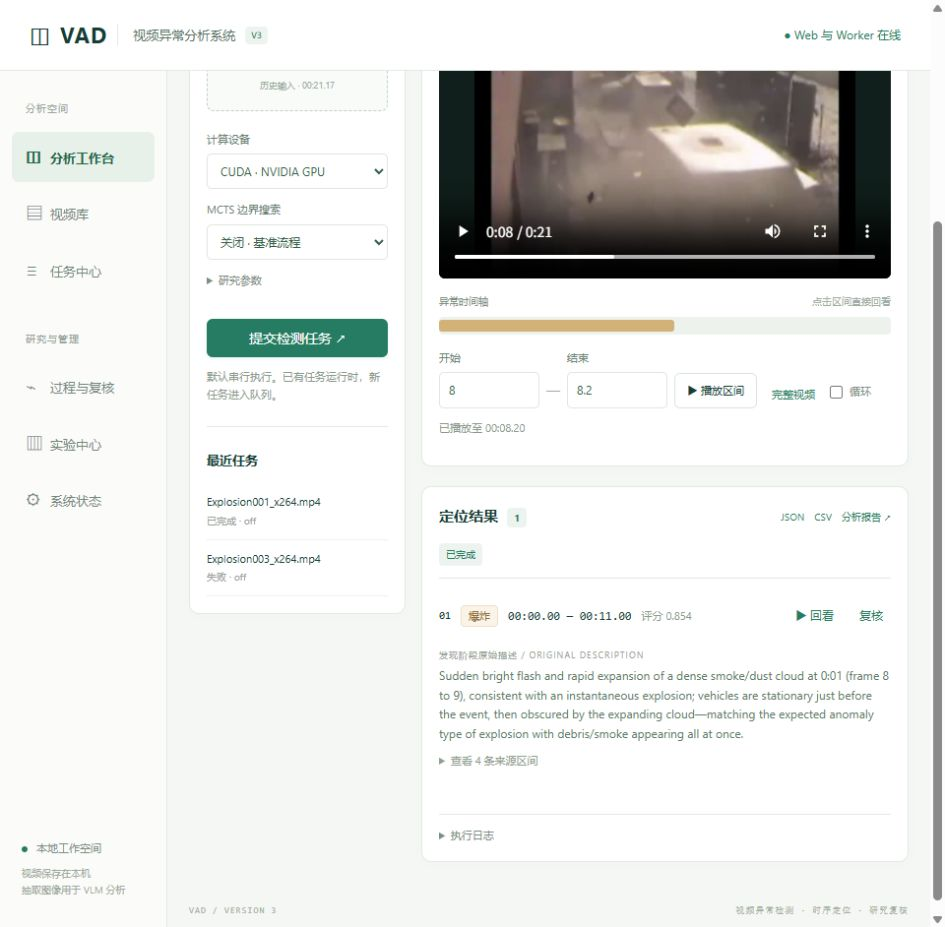
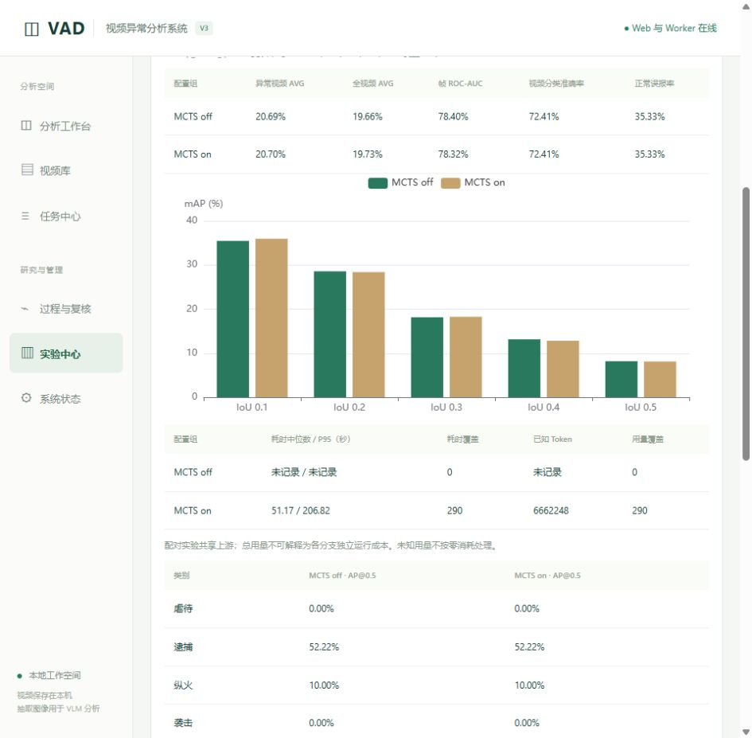

# V3 系统实施与验收记录

日期：2026-11-11。工作区：D:/Users/zzl/project/mcts_vad。定位：专业硕士的算法研究与单机工程演示系统。用户已取消“VLM 描述必须中文”，系统保留发现阶段原文。

## 1. 交付状态

单机核心工程已实现并在 http://127.0.0.1:7860 启动。正式 Web 和 Worker 均在线；原有两个任务已导入，原目录保持不变；290 视频历史实验已导入并完成两个协议的离线评价。

**尚未达到全部真实推理验收条件。** 当前 Windows 应用控制策略阻止 PyTorch DLL 加载，报 WinError 4551。已通过真实 CLI 提交验证：任务正常入队、启动进程，随后明确失败，没有输出 Normal 结论。系统没有禁用或规避该策略。需要管理员按设备既有策略允许可信 PyTorch 文件后，补做真实模型与小样本端到端验收。

| 模块 | 已实现内容 |
| --- | --- |
| 视频 | 上传解码检查、原 FPS/帧数、SHA-256、分页检索、视频复用、Range 播放、软删除与恢复 |
| 任务 | SQLite WAL、独立 Worker、串行队列、幂等提交、取消、超时、重试及独立 attempt、故障恢复 |
| 配置 | 冻结有效算法配置、VLM 请求参数、源码哈希、依赖版本、模型缓存修订标识；Web/Worker 各自加载 .env |
| 结果 | 最终区间与类别、原始描述及其来源、区间定位/循环/结束暂停、JSON/CSV/HTML 报告 |
| 研究 | 实际 VLM JPEG 与提示响应、原始时间映射、CLIP/运动/VideoMAE/融合曲线、阶段区间图、Q-score 分量、MCTS 树与节点详情 |
| 复核 | 确认、误报、修改、漏检补充；独立版本、并发检查；原始预测不可被复核覆盖 |
| 实验 | JSON/历史导入、从任务组建对比、独立 GT、输入哈希、协议冻结、不可覆盖的评价记录 |
| 指标 | 异常/全视频 AP、逐类 AP、帧级 AUC/AUPR/AP、分类报告/混淆矩阵、正常误报率、逐视频错误案例与匹配审计 |
| 运维 | 后台启停/重启/状态脚本、环境检查、日志、停止服务后的备份恢复、旧数据幂等迁移 |

删除采用数据库软删除，不承诺立即释放磁盘。单机状态下仍保留旧目录，避免迁移损坏用户原始数据。Web 仅绑定回环地址，限制 Host 与 Origin，不包含公网认证系统。

## 2. 安装及环境

解释器：C:/Users/Gigabyte/.conda/envs/common/python.exe，Python 3.13.17。

新增 psutil 7.2.2、imageio-ffmpeg 0.6.0；附带 FFmpeg 7.1。ECharts 5.6.0 与 LICENSE 已下载到本地 vendor 目录。Flask、Waitress 和算法依赖已存在。pip check 返回 No broken requirements found。

已有 CLIP 约 1.71 GB、VideoMAE 约 1.22 GB、MIL 约 5 MB 权重，未重复下载。torch 2.7.1+cu128 存在，但 import 阶段加载 fbgemm.dll / caffe2_nvrtc.dll 被 Windows 应用控制阻止；不是“网页读不到 .env”，也不能靠选择 CPU 绕过。

版本与检查结果见 [环境快照](../vad_v3/webapp/environment-2026-11-11.json)。快照只包含密钥是否配置，不含密钥。

## 3. 自动化与浏览器验收

以下组合共 **101 项通过**：

~~~powershell
python -m pytest vad_v3/webapp/tests tests/test_native_fps_ap.py tests/test_llm_usage.py vad_v3/video_anomaly_detection/tests/test_config.py vad_v3/video_anomaly_detection/tests/test_api_recovery.py vad_v3/video_anomaly_detection/tests/test_post_processor.py vad_v3/video_anomaly_detection/tests/test_token_compressor.py -q --tb=short
~~~

覆盖：真实子进程串行执行、取消/超时、重试 attempt、遗留执行恢复、跨数据目录推理锁、幂等请求、文件 Range、配置校验、失败不作 Normal、严格 VLM 响应解析、原语言描述、实际证据字节与时间歧义、独立修订、原预测不可变、HTML 转义、完整预测覆盖、历史协议精度与帧数取整、指标 CSV、备份恢复和旧数据迁移。后续 Host 限制通过专项测试。

Python 编译检查及 node --check 通过，git diff --check 无空白错误。

完整算法目录测试尝试过，但 7 个模块在收集阶段因 WinError 4551 失败：description_provenance、frame_scorer、mcts_fusion、mcts_prompt_protocol、models、postprocess_guard、video_state。没有把这些测试记为通过或静默跳过。

浏览器验收：

- 正式页面及六个导航入口可访问，Web/Worker 在线。
- 真实历史视频可加载；手动选择 1–2 秒区间，到终点暂停。
- 复核在隔离测试副本中保存为独立版本，原预测保持不变。
- 历史任务未记录的证据/阶段明确显示未记录。
- 实验指标、对比柱状图、混淆矩阵、成本覆盖和错误案例可查看。
- 搜索树、阶段区间图、Q-score 展示使用明确标记 SYNTHETIC_UI_FIXTURE 的隔离数据验证；节点选择后显示真实对应字段，回看定位到 2.2–3.8 秒。此项是界面验收，不是模型输出或算法效果证明。
- 一次真实检测提交在 PyTorch 加载阶段失败，界面明确提示不能据此判断视频正常。

7861 与 7862 测试服务已经关闭。测试副本留在 web_data/system-qa 与 web_data/ui-fixture-qa，不导入正式任务表或正式实验。

## 4. 真实历史数据复算

输入：v217 归档中的 290 个视频，140 异常、150 Normal。所有配置组覆盖同一完整集合。

| 配置组 | 异常子集 AVG | 全 290 视频 AVG | 源 FPS 协议帧 AUC | 历史协议帧 AUC |
| --- | ---: | ---: | ---: | ---: |
| MCTS off | 20.6913723915% | 19.6643152701% | 78.3980142826% | 78.4116861266% |
| MCTS on | 20.7039985715% | 19.7312947154% | 78.3197263644% | 78.3334540694% |

各 tIoU 阈值 AP 与现有 reevaluation_2026-11-06/ap_results.json 逐项比较，误差小于 1e-12；历史主分支 AUC=0.7833345406936949、AUPR=0.2882683106342779 与 evaluation_report.json 一致。

两套帧级协议存在端点、浮点精度与帧数取整差异，分别保存，不能混用。5 个 GT 越界视频在清单中明确记录：Arson011_x264、Arson016_x264、Explosion033_x264、Fighting003_x264、Shooting015_x264。AP 保留原标注；帧级评价限制在本视频帧范围。

正式实验 ID：d592d1cb41894dafbaaa38198ae933c9。

- 源 FPS 评价：c51e669fb973400d93c70159e5febfeb。
- 历史评价：f59a5a052a1244eeab38719f0280cfbf。

这次复算没有调用 VLM，也不是重新跑全量模型。差异很小，且帧级 AUC 没有提高，不能把系统建设或这些数字写成新的精度突破。

## 5. 剩余限制与下一步验收

1. Windows 策略问题解除后，重新运行环境检查、全部算法测试，以及异常、正常、混淆类、短事件的少量真实任务；检查新生成的图像、曲线、阶段与 MCTS 轨迹一致性。真实推理耗时、显存和 API 成本尚不能由此次测试代替。
2. 当前逐进程 GPU 峰值为未知；阶段耗时只显示已有轨迹实际记录的字段，不伪造精确百分比。无价格配置时不生成金额成本。
3. 浏览器定位不是逐帧剪辑；可变帧率视频未建立完整 PTS 标注映射，正式评价应使用已经核实的时间轴。本次历史数据均为 30 FPS。
4. 多用户权限、摄像头实时流、分布式、批量推理、自动转码属于 P2，未纳入本次单机交付。
5. 方案中部分消融归档在当前工作区不存在，已标注不能作为已复核证据；后续论文实验需补齐原数据。

这些限制已写入操作手册，当前状态是“核心工程可用、离线评价验收通过、真实 CUDA 推理验收受环境阻塞”，不是全部研究与部署条件都通过。

## 6. 使用入口与截图

详细命令、数据格式、接口、备份恢复见 [操作手册](../vad_v3/webapp/README.md)。原建设方案已调整为四周范围，并取消中文描述要求。

