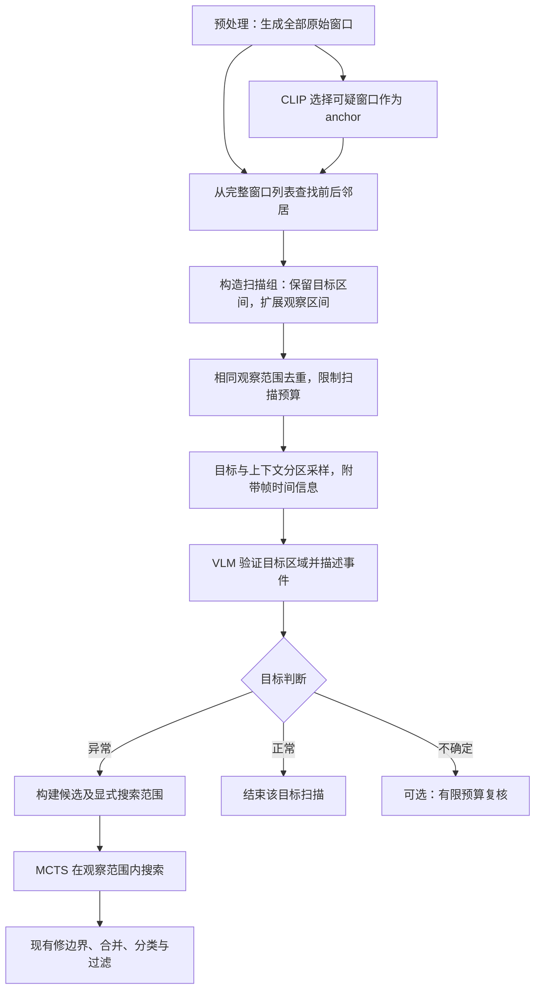

# V1 Stage 4：围绕可疑窗口引入邻居上下文的实现方案

日期：2026-10-21。

本文记录待实施方案，不表示代码已经修改或效果已经验证。目标是在 VLM 候选验证之前增加前后上下文，缓解短窗口证据不足造成的漏检，同时控制输入预算和后续 MCTS 搜索范围。

## 1. 当前流程与问题

V1 预处理将视频切成重叠窗口 `video_data['segments']`。默认窗口长度 6 秒、重叠比例 25%，步长为 4.5 秒。窗口保存时间范围以及过滤后 `all_frames` 中的帧索引。

现有主要调用链：

1. CLIP 曲线产生疑似区域。
2. `_directed_llm_scan()` 选择与这些区域重叠的原始窗口，并补充部分 CLIP 通用异常分数较高的窗口。
3. `scan_segment()` 对各窗口分别抽取关键帧，调用 VLM 判断异常是否存在、返回置信度和事件描述。
4. 仅保留 `is_anomalous` 为真且置信度大于 0.3 的片段，然后合并相邻候选。
5. Stage 5 对候选左右各扩展候选时长的 75%，在视频范围内运行 MCTS。

相关代码：

- [video_preprocessor.py](video_anomaly_detection/video_preprocessor.py)：分段和时间到帧的映射。
- [pipeline.py](video_anomaly_detection/pipeline.py)：`_directed_llm_scan()`、Stage 5 调用。
- [anomaly_discovery.py](video_anomaly_detection/anomaly_discovery.py)：`_sample_keyframes()`、`scan_segment()`、`_parse_response()`、`_merge_adjacent()`。
- [temporal_mcts.py](video_anomaly_detection/temporal_mcts.py)：搜索区间和节点验证。

问题在于：合并和搜索范围扩展都发生在候选验证之后。如果单个窗口仅包含“拿起商品”，另一个窗口才包含“藏匿商品”，分别观察可能无法形成充分证据。两个窗口都被过滤后，后续合并与 MCTS 无法恢复这次漏检。

还需区分两类错误：窗口没有覆盖完整过程，以及窗口覆盖了过程但抽帧遗漏关键动作。增加上下文主要解决前者，必须配合采样调整才能缓解后者。

## 2. 设计原则

1. 邻居从完整的原始 `segments` 中选取，不只从已经通过 CLIP 筛选的窗口中选取。
2. 区分目标区间与观察区间。前者是要验证的位置，后者是供理解事件的图像范围。
3. 不递归合并所有重叠组，避免整个视频连接成一个超长窗口。
4. 扩大观察范围时保留目标区域的采样密度。
5. VLM 仍负责候选验证和事件描述，精细边界交给 MCTS。
6. 已扩展的观察区间直接作为显式搜索范围，不再无条件增加 75% padding。
7. 初版关闭额外复核，仅引入邻居上下文；复核机制作为独立实验选项。

## 3. 拟议流程



图中的复核是可选后续增强；初版可记录不确定状态但不额外调用模型。

## 4. 数据契约

### 4.1 原始窗口

```python
segment = {
    't_start': 9.0,
    't_end': 15.0,
    'frame_indices': [...],
}
```

`frame_indices` 是保留帧数组索引，不是原视频帧编号。`timestamps[i]` 给出 `all_frames[i]` 对应的视频时间。

### 4.2 扫描组

原始窗口示例：

```text
S0: [0.0, 6.0)
S1: [4.5, 10.5)
S2: [9.0, 15.0)      <- CLIP 选中的 anchor
S3: [13.5, 19.5)
S4: [18.0, 24.0)
```

前后各加入一个邻居后：

```python
scan_group = {
    'group_id': 'group_2',
    't_start': 4.5,       # 观察范围
    't_end': 19.5,
    'frame_indices': [...],
    'targets': [
        {
            'target_id': 'segment_2',
            'segment_id': 2,
            't_start': 9.0,
            't_end': 15.0,
        }
    ],
    'member_segment_ids': [1, 2, 3],
}
```

建议使用 `targets` 对象列表，替代只有边界的 `target_intervals`，以便将多目标响应严格对应到原始窗口。相同观察范围去重后，一个扫描组可能包含多个目标，不能只返回一个整体异常判断。

## 5. 如何构造邻居扫描组

在 `pipeline.py` 新增 `_build_neighbor_scan_groups()`，放在现有 CLIP 选窗之后、VLM 调用之前。

以下为接口示例，实施时应接入项目日志、配置和异常处理：

```python
def _build_neighbor_scan_groups(
    self, video_data, targeted_segments, neighbor_radius=1
):
    segments = video_data['segments']
    timestamps = video_data['timestamps']
    position_by_id = {id(seg): i for i, seg in enumerate(segments)}
    groups = {}

    for anchor in targeted_segments:
        # 当前定向扫描保留的是原始 segment 对象。
        anchor_idx = position_by_id[id(anchor)]
        left = max(0, anchor_idx - neighbor_radius)
        right = min(len(segments) - 1, anchor_idx + neighbor_radius)
        start = segments[left]['t_start']
        end = segments[right]['t_end']
        key = (start, end)

        if key not in groups:
            lo = int(np.searchsorted(timestamps, start, side='left'))
            hi = int(np.searchsorted(timestamps, end, side='left'))
            if lo >= hi:
                continue
            groups[key] = {
                'group_id': f'group_{len(groups)}',
                't_start': start,
                't_end': end,
                'frame_indices': list(range(lo, hi)),
                'targets': [],
                'member_segment_ids': list(range(left, right + 1)),
            }

        group = groups[key]
        if not any(t['segment_id'] == anchor_idx for t in group['targets']):
            group['targets'].append({
                'target_id': f'segment_{anchor_idx}',
                'segment_id': anchor_idx,
                't_start': anchor['t_start'],
                't_end': anchor['t_end'],
            })

    return list(groups.values())
```

前提及边界：

- `segments` 按时间排序，`timestamps` 单调有序。
- 代码使用现有 NumPy 导入。若未来复制或序列化窗口，应改用稳定 `segment_id`，不能再依赖 `id()`。
- 根据合并后的完整范围查询帧，可包含窗口之间的时间间隙；不能仅拼接两个索引列表却遗漏中间画面。
- 视频首尾自动减少邻居数量。
- 空帧扫描组直接跳过并记录，不使用观察范围以外的最近帧伪装成区间内证据。
- 当前示例只对完全相同的观察范围去重。不同但高度重叠的组仍可重复扫描，这是初版明确接受的成本。
- 默认前后各一个邻居约产生 15 秒观察范围；自定义长窗口时也会变长。若增加最大观察时长配置，应优先减少邻居，不能裁掉目标本身；目标自身超长则记录并采用独立长窗口策略。

## 6. 扫描预算与采样

### 6.1 扫描数量

初版保留现有 anchor 选择与数量上限，然后构组去重。每个 anchor 至多生成一个组，因此组数不会超过所选 anchor 数。

当前定向扫描上限为 `min(max(14, len(segments) // 4), 24)`。邻居属于额外观察证据，不应该因为加入两个邻居就自动增加两次请求。

若后续启用复核，应独立设置每视频额外调用上限，并对已经复核的目标去重。

### 6.2 分区采样

新增 `_sample_context_keyframes(scan_group, video_data, max_frames)`，返回帧、实际时间戳与全局帧索引。

单目标的示例预算为 12 帧：目标区域 6 帧、前方上下文 3 帧、后方上下文 3 帧。这是实验起点，不是已验证最优参数。

要求：

1. 先满足目标区域的证据，再分配上下文预算。
2. 按实际时间选择可用帧，避免过滤后的不均匀帧序列被当成恒定帧率。
3. 保留目标首尾附近及明显变化附近的帧；其余预算可使用语义去重。
4. 某区域帧数不足时重新分配剩余预算；不能重复同一帧来凑数量。
5. 合并索引去重并按时间排序，图像顺序与提示中的时间戳严格一致。
6. 多目标组先分配各目标最低证据预算，共享重叠帧。若总预算不足以支持所有目标，将其拆成多次请求并计入调用上限。

扩大窗口但维持极少量均匀采样，可能降低短动作可见性。增加范围与提高帧数的收益必须通过实验分开测量。

## 7. VLM 提示与返回值

修改 `scan_segment()`，或者新增 `scan_context_group()` 保留旧接口以便对照。

提示示例：

```text
Observation interval: 4.5-19.5 seconds.
Target segment_2: 9.0-15.0 seconds.

The surrounding frames provide context.
For EACH target, determine whether an abnormal event occurs in or
overlaps that target interval. Do not label a target as anomalous
solely because an event is visible elsewhere in the observation interval.
Use uncertain when the visual evidence is insufficient.

Frames are in chronological order.
Frame timestamps: [actual selected timestamps].
```

继续保留现有场景背景、异常类型提示和类别视觉线索。帧时间列表必须从实际所选索引生成。

建议响应：

```json
{
  "targets": [
    {
      "target_id": "segment_2",
      "status": "anomalous",
      "confidence": 0.86,
      "description": "A person conceals merchandise.",
      "needs_more_context": false
    }
  ],
  "context_only_anomaly": false
}
```

解析规则：

- 按 `target_id` 匹配，禁止按返回数组位置猜测目标。
- `status` 仅允许 `anomalous`、`normal`、`uncertain`。
- 缺失、重复、未知目标 ID 或不可解析结果应记录为解析失败或不确定，不能默认为已确认正常。
- 仅 `anomalous` 且通过置信门的目标进入候选；初版可保留现有 `> 0.3` 门限用于对照，但新提示下分数分布可能改变，需验证。
- 每个目标保留自己的描述，避免一个扫描组中的不同事件共用错误搜索目标。
- `context_only_anomaly` 只作为复核线索，不直接给目标贴异常标签。
- 此阶段不要求 VLM 输出精确起止时间。

若后续启用上下文异常复核，需要进一步返回可定位到邻居的证据时间或结构化邻居 ID；仅有一个布尔值不足以决定复核哪个邻居。也可以在固定预算下复核两个邻居，但不能无限递归。

## 8. 候选与 MCTS 衔接

通过验证的单目标候选：

```python
candidate = {
    't_start': target['t_start'],
    't_end': target['t_end'],
    'frame_indices': target_frame_indices,
    'coarse_score': result['confidence'],
    'description': result['description'],
    'search_start': scan_group['t_start'],
    'search_end': scan_group['t_end'],
    'target_ids': [target['target_id']],
    'source_group_ids': [scan_group['group_id']],
}
```

注意 `frame_indices` 对应候选目标区间，不应错误填成整个观察范围的索引。搜索帧由 MCTS 根据 `search_start/search_end` 重新映射。

Stage 5 改为优先读取显式搜索范围：

```python
if 'search_start' in cand and 'search_end' in cand:
    search_start = cand['search_start']
    search_end = cand['search_end']
else:
    duration = cand['t_end'] - cand['t_start']
    padding = duration * 0.75
    search_start = max(0, cand['t_start'] - padding)
    search_end = min(video_data['duration'], cand['t_end'] + padding)
```

调用前验证 `0 <= search_start <= t_start < t_end <= search_end <= video_duration`。

现有 MCTS 实际启用的是左右收缩动作；以观察范围作为根节点可提供向内定位空间，但不能保证有限深度下能够恢复所有边界。初版不必修改节点状态或动作集合，先评估搜索范围变化带来的影响。

不能将 15 秒观察区间再次当作普通候选扩展 75%，否则未裁剪时范围会变成 37.5 秒。

### 8.1 候选合并的字段适配

现有 `_merge_adjacent()` 构造新字典，需要显式保留新增字段，不能依赖自动透传。

- `target_ids`、`source_group_ids` 去重合并。
- `frame_indices` 根据合并后的候选时间重新计算，保证有序、无重复。
- `search_start/search_end` 取覆盖双方候选及搜索范围的并集。
- 搜索并集过长或事件描述明显不同的候选不合并，保持独立。
- 不能一边扩大候选时间，一边截断搜索范围到无法覆盖候选。

初版可以保留原来的候选评分规则，但应记录合并来源。如何判定描述属于同一事件若没有可靠实现，应使用保守规则或暂不合并这些新候选，不宜声称已经解决事件关联。

## 9. 修改清单与实施顺序

| 位置 | 改动 |
|---|---|
| `pipeline.py::_directed_llm_scan()` | 保留原选窗，增加构组和预算控制 |
| `pipeline.py` 新辅助函数 | 邻居查询、去重、目标和来源记录 |
| `anomaly_discovery.py` 新采样接口 | 分区预算、实际时间戳和帧索引 |
| `scan_segment()` 或新 `scan_context_group()` | 多目标上下文提示与结构化响应 |
| 响应解析 | 区分异常、正常、不确定与解析失败 |
| 候选构建与 `_merge_adjacent()` | 保存搜索范围，避免丢字段和重复帧 |
| `pipeline.py` Stage 5 | 优先使用显式搜索范围 |
| 普通 `discover()` 分支 | 后续接入共享构组与验证逻辑 |
| 配置及日志 | 功能开关、邻居数量、帧预算、搜索长度和调用统计 |

推荐先实现单目标邻居观察与显式搜索范围，再做完全重复组去重、多目标解析和可选复核。每一步保留旧路径开关，避免多个机制同时改变后无法归因。

普通 `discover()` 的接入应作为明确步骤；仅修改定向分支时，报告该方法的实际覆盖范围，不能声称所有 Stage 4 路径都已支持上下文扫描。

## 10. 后续阶段的兼容性

- 最终异常结果仍可保持原有 `t_start/t_end/confidence/anomaly_type/depth/visits` 接口。
- 新增的目标、来源、观察范围主要用于候选和调试记录。
- 不用 Stage 4 VLM 分数直接替换 MCTS 最终奖励，避免在本实验中同时改变置信度语义。
- 输入候选改变会影响 MCTS、合并、最终分类和置信门；保持阶段顺序不等于输出行为不变。
- 当前全视频最终类别统一机制保留，因此本方案不解决视频内多种异常被统一分类的问题。

## 11. 验证设计

### 11.1 必要的功能检查

1. 视频首尾 anchor 不越界。
2. 未被 CLIP 选中的邻居仍然进入观察范围。
3. 重叠帧只发送一次，帧与时间戳一一对应。
4. 相同观察范围可合并请求，但各目标结果独立匹配。
5. 空帧、解析失败、多目标缺失有可追踪处理。
6. 候选合并后所有新增字段保留，候选位于搜索范围内。
7. MCTS 未对显式观察范围重复扩展。
8. 功能关闭时恢复旧路径。

### 11.2 对照实验

| 实验 | 用途 |
|---|---|
| 原始单窗口扫描 | 基线 |
| 邻居上下文，保持相同帧预算 | 检验扩大观察范围的作用 |
| 原始单窗口，提高帧预算 | 检验单纯增加视觉证据的作用 |
| 邻居上下文，提高帧预算 | 检验组合效果 |
| 邻居上下文，加分区采样 | 检验保留目标密度的作用 |
| 可选二次复核 | 单独衡量复核增益与成本 |

保持相同视频、初分类、CLIP anchor、模型和后处理配置。候选及观察范围变化时，完整重跑 MCTS 和后处理，不能简单套用原结果。

报告候选召回率时明确匹配定义；目标候选覆盖率与观察范围覆盖率分开报告，避免仅因为观察范围变宽就得到表面召回提升。

主要指标：

- Stage 4 异常候选召回率、误检数量和不确定比例。
- 最终 temporal mAP 及不同 IoU 阈值下的 AP。
- 起止边界误差，短事件与长事件表现。
- VLM 请求次数、累计输入帧数、可获得的 token 用量、耗时。
- MCTS 根区间长度、最终候选数量、重复检测情况。

新提示下 VLM 分数不保证与旧提示可比。阈值和预算仅在训练/验证数据上选择，再评测固定测试集。

## 12. 首版落地范围

建议首版采用：前后各一个邻居、固定输入帧预算、明确目标时间、保留目标候选边界、以观察区间作为 MCTS 搜索根范围，并关闭自动复核。

该方案可缓解跨窗口事件的上下文缺失，但不能保证解决关键动作不可见、采样过稀、模型误判或多事件混淆。以候选召回、最终定位质量和额外推理成本共同判断是否值得启用。
