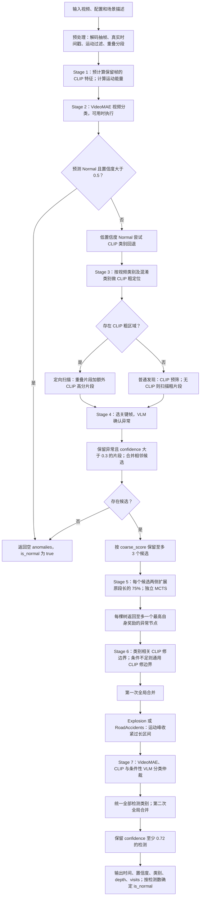
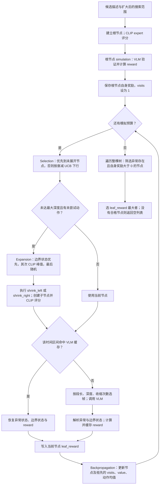
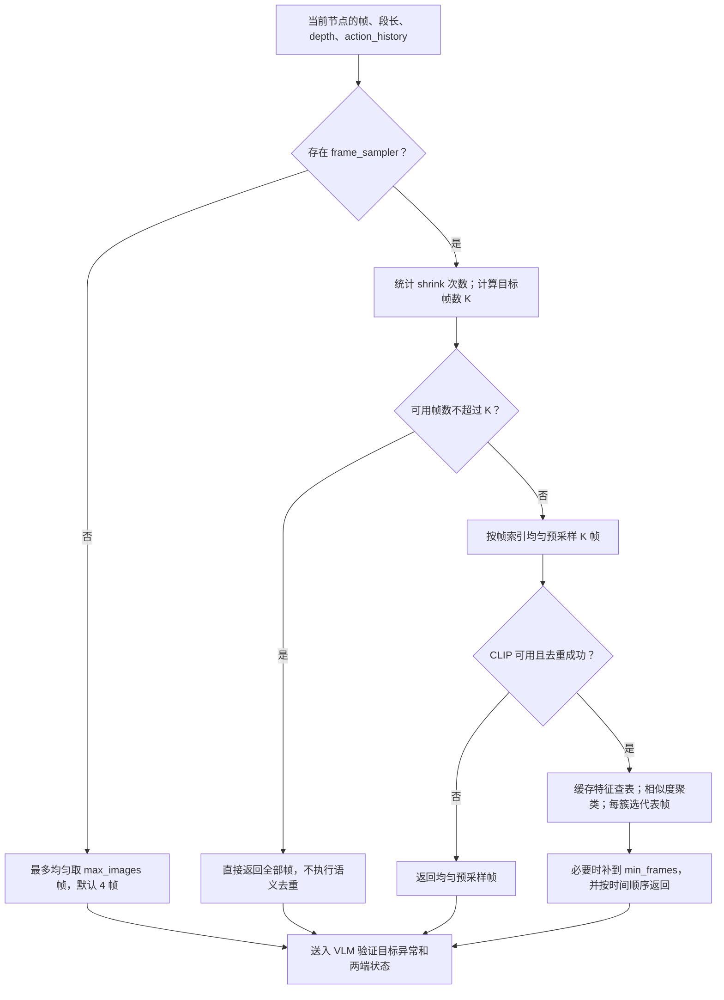
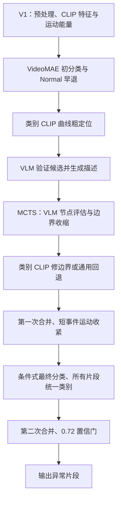
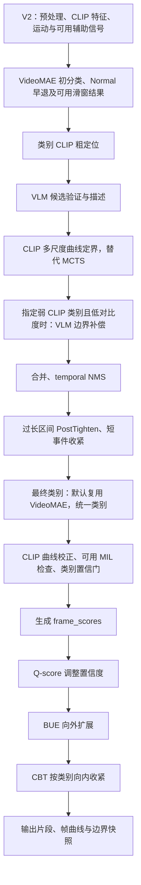

# V1 完整视频异常定位 Pipeline 与 MCTS 代码解析

> 核对日期：2026-10-20。本文以本目录 `video_anomaly_detection` 实际代码为准，主入口为 `pipeline.py::MultiAnomalyVAD.detect`。按照“初步分类 → 候选确认 → 时间定位 → 最终分类”的数据流组织，每个阶段说明输入、操作、输出、作用与代码。Stage 编号采用 `detect()` 内的注释。
>
> 本次为静态代码分析，没有调用模型或重新评测。流程图采用 Mermaid。源码链接相对于本文件，所列行号为本次核对时的位置。

## 1. 当前 V1 的架构结论

V1 已经使用 VideoMAE、CLIP 和 VLM，由 Pipeline 统一调度；Stage 5 使用 MCTS 搜索时间边界，搜索后仍有 CLIP 边界修正、合并、运动峰处理和分类。

| 组件 | 当前职责 |
|---|---|
| VideoMAE | 视频级类别判断、Normal 早退；为 CLIP 粗定位、扫描提示和后处理提供类别 |
| CLIP / `anomaly_expert` | 编码帧、生成粗定位区域、给 MCTS 节点评分和峰值线索、语义选帧、搜索后修边界及辅助分类 |
| VLM | 确认粗候选；在 MCTS 中验证目标异常是否仍存在、返回边界状态；必要时仲裁最终类别 |
| MCTS | 在扩大的候选范围中构建时间区间树，通过奖励搜索较合适的边界 |
| 后处理 | 修边界、合并区间、统一类别，最后按置信度过滤 |

**当前 V1 实际仅启用 `shrink_left`、`shrink_right`。** 文件保留了 `shift_left`、`shift_right` 执行函数，但它们没有进入 `self.actions` 和 `expansion()` 的执行分发表。存在四个函数，不等于当前搜索可选四个动作。

### 1.1 类别识别与时间定位怎样衔接

```text
视频预处理与共享信号
    ↓
VideoMAE：初步识别视频类别，检查是否 Normal
    ↓ 类别指导
CLIP：寻找符合该类别的疑似时间区域
    ↓
VLM：确认扫描片段中是否存在异常，生成事件描述
    ↓ 事件描述作为搜索目标
MCTS：搜索异常的起止时间
    ↓
CLIP 修边界、第一次合并、短事件处理
    ↓ 定位区间内的画面用于条件性分类复核
VideoMAE 先验 + CLIP + 必要时 VLM：确定最终类别
    ↓
统一类别、第二次合并、置信度过滤
    ↓
输出：类别 + 起止秒数 + 置信度 + 搜索元数据
```

最终分类不意味着再次运行 VideoMAE：主路径复用先前的视频分类结果，只有特定分支重新读取定位区间画面进行 CLIP/VLM 复核。最后所有检测被赋予同一个 ensemble 类别，因此当前更接近“视频主异常类别 + 若干时间段”，而不是多个事件各自独立分类。

### 1.2 逐阶段输入输出总表

| 阶段 | 直接输入 | 核心操作 | 直接输出 | 对下一阶段的作用 |
|---|---|---|---|---|
| 预处理 | 视频路径、采样与分段参数 | 抽帧、记录时间、运动过滤、重叠分段 | `video_data`：帧、时间戳、粗片段、时长等 | 建立共享视觉证据与时间索引 |
| Stage 1 共享信号 | 保留帧、CLIP 模型 | 图像编码、归一化、相邻保留帧差 | `clip_features[N,D]`、`motion_energy[N]` | 后续按索引复用特征 |
| VideoMAE 初分类 | 保留的 RGB 帧 | 16 帧采样、TTA、Softmax | 视频类别与置信度，或 Normal 早退 | 指定定位类别和提示 |
| CLIP 粗定位 | 特征、类别、时间戳、运动信号 | 类别曲线、平滑、阈值分区与去重 | `clip_regions` | 指导扫描，不直接认定异常 |
| VLM 候选确认 | 扫描片段、关键帧、场景及类别提示 | 判断存在性、生成描述、合并、top-3 | `candidates`：时间、索引、`coarse_score`、描述 | 描述成为 MCTS 目标，时间决定根范围 |
| MCTS 定界 | 候选描述、扩大后的时间范围、共享视频数据 | 选择、扩展、验证、奖励、回传 | 每树 0 或 1 个异常段 | 提供时间边界与节点奖励 |
| 修边界与第一次合并 | MCTS 检测、类别曲线、运动信号 | CLIP 收扩、合并、运动峰处理 | 修正后的 `final_anomalies` | 提供最终分类所用区域 |
| 最终分类 | 初判类别/置信度、当前检测、帧和特征 | 类别复用、CLIP 覆盖或 VLM 仲裁 | 一个 `ensemble_cat`，写入全部检测 | 决定第二次同类合并 |
| 统一、合并与过滤 | 已分类检测 | 统一类别、再次合并、0.72 置信门 | 最终列表 | 决定保留区间及 `is_normal` |
| 输出 | 最终列表、路径和时长 | 字段投影，构建字典；CLI 可写 JSON | 类别、时间、置信度、depth、visits | 展示、回看和评测 |

### 1.3 阅读路径

- 第 3 节：参数和跨阶段的数据约定。
- 第 4～7 节：预处理、共享信号、初分类、粗定位与候选确认。
- 第 8～9 节：MCTS 的输入输出、四阶段、奖励及验证选帧。
- 第 10～11 节：搜索后的边界处理、最终分类、筛选与输出。
- 第 12～13 节：限制及源码导航。

## 2. 完整 Pipeline 流程图



`Stage 5` 的多棵候选树通过 `asyncio.gather(..., return_exceptions=True)` 并发执行；某棵树抛异常时跳过该候选。每棵树内部按模拟轮次顺序推进。其他步骤的 `async` 名称不代表调用了 VLM，例如 CLIP 边界修正也是异步接口。

## 3. 入口、默认参数与数据结构

### 3.1 入口和默认值

[run.py](video_anomaly_detection/run.py) 第 152 行 `main()` 创建客户端和 `MultiAnomalyVAD`，再调用 `detect()`。带 `--output_file` 时将结果写入 JSON，并附加处理耗时。

[pipeline.py](video_anomaly_detection/pipeline.py) 第 86 行的构造默认值与单视频 CLI 默认值不同：

| 参数 | `MultiAnomalyVAD` 默认 | `run.py` CLI 默认 |
|---|---:|---:|
| 解码采样 `fps` | 2 | 4 |
| 粗片段时长 | 6 秒 | 8 秒 |
| 重叠比例 | 0.25 | 沿用构造默认 |
| CLIP 模型 | ViT-L-14 | ViT-B-32 |
| MCTS 模拟轮数 | 12 | 8 |
| MCTS 最大深度 | 4 | 4 |
| VLM 目标选帧率 `fps_sample` | 3.0 | 2.0 |
| 关键帧数下限 / 上限 | 3 / 200 | 3 / 200 |
| 运动阈值 / 静态保留间隔 | 1.0 / 2 秒 | 1.0 / 2 秒 |

`TemporalBoundaryMCTS` 类本身的 `max_depth=5` 会被 Pipeline 覆盖，不能把它当成正常入口的实际深度。`fps` 控制视频抽帧，`fps_sample` 控制发送给 VLM 的关键帧预算，两者不同。

### 3.2 主要数据流

| 数据 | 来源 | 作用 |
|---|---|---|
| `all_frames`、`timestamps` | 视频预处理 | 保留帧与真实时间一一对应 |
| `segments` | 重叠分段 | 每项有起止时间和全局 `frame_indices` |
| `clip_features` | CLIP 预计算 | 全局缓存，供各阶段按帧索引读取 |
| `motion_energy` | 运动计算 | 短事件粗定位与收紧 |
| `videomae_category` | 视频分类或 CLIP 回退 | 粗定位、提示、修边界与分类 |
| 候选 `coarse_score`、`description` | Stage 4 VLM | 候选排序；描述传入 MCTS 作为待定位目标 |
| 节点 `state`、`anomaly_info` | MCTS | 时间区间、深度、动作历史、帧索引、CLIP 分数等 |
| 最终 `confidence` | 最佳节点自身 reward，合并时可取最大值 | 最后的 0.72 置信门 |

`coarse_score` 没有直接加入当前 MCTS 奖励公式。节点的 CLIP 异常分数、VLM confidence 和最终输出 confidence 也不是同一个概念。

### 3.3 时间标识与分数约定

| 标识 | 含义 | 是否在最终异常段中保存 |
|---|---|---|
| 原始帧号 `idx` | 解码时在原视频中的帧序号 | 否，预处理不单独返回原始帧号数组 |
| `frame_indices` | 过滤后 `all_frames` 的行索引 | 否，主要在片段、候选与 MCTS state 中使用 |
| `timestamps[k]` | 第 k 个保留帧的相对视频时间，单位秒 | 用于内部映射，V1 最终不返回整条数组 |
| `t_start/t_end` | 候选、节点或最终检测的时间边界 | 是，单位秒 |

时间戳按 `idx/video_fps` 生成，运动过滤时与图像同步筛选；这是按帧率换算的时间，不是逐帧 PTS。不能用过滤后索引除以采样率来恢复时间。

`videomae_confidence` 是整视频分类概率；`clip_cat_score` 是粗区域曲线分数；`coarse_score` 是 VLM 候选置信度；MCTS 输出 `confidence` 是组合奖励。它们没有统一校准，也没有简单逐阶段复制。

## 4. 预处理与 Stage 1：抽帧、过滤、分段、共享特征

### 4.1 预处理的输入、输出与作用

**输入：**`video_path` 与采样率、运动阈值、分段长度、重叠比例等配置。

**输出：**共享字典，而不是切好的视频文件：

```python
video_data = {
    'video_path': video_path,
    'duration': duration,          # 秒
    'video_fps': video_fps,        # 原视频标称帧率
    'all_frames': frames,          # [N,H,W,3]，过滤后 RGB 图像
    'timestamps': timestamps,     # [N]，与图像一一对应
    'segments': [
        {'t_start': ..., 't_end': ..., 'frame_indices': [...]},
    ],
}
```

**作用：**降低计算量、保留图像与视频时间的对应关系，为发现阶段建立扫描窗口。此时尚未判断异常类别或最终边界。

代码：[video_preprocessor.py](video_anomaly_detection/video_preprocessor.py) 第 40 行 `process()`。

1. 从视频读取原始帧率和总帧数，得到时长。
2. 计算 `sample_interval=max(1,int(video_fps/fps))`。采样帧使用 `cap.read()`，其他帧使用 `cap.grab()`。
3. 保存 RGB 图像，时间戳取 `原始帧号/video_fps`，不会按目标 fps 重写时间。
4. 抽样图像缩小到 64×64，计算相邻抽样帧的平均绝对差。保留第一帧、运动超过阈值的帧，以及距离上次保留帧达到最低间隔的帧。
5. 按 `segment_duration×(1-overlap)` 的步长分段。例如 6 秒、25% 重叠时步长为 4.5 秒。按时间戳二分映射 `[start,end)` 到帧索引；已有片段时跳过短于名义时长 30% 的末尾残段。

运动过滤后帧间隔可能不均匀。`get_segment_frames()` 按真实时间戳切片，空切片会取离区间中点最近的保留帧。

### 4.2 Stage 1 的输入、输出与代码操作

**输入：**保留的 `all_frames` 与已初始化的 CLIP expert。

**输出：**在同一字典增加 `clip_features`（CLIP 可用时）及 `motion_energy`。主流程第 160 行起：

```python
video_data['clip_features'] = self.anomaly_expert.precompute_video_features(
    video_data['all_frames']
)
video_data['motion_energy'] = self._compute_motion_energy(video_data)
```

图像特征的核心计算为：

```python
features = self.model.encode_image(image_tensor)
features = features / features.norm(dim=-1, keepdim=True)
```

结果 `[N,D]` 的每一行是帧语义向量，不是异常概率。expert 初始化时 `_precompute_text_features()` 把每类多条描述编码、归一化、平均后再次归一化，形成默认 `[14,D]` 文本特征；Normal 位于最后一行。图像与文本向量匹配后才得到类别分数。

**作用：**区域评分、MCTS 节点评分、语义选帧、后处理与分类共享这些特征。VideoMAE 直接读取 RGB 图像，不使用 CLIP 向量作为输入。

运动能量重新比较相邻**保留帧**，输出 `[N]` 的平均绝对帧差，不再删帧；预处理运动过滤比较过滤前的相邻抽样帧，用分数决定保留哪些图像。两次算法类似，但帧对可能不同。二者都未除以时间间隔，不是物理运动速度。

[anomaly_expert.py](video_anomaly_detection/anomaly_expert.py) 第 193 行 `precompute_video_features()` 对所有保留帧批量编码，默认每批 32 帧，归一化后缓存。后面的 MCTS 节点评分优先从缓存取特征，而不是每个节点重新编码整个片段。

## 5. Stage 2：VideoMAE 类别判断

**输入：**保留的 RGB 帧，`top_k=3, tta=True`；不是粗片段列表或 CLIP 特征。

```python
result = self.videomae.classify(video_data['all_frames'], top_k=3, tta=True)
videomae_category = result['category']
videomae_confidence = result['confidence']
```

**输出：**分类器返回 `category`、`confidence`、`top_k`、`all_probs`。主流程消费前两个字段，top-3 主要用于日志；不会自动将 VideoMAE top-3 全部用于定位，替代类别来自固定混淆表。

**作用：**建立初始类别先验，并过滤高置信度 Normal 视频。误判 Normal 会阻断后续定位，不能靠 MCTS 补救。

代码：[pipeline.py](video_anomaly_detection/pipeline.py) 第 173 行；[videomae_classifier.py](video_anomaly_detection/videomae_classifier.py)。

模型为 UCF-Crime 微调的 VideoMAE-large，输出 13 个异常类加 Normal。每次模型前向默认输入 16 帧；整视频分类开启 TTA 时，对多种时间采样分别前向后平均 logits。

具体操作：不足 16 帧时重复末帧，否则按帧索引采样 16 帧；缩放到 224×224、除以 255、按通道均值与标准差归一化，组成 `[1,16,3,224,224]`。至少 32 帧且开启 TTA 时使用全序列、偏移、前部、后部及满足条件的中部采样，平均 logits 后 Softmax。它不是对帧分类结果多数投票。

- `Normal` 且 confidence 大于 0.5：立即返回无异常，不执行候选发现或 MCTS。
- 低置信度 Normal：尝试用 CLIP 分布中的异常类别回退。
- 得到异常类别：把它作为粗定位及后续处理的类别依据。
- 模型不可用：继续后续降级路径，不把“未分类”直接当作正常。

混淆表还会让 Stage 3 检查替代类别：RoadAccidents → Robbery，Abuse → Explosion，Assault → Arson。VideoMAE 不输出精确边界，也没有在当前 MCTS 内逐节点前向。

低置信度 Normal 的 CLIP 回退只改变 `videomae_category`，没有把 `videomae_confidence` 同步替换成 CLIP 分数。因此两者在该分支后可能来自不同判断。

### 5.1 初分类怎样具体指导后续定位

VideoMAE 不调用其他模型，`detect()` 读取它的结果后通过普通变量传递完成指导：

```python
categories_to_search = [videomae_category] if videomae_category else []
if videomae_category in VIDEOMAE_CONFUSION_MAP:
    for alt in VIDEOMAE_CONFUSION_MAP[videomae_category]:
        if alt not in categories_to_search:
            categories_to_search.append(alt)
```

例如 VideoMAE 输出 RoadAccidents，实际检查的类别为 `['RoadAccidents','Robbery']`，而不是直接使用 VideoMAE 的 top-3。随后每个类别调用一次 `_clip_temporal_localization(video_data, cat)`，类别被转换成文本特征矩阵的列索引：

```python
cat_idx = self.anomaly_categories.index(category)
cat_scores = probs[:, cat_idx]
normal_scores = probs[:, -1]
relative_scores = cat_scores / (cat_scores + normal_scores + 1e-8)
```

因此，同一批图像特征可以得到不同类别的时间曲线；VideoMAE 决定“重点查看哪一条曲线”，不直接决定异常边界。

### 5.2 类别怎样进入 VLM 提示词

定向扫描 `_directed_llm_scan()` 使用视频主类别查询 `CATEGORY_CUES`，构造：

```python
cue = CATEGORY_CUES.get(category, category)
category_hint = f"\nExpected anomaly type: {category} — {cue}\n"
tasks.append(self.discovery.scan_segment(
    seg, all_frames, context_prompt + category_hint, precomputed))
```

`CATEGORY_CUES` 是人工编写的判别线索。例如 RoadAccidents 强调碰撞、翻车、打滑及损坏；Robbery 强调面对面的武器或暴力威胁。提示中同时包含用户 `context` 形成的场景说明。

这不是“要求 VLM 必须回答该类别”：`scan_segment()` 仍要求检查多种异常，并返回是否异常和描述。类别提示会引导注意力，也可能造成错误先验偏置。

两个实际限制：

- 即使区域来自混淆类别 Robbery，定向扫描传入的仍是视频主类别 RoadAccidents；`source_category` 没有逐片段转换成不同提示。
- 没有 CLIP 区域时调用 `discover(video_data, context_prompt)`，这一普通发现路径不附加上述视频类别提示，但仍保留通用异常清单。

## 6. Stage 3：CLIP 类别曲线粗定位

**输入：**图像特征、文本特征、视频类别及混淆类别、时间戳、时长和运动信号。

**输出：**`clip_regions`，每项有 `t_start`、`t_end`、`clip_cat_score`，主流程附加 `source_category`。

**作用：**把视频级类别转换成待检查的时间区域。它指导 Stage 4 扫描，分数不等于 VLM `coarse_score`。

```python
for cat in categories_to_search:
    regions = self._clip_temporal_localization(video_data, cat)
    for r in regions:
        r['source_category'] = cat
    all_clip_regions.extend(regions)
clip_regions = self._deduplicate_clip_regions(all_clip_regions)
```

代码：[pipeline.py](video_anomaly_detection/pipeline.py) 第 473 行 `_clip_temporal_localization()`。

对每个待检查类别 `c`，先得到每帧的类别概率，再计算：

```text
r_c(i) = P_i(c) / (P_i(c) + P_i(Normal) + 1e-8)
```

该值表示相对于 Normal，当前帧有多支持类别 c；不是经校准的真实异常概率。随后：

1. 使用约 2 秒对应的索引窗口做滑动平均。当前 V1 此处是单个平滑尺度。
2. 平滑曲线极差小于 0.08 或变异系数小于 0.03 时，认为信号不足；Explosion、RoadAccidents 可回退运动定位。
3. 在有效的运动敏感类别路径上，可融合 `0.6×CLIP + 0.4×运动`。
4. 使用 `均值+0.3×标准差` 阈值；高分点不足时按排名放宽。
5. 形成连续区域，合并间隙小于 3 秒的区间，两侧各扩展 2 秒；短区间尝试扩到 6 秒，并裁剪到视频范围。
6. 按区域平均分排序，每类别至多 5 个，再跨类别去重。

这些区域只用于安排扫描，不能绕过 VLM 确认直接输出异常。无有效粗区域时进入普通发现路径。

### 6.1 从向量到分数：代码中的计算顺序

`_clip_temporal_localization()` 第 487 行附近：

```python
logit_scale = self.anomaly_expert.model.logit_scale.exp().detach().clamp(max=100.0)
similarity = precomputed @ self.anomaly_expert.text_features.T * logit_scale
probs = torch.softmax(similarity, dim=-1).cpu().numpy()
cat_scores = probs[:, cat_idx]
normal_scores = probs[:, -1]
relative_scores = cat_scores / (cat_scores + normal_scores + 1e-8)
```

图像矩阵 `[N,D]` 与文本矩阵转置 `[D,14]` 相乘得到 `[N,14]`。随后每帧在 14 类上 Softmax，再取目标类相对于 Normal 的分数，形成长度 N 的曲线。每个点仍通过 `timestamps[i]` 对应原视频时间。

### 6.2 平滑、阈值与区间提取

```python
fps = max(1, len(timestamps) / max(1, video_data['duration']))
window = max(3, int(2 * fps))
# 长度足够时 np.convolve(relative_scores, np.ones(window)/window, mode='same')
threshold = smoothed.mean() + 0.3 * smoothed.std()
min_frames_needed = max(4, int(0.15 * len(smoothed)))
```

这里 fps 是由保留帧数估计的索引密度，不是原视频 FPS，也不精确反映过滤后的每一段时间间隔。运动敏感类别在曲线有效且运动信号可用时，会先融合运动，再计算区域阈值。

若高于阈值的点不足 `min_frames_needed`，代码取排序后对应高分点的值作为新阈值，再使用严格的 `smoothed > threshold`。存在大量相同分数时，这不是“保证至少保留 15% 点”的硬约束。

随后按时间顺序扫描布尔数组：

```text
低 低 高 高 高 低 低 高 高 低
      └区间一┘       └区间二┘
```

连续高分区的首尾索引映射为 `timestamps[start_idx/end_idx]`。间隔小于 3 秒则合并，再做两侧 2 秒 padding 和短区间扩展；每个区域的 `clip_cat_score` 是扩展区间内平滑曲线的平均值。按分数每类别取前 5 个。

### 6.3 跨类别区域怎样合并

`_deduplicate_clip_regions()`（第 343 行）不是按类别分别保留结果，也不是标准 IoU NMS：

1. 所有类别区域按开始时间排序。
2. 下一段开始时间不超过上一段结束加 3 秒，就合并覆盖范围。
3. `clip_cat_score` 取两者最大值。
4. 最后按分数取最多 5 个区域。

合并时保留前一个字典的 `source_category`，不会生成完整来源类别集合。因此它只是扫描导航标记，不能作为“合并区域中所有事件的最终类别”。

## 7. Stage 4：VLM 确认候选

**输入：**原始粗分段 `video_data['segments']`、共享帧及特征、可用的 `clip_regions`、用户 `context` 和视频类别提示。CLIP 区域用于筛选哪些粗分段要扫描；不是直接将区域原样发给 VLM。

**核心调度（主流程第 223 行起）：**

```python
if clip_regions:
    candidates = await self._directed_llm_scan(
        video_data, clip_regions, context_prompt, videomae_category)
else:
    candidates = await self.discovery.discover(video_data, context_prompt)
```

**输出：**合并并限制数量后的候选列表：

```python
{
    't_start': seg['t_start'],
    't_end': seg['t_end'],
    'frame_indices': seg['frame_indices'],
    'coarse_score': result['anomaly_score'],  # 此处来自 VLM confidence
    'description': result['description'],
}
```

**作用：**为曲线发现的疑似区域提供视觉语义确认，并生成“要定位什么事件”的描述。候选边界来自扫描窗口及其合并，不是 VLM 此时直接估计的精确起止时间。

### 7.1 扫描哪些片段

定向路径位于 [pipeline.py](video_anomaly_detection/pipeline.py) 第 618 行：先选择与 CLIP 区域重叠的原始分段，再补充一般异常分数靠前、尚未覆盖的片段，补充目标数为 `max(2,int(0.2×分段数))`。

预算为：

```text
max_scan = min(max(14, 分段数//4), 24)
```

超预算时直接截取构建列表的前部，并非将全部来源重新按分数排序。这里计算的 `adaptive_thresh` 没有用于实际筛选。

无 CLIP 粗区域时调用 [anomaly_discovery.py](video_anomaly_detection/anomaly_discovery.py) 的 `discover()`：CLIP 可用则按自适应阈值预筛，Pipeline 传入最低通过比例 0.2，随后限制最多 6 个高分片段；无 CLIP 时扫描已有粗片段，不走这条 CLIP 预算限制。

### 7.2 如何选关键帧

`scan_segment()` → `_sample_keyframes()` → `SemanticFrameSampler.select_keyframes()`。发现阶段不传 MCTS 状态，因此 depth 和 n_shrinks 均为 0。具体采样公式见第 9 节。

VLM 返回 JSON 字段 `is_anomalous`、`confidence`、`description`。接受条件实际为：

```python
is_suspicious = is_anomalous and confidence > 0.3
```

不要采用模块头部旧注释中的 0.2。候选保存原片段时间、帧索引，以 VLM confidence 作为 `coarse_score`。相邻候选间隙不超过 2 秒时合并，coarse_score 取最大值，保留前一个描述。

无候选立即返回空结果；有候选则按 coarse_score 保留至多 3 个。漏掉的事件不会由后面的 MCTS 自动补建候选。

**与后续连接的关键点：**Stage 3 的 `source_category` 不在上述候选构造字段中，不能假定它随候选传进 MCTS。MCTS 目标主要来自 `description`，候选 `coarse_score` 主要用于 top-3 选择。合并候选采用前一个描述，可能无法完整表达后一个片段中不同的事件。

### 7.3 VLM 是通过 prompt 确认候选吗

是，但必须同时提供图像。代码位于 [anomaly_discovery.py](video_anomaly_detection/anomaly_discovery.py) 第 43 行：

```python
keyframes = self._sample_keyframes(segment, all_frames, precomputed_features)
# prompt 包含片段时间、context、异常清单和 JSON 输出要求
response = await self.llm.generate(prompt, keyframes)
return self._parse_response(response)
```

prompt 的实际组成：

| 内容 | 来源 | 作用 |
|---|---|---|
| 片段起止秒数 | `segment` | 告知当前观察范围 |
| 场景说明 | 用户 context | 提供监控环境上下文 |
| Expected anomaly type 和视觉线索 | 定向扫描的类别提示 | 聚焦可能事件；普通发现路径不添加 |
| Violence、Crime、Property、Incidents、Law enforcement 清单 | `scan_segment()` 固定文本 | 定义“异常”检查范围 |
| 注意细微信号 | 固定提示，如藏物、蜷缩、突然奔跑、烟火、破锁等 | 提高敏感性，也可能增加误报 |
| JSON schema | 固定模板 | 要求返回存在性、置信度和事件描述 |

输出要求为：

```json
{"is_anomalous": true, "confidence": 0.9, "description": "事件的视觉描述"}
```

以上数值只是格式示例。VLM 根据关键帧及提示生成回答，程序通过首尾花括号提取 JSON，然后按 `is_anomalous and confidence > 0.3` 接受。JSON 解析失败时回退空字典，通常得到不接受结果；当前代码不是严格的完整响应 schema 校验。

### 7.4 “模型确认”与“程序构造候选”是两步

VLM 不在此输出 `t_start/t_end`。程序在确认通过后，用扫描片段的时间构造候选：

```python
if result['is_suspicious']:
    suspicious.append({
        't_start': seg['t_start'],
        't_end': seg['t_end'],
        'frame_indices': seg['frame_indices'],
        'coarse_score': result['anomaly_score'],
        'description': result['description'],
    })
```

再合并间隙不超过 2 秒的候选，保留前段描述、最大粗置信度；有超过 3 个候选才按 coarse_score 截断。于是候选成立需要满足：被安排扫描、有可用视觉输入、VLM 回答通过解析与阈值，以及没有在后续预算中被舍弃。prompt 是语义判断依据，不替代程序的过滤和区间构造。

## 8. Stage 5：MCTS 完整内部流程

### 8.0 输入、输出、作用与调用关系

**输入：**每个候选的时间范围和描述、完整 `video_data`、VLM 客户端、CLIP expert、语义采样器、模拟次数与最大深度。粗候选帧索引不直接作为根节点帧索引，因为搜索窗口会扩大，必须重新按时间取帧。

**核心调用（主流程第 253 行起，省略无关参数）：**

```python
mcts = TemporalBoundaryMCTS(
    anomaly_description=cand['description'],
    video_data=video_data,
    llm_client=self.llm_client,
    anomaly_expert=self.anomaly_expert,
    frame_sampler=self.frame_sampler,
    anomaly_categories=self.anomaly_categories,
)
mcts_tasks.append(mcts.search(search_start, search_end))
```

**输出：**每个候选对应 0 或 1 个结果，多个结果汇总到 `all_anomalies`：

```python
{
    't_start': best.state['t_start'],
    't_end': best.state['t_end'],
    'confidence': best.leaf_reward,
    'anomaly_type': anomaly_type,
    'depth': best.state['depth'],
    'visits': best.visits,
}
```

输出不保留候选 `coarse_score`、`description` 或 `frame_indices`。`confidence` 在此变为节点自身奖励，`anomaly_type` 优先来自该节点的 CLIP 类别判断。

**作用：**在仍包含目标异常的前提下搜索更合适、较紧的区间。它用模型评估候选时间区间，不是让 VLM 一次直接报出最终秒数。搜索异常被主流程捕获并跳过对应候选；无合格异常节点则该树返回空列表。

### 8.1 搜索范围与根节点

代码：[pipeline.py](video_anomaly_detection/pipeline.py) 第 250 行；[temporal_mcts.py](video_anomaly_detection/temporal_mcts.py) 第 484 行 `search()`。

粗候选 `[s,e]`、长度 `D=e-s` 对应搜索范围：

```text
[max(0,s-0.75D), min(视频时长,e+0.75D)]
```

例如 `[20,28]` 秒的候选，根区间为 `[14,34]` 秒。节点 `original_t_start/end` 指这个扩大后的根区间；`temporal_ratio` 是当前区间长度除以根区间长度，不是除以原始候选长度。

先建立根节点，调用 CLIP expert 评分，再执行一次根节点 VLM simulation；之后才进入 n_simulations 次循环。因此默认构造参数下，每棵树最多有 **1 次根评估 + 12 次循环评估**，CLI 默认则为 1+8；缓存命中会减少实际 VLM 请求数。这里没有基于连续一致结果的提前停止。

### 8.2 MCTS 内部流程图



这里的 simulation 是对当前区间直接评估，不是随机 rollout 到若干终局。`leaf_reward` 名称也不意味着只评价叶子：根和内部节点都可能有自身奖励，并参与最终选择。

### 8.3 Selection：选择哪条已有分支

`selection()` 第 225 行：遇到有未尝试动作或没有子节点的节点就停下；否则选择 UCB 最大子节点递归向下。

```text
c = c_puct × exp(-0.1×当前模拟轮次)，c_puct 默认 1
UCB(action) = q_hat(action)
              + c × sqrt(2×log(parent.visits+1)/(child.visits+1e-8))
```

未访问子节点优先；没有 q_hat 时回退 `child.value/child.visits`。前期探索权重大，后期更偏向已有高奖励分支。

### 8.4 Expansion：实际只有两个启用动作

代码第 88 行附近的动作列表和第 259 行 `expansion()` 一致：

```python
self.actions = ["shrink_left", "shrink_right"]
executors = {
    "shrink_left": self._execute_shrink_left,
    "shrink_right": self._execute_shrink_right,
}
```

父节点深度 d 对应收缩比例：`r=0.4/(1+0.3d)`。

| 动作 | 新区间 | 直观意义 |
|---|---|---|
| shrink_left | `[s+rD,e]` | 丢掉左边，保留右侧 |
| shrink_right | `[s,e-rD]` | 丢掉右边，保留左侧 |

深度 0 的 `[0,10]` 执行 shrink_left 得 `[4,10]`，执行 shrink_right 得 `[0,6]`。动作有效条件为收缩后的长度严格大于 0.5 秒，扩展还受最大深度约束。

两个 shift 函数定义的语义是整体移动 20% 段长，并限制在根区间内；但当前正常搜索不可达。若未来启用，动作列表和执行分发表都需适配，不能只修改其中一处。

### 8.5 `_select_action_with_expert` 如何确定下一步

代码第 283 行按以下顺序处理：

1. VLM 判断 `starts_at_beginning=False`，优先 shrink_left。
2. VLM 判断 `ends_at_end=False`，将 shrink_right 加入优先列表。两者同时满足时列表先左后右。
3. 只有优先列表为空时，才参考 CLIP `peak_time`。峰值相对位置小于 0.4，优先 shrink_right；大于 0.6，优先 shrink_left；居中时左右都列入。
4. 返回优先列表中仍未尝试的第一个动作；如果都已尝试，从剩余动作随机选择。

VLM 返回的是异常是否持续到两端，不直接输出动作名称；代码将边界状态映射成收缩方向。Selection 用于选已有分支，以上启发式用于 Expansion 选择未尝试动作，二者不是同一个决策。

### 8.6 CLIP expert 怎样评价节点

[anomaly_expert.py](video_anomaly_detection/anomaly_expert.py) 第 305 行 `score_segment()`：有全局缓存时最多从该区间均匀取 8 个帧索引的特征，无缓存时编码至多 8 帧。

```text
A_i = 该帧概率最大的三个异常类别概率之和
g_i = A_i / (A_i + P_i(Normal))
anomaly_score = mean(g_i)
predicted_type = 平均类别概率最高的异常类别
```

还返回 `category_scores`、`peak_frame_idx`、`peak_time`。注意这里是通用异常分数，不是 Stage 3 的单一 VideoMAE 目标类别曲线。VLM 使用候选 description 检查特定目标，两条证据可能关注不同异常。

**当前峰值时间映射存在静态可见问题：**最多 8 个抽样特征上的 `peak_frame_idx` 被除以原区间 `len(frames)-1`，且没有使用所选帧的真实时间戳。当原帧数大于 8 时，峰值可能被错误映射到区间较早位置；非均匀采样也影响该近似。这会影响方向启发式。本次记录实际行为，未修算法。

### 8.7 Simulation、奖励与缓存

第 318 行 `simulation()` 先用 `(round(start,1),round(end,1))` 查本棵树的缓存；命中则恢复状态和 reward，不再次选帧或调用 VLM。未命中时，选帧后请求：

```text
Answer: yes/no
Confidence: 0–100
Starts_at_beginning: yes/no
Ends_at_end: yes/no
```

第一行用正则检查是否含 yes，confidence 转到 0–1；缺 confidence 时异常取 0.7、非异常取 0.3。缺少两端字段时默认 True。

若异常不存在，reward=0；否则：

```text
shrink_bonus = 0.15×(1-temporal_ratio)
boundary_bonus = +0.05  两端均在发生异常
                 -0.05 两端均有冗余
                  0    其余情况
reward = clip(0.4×CLIP异常分 + 0.4×VLM置信度
              + shrink_bonus + boundary_bonus, 0, 1)
```

例如 CLIP=0.8、VLM=0.9、长度比 0.5、两端均有异常，reward 为 `0.32+0.36+0.075+0.05=0.805`。这只是计算示例，不是评测结果。

模拟函数旧注释写过 CLIP 权重 0.8，文件头还描述过其他动作与奖励公式；当前执行以以上 0.4/0.4 公式为准。即使某节点判断无异常，代码也没有显式将它永久剪枝，后续仍可能扩展它。

### 8.8 Backpropagation 与最终结果

第 448 行从当前节点回溯到根：`visits+=1`、`value+=reward`；对路径动作更新访问数、奖励历史及在线均值：

```text
q_hat = q_hat + (reward-q_hat)/动作访问次数
```

搜索结束，第 565 行 `_extract_results()` 遍历整棵树，筛选 `anomaly_present=True` 且 `leaf_reward>0`，选择自身 reward 最大者。不是选择 visits 最多，也不是选择 value 最大或最深节点。

每棵树返回 0 或 1 段，confidence 等于该节点 leaf_reward；类别优先用 expert predicted_type，否则用候选 description。这个类别后续还会被集成分类覆盖。

## 9. MCTS 模拟前的选帧完整流程

### 9.1 state、时间戳、帧索引的完整映射

根节点创建和 `_create_child()` 都执行以下映射；`simulation()` 随后直接使用缓存到 state 的索引：

```python
# 创建节点时：时间区间 → 全局保留帧索引
frames, frame_indices = VideoPreprocessor.get_segment_frames(
    self.video_data, t_start, t_end)
# state 中保存 t_start、t_end、frame_indices，以及 depth 等状态

# simulation 时：索引 → 区间图像，再做关键帧采样
frames = self.video_data['all_frames'][node.state['frame_indices']]
```

`get_segment_frames()` 使用 `bisect_left(timestamps,t_start/end)`，通常提取 `[t_start,t_end)` 内的图像；没有图像时取最近中点帧兜底。MCTS 动作先在秒数上运算，再映射到帧，不是先固定某个原视频帧号再进行边界搜索。

例如，保留时间为 `[0,1.5,2.0,2.5,4.0]`，区间 `[1,3)` 对应索引 `[1,2,3]`，实际图像时间为 `[1.5,2.0,2.5]`。后续动态采样还可能减少 VLM 看到的帧数。若命中区间缓存，则直接复用评估，无须再调用 VLM。

当前 `_build_prompt()` 写入整段起止时间和目标描述，并说明帧按时间排序；没有为每张关键帧逐一附上真实时间戳。VLM 返回异常存在性和两端状态，具体边界移动由代码执行。

### 9.2 动态预算与语义去重

代码：[token_compressor.py](video_anomaly_detection/token_compressor.py) 第 57 行 `compute_target_frames()`、第 78 行 `select_keyframes()`；调用位置为 `temporal_mcts.py::simulation`。



目标帧数：

```text
n_shrinks = action_history 中以 shrink 开头的动作数量
fps_effective = fps_sample × (1+0.5×n_shrinks)
depth_max = max(min_frames, int(max_frames/(1+0.3×depth)))
K = max(min_frames, min(ceil(段长×fps_effective), depth_max))
K = min(K, 可用帧数)
```

当前只有 shrink 动作，所以正常树路径上 n_shrinks 与 depth 相同，但接口仍分别传递。收缩后采样密度提高，同时深层帧数上限降低；实际帧数还受解码抽帧数量限制。

语义去重用归一化 CLIP 特征的余弦相似度做贪心聚类，每簇选择与同簇其他帧平均相似度较低的代表帧；不足最小帧数时从未选帧补充，最后按索引排序。默认 Pipeline 阈值为 0.90。

三个不同帧预算不可混淆：全视频 CLIP 特征编码使用全部保留帧；节点 expert 评分最多 8 帧；VLM simulation 使用动态 K，而无采样器时默认最多 4 帧。均匀帧索引采样在运动过滤后也不等于均匀物理时间采样。

### 9.3 全流程到底有没有“图像 token 压缩”

**有帧级压缩，没有在当前代码中实现视觉编码器内部的 patch/token 合并或裁剪。** `token_compressor.py` 的实际核心类是 `SemanticFrameSampler`：减少送给 VLM 的图片数量，从输入层降低视觉负担；它不返回可直接交给远程 VLM 的压缩视觉 token。

| 当前机制 | 使用位置 | 实际减少的内容 |
|---|---|---|
| 解码抽帧、运动过滤 | 全部视觉模型之前 | 可用图像数，影响全流程 |
| 动态 K 和 CLIP 语义去重 | Stage 4 `_sample_keyframes()`；MCTS `simulation()` | 发给 VLM 的关键帧数 |
| 最高异常分帧选择，通常至多 16 帧 | 最终分类的条件性视觉复核 | 分类请求图片数；不是语义聚类去重 |
| 客户端 `_sample_frames()` | `run.py::generate()` 发请求前 | 超过 max_frames 时再次均匀限帧 |
| JPEG quality=80 | 同一客户端图像序列化 | 网络传输字节，不能据此声称按比例降低视觉 token |

客户端把 RGB 图像转为 JPEG/base64，再以 `image_url` 发送；当前上述调用没有传 `as_video=True`，默认发送按顺序排列的多张图片。客户端的 `max_tokens` 参数限制生成回复的 token 预算，不是输入图像 token 压缩参数。

CLIP 和 VideoMAE 的自身图像预处理服务于各自模型，不意味着发送给远程 VLM 的图像也自动缩放成相同尺寸。预处理运动分数所用的 64×64 图像更不会替换真正发送的帧。

### 9.4 能在哪里进一步使用压缩

以下是可研究的改动点，**尚未实现或验证收益**：

| 可接入位置 | 适合的方式 | 必须保护的信息 |
|---|---|---|
| Stage 4 VLM 前 | 保持时间覆盖的关键帧筛选、分辨率预算 | 不遗漏短暂动作和弱异常 |
| MCTS simulation 前 | 复用现有采样器，额外保护首尾帧及变化点 | VLM 必须能判断异常是否持续到两端 |
| 最终分类前 | 高异常分帧加语义去重和上下文帧 | 区分类别所需物体、场景和动作过程 |
| 所有 VLM 请求的客户端 | 按显式策略缩放图像、选择细节区域 | 小目标、遮挡、藏匿动作；需单独评测 |
| 改用可控制的本地视觉语言模型内部 | 评估兼容该模型的 token 选择/合并方法 | 视觉位置、时序信息及模型接口一致性 |

为什么不能直接把本地 CLIP 向量当作“压缩 token”发给当前 VLM？因为 `generate(prompt, images)` 当前发送文本和图片，没有暴露任意视觉 embedding 输入接口；本地 CLIP 向量也没有被证明与远程模型的视觉 token 空间、维度、位置编码兼容。需要模型明确支持相应接口，或修改可控模型的视觉编码和投影部分；仅改 `image_processor` 参数不够。

当前 `image_processor` 在相关类中主要是存储和传递，没有在这些选帧/生成路径中实际调用压缩操作。不能根据参数名称或文件名推断已经实现模型内部 token 压缩。

### 9.5 压缩的边界风险

帧数已经不超过 K 时，采样器直接返回全部帧，不执行去重；因此“配置了采样器”不代表每次请求都发生压缩。语义去重后的代表帧也不保证保留原区间首尾，可能影响 MCTS 的两端状态判断。客户端最后的均匀限帧仅保留其输入序列的首尾，不能恢复前面已删掉的原区间端点。

对监控异常，视觉相似不等于事件语义重复。例如藏物前后两帧背景几乎相同，但关键动作可能不同。是否进一步压缩，需要同时测漏检、边界 IoU、分类准确率、请求耗时和实际用量，不能只比较图片数。

## 10. Stage 6：MCTS 之后仍会修改边界

**输入：**MCTS 汇总的 `all_anomalies`、共享帧/时间戳/特征/运动信号，以及初始 `videomae_category`。修边界默认依据视频类别，而不是每个节点的 `anomaly_type`。

**核心调度（主流程第 278 行起）：**

```python
# CLIP 模型可用时，逐段修正
r = await self._refine_boundary_category_aware(
    anomaly, video_data, videomae_category)
# 汇总修正后结果，再合并
final_anomalies = self._global_merge(all_anomalies)
if videomae_category in SHORT_EVENT_CATEGORIES:
    final_anomalies = self._narrow_short_events(final_anomalies, video_data)
```

**输出：**修正及合并后的检测列表，继续包含起止时间、confidence、类别、depth、visits。边界可能改变，检测数量也可能因合并减少；修边界不重新运行 MCTS，合并的 confidence 取成员最大值。

**作用：**补偿树搜索的离散收缩步长、整合相邻候选，针对短事件减少过宽覆盖。CLIP 不可用时主流程跳过 CLIP 修边界，但合并等后处理仍执行。三项具体操作如下。

### 10.1 类别相关 CLIP 修正

[pipeline.py](video_anomaly_detection/pipeline.py) 第 695 行 `_refine_boundary_category_aware()` 使用视频类别相对曲线，不是 MCTS 的通用 top-3 异常分数。

- 无有效类别/特征或曲线变异系数小于 0.05：回退通用修正。
- 以 MCTS 区间内均值 `core_mean` 为基准，按 `0.65×core_mean` 向两侧连续扩展，每侧最多原段长 40%。
- 再按 `0.4×core_mean` 清理低分边缘，每侧检查约扩展后帧数的 20%。
- 修正后不足 1 秒则恢复原区间。

类别修正通过复制原检测改时间，不重新计算 MCTS reward。因此输出 confidence 仍反映旧节点的评估，而非重新评估后的最终边界。

代码中的“扩展”和“收缩”都是沿相邻采样点检查，遇到不满足阈值的点便停止：

```python
core_scores = relative_scores[lo:hi]
core_mean = np.mean(core_scores)
max_expand = (t_end - t_start) * 0.4
threshold = core_mean * 0.65
# 左右逐点向外检查，分数达到 threshold 才继续扩展
shrink_threshold = core_mean * 0.4
max_shrink_frames = max(1, (end_idx - start_idx) // 5)
# 每侧只在有限范围内清理低于 shrink_threshold 的边缘点
```

例如 MCTS 给出 `[20,30]` 秒，扩展检查范围最多到 `[16,34]`，但不表示一定扩满；如果左边紧邻点分数已经低于阈值，左侧立即停止。示例核心均值 0.8 时扩展阈值为 0.52、收缩阈值为 0.32。边界最后取对应时间戳，修正不足 1 秒才恢复原时间。

### 10.2 通用 CLIP 修正

第 799 行 `_refine_boundary()` 用通用 CLIP 段分数计算阈值，先二分收缩，再二分扩展：收缩阈值为 core_score 的 0.6，每侧搜索原段长的 30%；扩展阈值为 0.8，每侧范围为收缩后段长的 30%。调用的是 CLIP expert，不是 VLM。

`_score_window(video_data,t,step)` 实际读取 `[t,t+step)` 的帧，调用 `score_segment()` 取通用异常分。二分函数使用 `step=max(0.5,搜索宽度/8)` 控制粒度，低分处倾向裁掉背景，高分处倾向保留或继续扩展。它是假定局部边缘适合这种搜索的启发式；多峰曲线并不保证满足单调性，因此不是最优边界的数学保证。

### 10.3 第一次合并及短事件处理

第 1174 行 `_global_merge()`：同类别重叠或间隙不超过默认 6 秒时合并；不同类别在 IoU 大于 0.3 时合并。时间取覆盖范围、confidence 取最大值，depth/visits 从较高置信度检测继承。

若视频类别为 Explosion 或 RoadAccidents，`_narrow_short_events()` 对超过 10 秒的区间检查运动峰。峰值超过全视频运动均值加标准差时，尝试替换为峰值前后各 5 秒，并裁剪到视频范围、要求至少 3 秒。这不是 V2 的短事件长度规则，也不严格保证新区间是旧区间的子集。

### 10.4 第一次合并的具体执行过程

`_global_merge()` 先复制检测并按开始时间排序，然后反复扫描，直到一轮没有新合并。每个新检测尝试与当前已累积检测匹配：

```text
同类：有重叠，或者间隙 <= 6 秒 → 合并
异类：有重叠，并且交集 / 覆盖两段的联合长度 > 0.3 → 合并
不符合 → 独立保留
```

合并不是只保留更高分框，而是形成覆盖两段的时间区间：

```python
{
    't_start': min(existing['t_start'], a['t_start']),
    't_end': max(existing['t_end'], a['t_end']),
    'confidence': max(existing['confidence'], a['confidence']),
    # 同类沿用原类别；异类采用较高置信度成员的类别
    # depth、visits 同样从较高置信度成员继承
}
```

例如同类 `[10,15]` 与 `[19,23]` 的间隙为 4 秒，会合并为 `[10,23]`，中间没有候选覆盖的 4 秒也包含进去。异类 `[10,20]` 与 `[15,25]` 的 IoU 为 `5/15≈0.333`，也满足合并条件。这些数字仅演示规则。

第一次合并使用 MCTS expert 给出的当前类别；最终分类尚未执行，因此之后统一类别可能再次触发同类合并。两次合并都不调用 VLM 验证桥接区域。

### 10.5 Stage 6 的逐步执行与字段生命周期（补充）

以下以当前 V1 `detect()` 的实际调用为准。Stage 6 不是对 MCTS 结果的简单格式整理，而是继续修改时间边界的第二套定位机制。

| 顺序 | 输入 | 实际操作 | 输出变化 | 目的 |
|---|---|---|---|---|
| 1 | 每个 MCTS 结果、全视频 CLIP 特征、初始视频类别 | `_refine_boundary_category_aware()`，必要时回退 `_refine_boundary()` | 修改 `t_start/t_end`，原奖励不变 | 补回遗漏内容或删除背景 |
| 2 | 所有修正后的检测 | `_global_merge()` 反复合并到稳定 | 数量减少，范围取并集，置信度取最大 | 整合不同候选搜索出的邻近/重叠事件 |
| 3 | 第一次合并结果、全视频运动能量 | 指定短事件类别调用 `_narrow_short_events()` | 可能改成运动峰前后各 5 秒，数量和置信度不变 | 修正突发事件的过宽窗口 |

共享的 `all_frames`、`timestamps`、`clip_features` 和 `motion_energy` 不被这些步骤裁剪。每次通过新的时间边界查询全视频证据，因此最终片段不必与某个原始 segment 对齐。

**类别修边界的计算解释：**设目标类别相对曲线为 `r(t)=p(c)/(p(c)+p(Normal)+eps)`。以旧节点 `[s,e)` 内的均值 `m` 为参考，向外连续检查 `r(t)>=0.65m` 的点，向内清理 `r(t)<0.4m` 的边缘点。参考均值不会在每扩展一个点后重新估计。曲线判别性使用全视频变异系数，不是只检查当前区间。向内裁剪的 20% 是帧数比例，不是严格的秒数比例；过滤后采样不均匀时，两者不同。

**通用回退的解释：**没有可靠类别曲线时，改用 CLIP expert 的 top-3 异常相对 Normal 段分数。核心区间先评分，再在局部短窗口上搜索边界。这里没有调用 VLM，也没有重新生成事件描述。主调度在 CLIP 模型不可用时直接跳过整个修边界步骤，不能把函数内部回退理解为一定有独立模型兜底。

**短事件收紧的完整条件：**初始视频类别为 Explosion 或 RoadAccidents；运动数组至少 4 个元素；当前区间超过 10 秒；区间内有足够采样点；局部最高运动值严格超过全视频运动均值加标准差。满足后取峰值时间前后 5 秒，限制在视频范围内，新长度至少 3 秒才替换。它不重新调用 CLIP/VLM，不要求新区间严格包含于旧区间。

### 10.6 为什么 Stage 6 可能改善或破坏 MCTS 的结果

- MCTS 实际动作主要向内收缩，CLIP 修正可向外补回遗漏边缘，但错误类别曲线也可能引入无关画面。
- 合并能消除重复候选，但同类间隙最多 6 秒会将未验证的中间背景包含进去；两次独立事件也可能被连接。
- 运动峰可帮助定位碰撞或爆炸，但镜头晃动、光照变化也会产生高帧差。
- `confidence` 没有随新边界重新计算。最终高分不等于 VLM 已验证了整个合并区间。
- `depth/visits` 只是被保留成员节点的搜索元数据，不能描述合并后整个区间的搜索历史。

评估 MCTS 本身时，应同时保存 Stage 5 原始结果和 Stage 6 之后的结果；仅用最终 mAP 无法判断收益来自树搜索还是后处理。

## 11. Stage 7：最终分类、第二次合并与输出

### 11.1 分类分支

**输入：**当前 `final_anomalies`、共享 `video_data`，以及之前的 `videomae_category`、`videomae_confidence`。需要视觉复核时，按当前检测边界重新读取图像，不复用 MCTS 曾发送的那组关键帧。

**操作与输出（主流程第 299 行起）：**

```python
if final_anomalies:
    ensemble_cat = await self._ensemble_classify(
        final_anomalies, video_data, videomae_category, videomae_confidence)
    for a in final_anomalies:
        a['anomaly_type'] = ensemble_cat
```

`_ensemble_classify()` 输出一个类别字符串，不输出新的时间区间，也不输出供最终置信门使用的新 confidence。原 MCTS 奖励继续作为检测 confidence。

**作用：**结合视频级先验和已定位区域的证据确定主类别。它没有保证逐事件独立分类，也不会在每个分支都重新检查画面；无混淆且无需覆盖的类别可以直接复用 VideoMAE。

[pipeline.py](video_anomaly_detection/pipeline.py) 第 890 行 `_ensemble_classify()`：

| 条件 | 行为 |
|---|---|
| 无有效 VideoMAE 异常类别 | 走 CLIP 引导分类回退 |
| VideoMAE confidence 小于 0.5 | 若检测帧的 CLIP top-1 与其不同且分数大于 0.35，可直接覆盖 |
| 视频类别没有配置混淆类别 | 直接返回 VideoMAE 类别 |
| 存在混淆类别 | 选择异常帧，VLM 连续调用 3 次投票；至少 2 票才采用，否则回退 VideoMAE |

CLIP 引导回退中，top-1/top-2 大于 3 时直接采用 CLIP top-1；否则让 VLM 在少数候选类别中选择。`classify_llm_client` 可独立配置，未提供时复用检测客户端。

最终返回一个 ensemble 类别，写入所有检测，再执行类别统一和第二次 `_global_merge()`。因此，多个事件可能共享同一最终类别；原本不同类的相邻区间在改成同类后还可能被再次合并。

`_dual_videomae_classify()` 虽有定义，但当前 `detect()` 没有调用它，不能画成主流程中必经的片段级 VideoMAE 分类步骤。

### 11.2 分类复核实际读取哪些画面

`_ensemble_classify()` 第 900 行起按每个当前异常区间调用 `get_segment_frames()`，取得保留帧索引并去重。低 VideoMAE 置信分支用这些帧的 CLIP 分布判断是否覆盖原类别。

混淆类别仲裁分支用 `get_top_anomaly_frames(..., n=16)` 优先挑选至多 16 张高异常分帧，再将图像、检测区间说明、候选类别和 CLIP 分布交给 `_classify_from_candidates()`。无相应特征/索引时使用已有降级选帧路径。这里主要在判断类别，不重新估计时间边界。

因此“定位结果反过来支持分类”具体是：**用定位区间限定读取画面的范围，再对这些画面做类别判断**，不是把起止秒数单独交给模型就能识别类别。

#### 最终分类的判定顺序与 prompt

`_ensemble_classify()` 依序执行，前面的分支返回后不再进入后面的分支：

1. 没有 VideoMAE 类别或类别仍为 Normal：调用 `_classify_clip_guided()`。
2. VideoMAE confidence 小于 0.5：若定位帧的 CLIP top-1 不同于原类别且分数大于 0.35，直接返回 CLIP 类别。
3. 视频类别不在混淆表：直接返回视频类别，不调用分类 VLM。
4. 有混淆替代类别：组成至多 4 个候选，对所选图片调用 3 次分类 VLM；至少两票一致就采用，否则使用视频类别。

`_classify_clip_guided()` 是另一条回退：CLIP top-1/top-2 大于 3 时直接采用 top-1；否则选择 top-1、top-2，若二者差距较小（比值小于 1.5）且有第三类，再加入 top-3，调用一次 VLM。无可用分类分布时保留已有检测类别，而不是凭空创造可靠类别。

`_classify_from_candidates()`（第 1039 行）构造如下内容：

```text
这些图片来自已定位的异常区间，按时间顺序排列。
Visual analysis prior: 候选类别及相应 CLIP 分数。
Which type of anomaly is shown?
1. 类别一：CATEGORY_CUES 中的判别线索
2. 类别二：CATEGORY_CUES 中的判别线索
……
只返回 JSON：
choice、anomaly_type、confidence、reasoning
```

`get_top_anomaly_frames()` 先按异常分选帧，再按索引恢复时序，因此图片顺序不是置信度降序。该提示与 Stage 4 的“是否存在异常”不同：它已经假设图像来自异常区域，重点要求区分类别。

解析时优先使用合法数字 `choice`，其次使用候选中的 `anomaly_type`；代码也接受全局异常类别表中的其他合法类别，因此并非严格限制在列出的候选集合。解析失败则回退第一个候选。返回的 `confidence`、`reasoning` 不用于重新计算检测置信度；方法最终只返回类别字符串。

三次投票不代表三个独立分类模型，也不保证三次错误独立。当前对全部检测共同选帧、产生一个类别，再写给每段；多种不同事件共存的视频因此可能被统一为一种类别。

### 11.3 统一类别、再次合并和置信门

**输入：**写入最终类别后的检测列表。

**操作（主流程第 308 行起）：**

```python
final_anomalies = self._unify_anomaly_types(final_anomalies)
final_anomalies = self._global_merge(final_anomalies)
final_anomalies = [
    a for a in final_anomalies if a['confidence'] >= 0.72
]
```

`_unify_anomaly_types()` 在多类别时，按每个类别的 `sum(confidence×duration)` 选类别，并改写全部检测；已统一时直接返回。正常主路径前面已经写入同一个 ensemble 类别，因此这里通常不再改变结果。

第二次合并仍使用同类间隙不超过 6 秒等规则。第一次合并时不同类的两个邻近区间，最终分类后可能变成同类，从而在第二次合并时连接起来。置信门检查的是合并后的 confidence，不是 VideoMAE 分类分数或粗候选分数。

**输出：**最后保留的列表，数量可能进一步减少，边界可能因合并变宽。

**作用：**统一类别、整合重复/邻近事件并过滤低奖励检测。合并保留最大 confidence，因此该置信度不代表对合并后的整个新区间重新验证。

### 11.4 最终输出与保存

**输入：**最终列表和视频路径、时长。

**操作：**投影保留六个异常字段，以列表是否为空设置 `is_normal`，由 `detect()` 返回字典。`run.py::main()` 仅在提供 `--output_file` 时写出 JSON，并补充 `processing_time`。

**输出及作用：**提供以秒为单位的事件区间，供回看、展示和评测，不保存每个节点的完整 state 或原视频帧号。

只保留 `confidence>=0.72` 的检测。普通返回结构为：

```json
{
  "video_path": "example.mp4",
  "duration": 60.0,
  "is_normal": false,
  "anomalies": [
    {
      "t_start": 20.0,
      "t_end": 28.0,
      "confidence": 0.805,
      "anomaly_type": "RoadAccidents",
      "depth": 2,
      "visits": 3
    }
  ]
}
```

以上仅为格式示例。当前 V1 `detect()` 不返回 V2 的连续 `frame_scores`、`pre_bue_boundaries` 或 `pre_cbt_boundaries`；正常路径也没有 V2 的 MIL 融合、Q-score、BUE、CBT 或独立 temporal NMS。

`is_normal=True` 只表示当前输出无检测，可能来自 VideoMAE 早退、VLM 无候选、MCTS 未命中/失败或最后置信门过滤，并不一定是一次明确的“正常”语义判决。

### 11.5 一个候选在各阶段怎样变化

以下数值仅演示数据流，不是实际模型输出或收益证据：

| 阶段 | 示例内容 | 变化原因 |
|---|---|---|
| VideoMAE | `RoadAccidents, confidence=0.72` | 得到类别先验，尚无时间边界 |
| CLIP 粗定位 | `[18,30]` 秒，区域分数 0.65 | 曲线提示该区域值得扫描 |
| VLM 候选 | `[20,28]` 秒，`coarse_score=0.90`，描述“车辆碰撞” | 对扫描片段确认事件；时间沿用片段/合并范围 |
| MCTS 根 | `[14,34]` 秒 | 对 8 秒候选两侧各加 6 秒 |
| MCTS 结果 | `[22,30.3077]` 秒，`confidence=0.805`，depth=2 | 示例路径先 shrink_left，再 shrink_right；置信度是节点奖励 |
| CLIP 修正与后处理 | 边界可能进一步改变，例如 `[21.5,29.5]` | 曲线提供扩展/收缩依据，不重新生成 MCTS confidence |
| 最终分类 | 所有检测写入 `RoadAccidents` | 复用或复核类别，不等于重新定位 |
| 第二次合并与过滤 | 没有邻段则保持，0.805 通过 0.72 门 | 输出最终事件 |

此例中的根区间收缩计算为 `[14,34] → [22,34] → [22,30.3077...]`，但实际搜索方向与结果由模型判断和奖励共同决定。

### 11.6 最终分类的计算过程与各模型职责（补充）

`_ensemble_classify()` 是条件分支集成，不是把三个模型的概率按固定权重相加。VideoMAE 的全视频类别和置信度来自 Stage 2，正常主路径不会在这里重新运行一次 VideoMAE。代码中存在 `_dual_videomae_classify()`，但不能将其当成当前 `detect()` 的必经步骤。

实际判定顺序：

1. 无有效 VideoMAE 异常类别：调用 `_classify_clip_guided()`。收集当前全部检测区间内的帧，计算 CLIP 类别分布；top1/top2 大于 3 时直接用 top1，否则将前两类、必要时前三类交给 VLM 判断。
2. VideoMAE 置信度小于 0.5：计算当前检测区间的 CLIP 类别分布。如果 top1 不同于原类别且分数大于 0.35，直接覆盖并返回。
3. 没有命中上述覆盖且原类别没有配置混淆项：直接返回原类别，不调用分类 VLM。
4. 存在混淆项：候选为原类别加预设备选，最多 4 类。从当前检测范围内用 CLIP 选择最多 16 张异常关键帧，按时间顺序输入 VLM，调用三次；至少两票一致则采用，否则回到原视频类别。

片段类别分布的计算为：对参与帧分别计算 14 类 softmax，再对各类按帧取平均，最后返回异常类别的排序结果。它与 MCTS 通用异常分数不是同一个量，也不是根据各帧 argmax 标签简单计数投票。

`_classify_from_candidates()` 提示包含当前异常区间时间、关键帧、候选类别的视觉线索及 CLIP 分数先验，要求输出 `choice/anomaly_type/confidence/reasoning`。解析时优先采用有效编号，其次采用候选类别名，也允许全局合法类别；解析失败回到第一个候选。最终只返回类别字符串，VLM 分类置信度与解释没有写入最终检测分数。

### 11.7 Stage 7 的输入输出、耦合与局限

| 子步骤 | 读取什么 | 改变什么 | 不会自动做什么 |
|---|---|---|---|
| 最终类别决策 | Stage 6 的时间区间、全视频先验、区间画面 | 得到一个视频级最终类别 | 不保证每次调用三种模型 |
| 写回类别 | 最终类别 | 所有检测的 `anomaly_type` | 不逐事件独立分类 |
| 类别统一 | 各段类别、置信度、时长 | 必要时按 `sum(confidence*duration)` 统一 | 主路径已统一时不再改变 |
| 第二次合并 | 新标签及旧边界 | 同类近邻可能被连接，数量减少 | 不验证中间桥接画面 |
| 0.72 置信门 | 合并后的检测置信度 | 删除低分结果 | 不用分类 VLM 置信度代替原分数 |
| 输出投影 | 保留的检测 | 输出六个异常字段及视频信息 | 不返回整棵搜索树 |

例如两段原先标为不同类、没有足够重叠而未合并；最终统一类别后，若间隙不超过 6 秒，第二次合并可以将它们连接。这说明分类也会间接改变最后的时间边界。

反方向上，Stage 6 的定位结果决定最终分类看哪些帧：边界过宽会混入背景，过窄会丢失动作证据。但最终类别改变后，当前代码不会以新类别从头重新执行 Stage 3、MCTS 和类别修边界。它是分阶段协作，不是类别与时间边界反复联合优化。

三种置信度应分别解释：`videomae_confidence` 是视频初分类 softmax；Stage 4 `coarse_score` 是 VLM 候选验证分数；V1 最终 `confidence` 主要来自 MCTS 奖励及合并取最大。最终类别与最终置信度并非同一个分类器的一对输出。

## 12. 关键耦合与解释边界

1. **最终边界不完全由 MCTS 决定。** CLIP 修正、运动峰处理和两次合并都能改变它；最终 depth/visits 只是来源节点元数据。
2. **奖励不是校准概率。** 输出 confidence 由模型分数和人为奖励项混合；0.72 是最终过滤门槛，不是 VLM 原始 confidence 门槛。
3. **CLIP 不可用会严重影响保留率。** 当前 expert fallback 的 anomaly_score 为 0，即使 VLM confidence=1，收缩奖励和边界奖励取上界，总 reward 也至多约 0.60，无法通过最终 0.72 门槛。
4. **当前 MCTS 只能沿路径收缩。** 若收缩一步丢失目标，该路径没有已启用的 shift/expand 动作恢复；搜索只能探索其他分支或保留更早的节点。根区间之外的扩展主要依赖后处理。
5. **缓存存在近似。** 时间保留一位小数可能让接近但不同的区间共用评估；不同候选树之间不共享该缓存。
6. **类别和时间线索会相互影响。** VideoMAE 误分类可能改变粗定位区域、扫描提示和后处理；MCTS 的通用 CLIP 高分不保证对应候选描述中的目标事件。
7. **VLM 成本来自多个阶段。** 粗扫描、每棵树的根及模拟评估、条件性最终分类都会调用 VLM。预算轮数不等于实际请求数，缓存和分类分支均需计入。

## 13. 代码导航与阅读顺序

| 文件 | 建议阅读位置 |
|---|---|
| [run.py](video_anomaly_detection/run.py) | 第 152 行 main，命令行配置与 JSON 写出 |
| [pipeline.py](video_anomaly_detection/pipeline.py) | 第 153 行 detect：先通读实际编排；再看第 473、618、695、890、1174 行 |
| [video_preprocessor.py](video_anomaly_detection/video_preprocessor.py) | 第 40 行 process，第 127 行 get_segment_frames |
| [anomaly_discovery.py](video_anomaly_detection/anomaly_discovery.py) | scan_segment、discover、_merge_adjacent |
| [temporal_mcts.py](video_anomaly_detection/temporal_mcts.py) | 第 484 行 search → 第 225 行 selection → 第 259 行 expansion → 第 318 行 simulation → 第 448 行 backpropagation → 第 565 行结果提取 |
| [anomaly_expert.py](video_anomaly_detection/anomaly_expert.py) | 第 193 行全帧预计算、第 305 行节点评分 |
| [token_compressor.py](video_anomaly_detection/token_compressor.py) | 第 57 行动态帧数、第 78 行选帧、第 135 行去重 |
| [videomae_classifier.py](video_anomaly_detection/videomae_classifier.py) | 视频分类与多时间采样 TTA |

V2 对照文档：[V2_CLIP_LOCALIZATION_ANALYSIS.md](../vad_v2/vad-6-8.13-169/V2_CLIP_LOCALIZATION_ANALYSIS.md)。比较两版时，应固定抽帧、候选、模型和后处理配置；不能仅将差异概括为“有没有 MCTS”。

## 14. V1 与 V2 的完整流程区别（2026-10-26 核对）

### 14.1 对照范围与阶段编号

本文 V2 指工作区 `vad_v2/vad-6-8.13-169` 的当前代码，不把目录名当成固定历史版本。主要依据其 [pipeline.py](../vad_v2/vad-6-8.13-169/video_anomaly_detection/pipeline.py)、[config.py](../vad_v2/vad-6-8.13-169/video_anomaly_detection/config.py)、[post_processor.py](../vad_v2/vad-6-8.13-169/video_anomaly_detection/post_processor.py) 和 [frame_scorer.py](../vad_v2/vad-6-8.13-169/video_anomaly_detection/frame_scorer.py)。

V2 文件顶部概述与 `detect()` 内部注释的 Stage 编号不完全一致，比较时应按函数和真实执行顺序，而不是仅按 Stage 数字。以下将主定界、后处理、最终分类和末端校正分别对齐。

### 14.2 两版的实际执行顺序





图中辅助模型必须可用才参与计算；Q-score、BUE、CBT 按当前默认配置开启，均可通过配置关闭。两张图均展示继续检测的主路径，Normal 早退或没有候选会提前返回。

### 14.3 逐项差异

| 环节 | V1 | V2 当前主路径 | 实际影响 |
|---|---|---|---|
| 共享视觉输入 | 保留帧、时间戳、CLIP 特征、运动能量 | 还可使用 MIL、VideoMAE 滑窗等时间信号 | 定位与置信度输入并不相同 |
| 初分类 | VideoMAE 全视频分类，Normal 可早退 | 保留初分类，并有滑窗相关处理 | 全局类别仍指导定位 |
| 候选验证 | CLIP 引导 VLM 检查异常并描述事件 | 仍有 VLM 候选检查 | V2 不是完全没有 VLM |
| 主定界 | 每候选建立 MCTS，反复调用 VLM 验证节点 | `_clip_boundary_detection()` 在类别曲线上直接产生边界 | V2 默认没有树搜索与节点 VLM 循环 |
| 主定界分数 | CLIP、VLM、收缩和首尾状态共同形成节点奖励 | 以候选 `coarse_score` 和边界信号等生成检测置信度 | 两版 confidence 不可直接当同尺度概率 |
| 定界元数据 | `depth/visits` 为搜索统计 | 有 `coarse_score/boundary_contrast` 等中间字段，depth/visits 无真实搜索含义 | 接口名称相同不表示语义相同 |
| 定界后 VLM | Stage 6 修边界不调用 VLM | 指定类别且边界对比度低时可以调用 VLM 估计时间 | V2 的 VLM 也可能改变边界 |
| 一般边界修正 | 每段执行类别修边界或通用回退 | 正常路径不用这套旧逐段调用，采用曲线定界和 PostTighten 等 | 文件里保留旧函数不等于仍在主路径执行 |
| 第一轮合并 | 同类默认间隙 6 秒 | 调用 `global_merge(..., same_type_gap=2.0)` | V2 更少跨较长空隙连接事件 |
| 去重 | 没有独立 temporal NMS | 合并后调用 `temporal_nms(..., iou_threshold=0.3)` | NMS 删除重复项，与取并集的合并不同 |
| 过长区间 | 类别修正、合并后短事件处理 | PostTighten 可重新调用 CLIP 定界，再做短事件处理 | V2 的 Stage 5 边界仍可被覆盖 |
| 短事件规则 | 超过 10 秒才检查运动峰 | `narrow_short_events()` 超过 15 秒才进入相应处理 | 触发集合和结果可能不同 |
| 最终分类 | 条件式 VideoMAE/CLIP/VLM 决策 | `classify_skip_class_agnostic=True` 时直接复用 VideoMAE，有效类别缺失则 unknown | 默认减少分类 VLM 调用 |
| 分类后再次合并 | 有第二次 `_global_merge()` | 当前主路径统一类别后没有对应的第二次全局合并调用 | 分类改标签对边界的影响路径不同 |
| 最终置信门 | 固定 0.72 | 按初始视频类别选择门限，默认回退 0.50 | 保留检测集合不能仅由主定界性能解释 |
| 连续帧分数 | 不返回连续 `frame_scores` | 生成并返回 `frame_scores/timestamps` | 可用于帧级分析和评测 |
| 末端校正 | 无 Q-score/BUE/CBT | 默认按此顺序执行 | 分数和边界在置信门之后还可能改变 |
| 返回形式 | 普通字典 | `DetectionResult` 与 `AnomalySegment`，输出含额外曲线及快照 | 融合代码需要显式适配 |

### 14.4 V2 的主定界与后处理具体做什么

**主定界：**`_clip_boundary_detection()` 从类别相对曲线出发，在候选附近构造搜索范围，使用多个平滑尺度、峰值与半高阈值等规则提取边界，并有梯度及过长区间处理。可用 MIL 分数会参与相关融合路径。没有 Selection/Expansion/Simulation/Backpropagation，也不依赖 MCTS 缓存。完整公式、分支和实现限制见 [V2 详细分析](../vad_v2/vad-6-8.13-169/V2_CLIP_LOCALIZATION_ANALYSIS.md)。

**VLM 边界补偿：**仅在初始类别属于 `LOW_CLIP_CATEGORIES`，且检测的 `boundary_contrast < 0.15` 时调用 `_vlm_boundary_estimation()`。字段缺失时默认取 1.0，因此不能假定把 MCTS 结果直接塞入此处仍会触发相同分支。这里的对比度用于判断曲线是否能分离事件和背景，不是最终类别置信度。

**PostTighten：**合并后长度超过该类别预期最大时长的 1.2 倍时，尝试重新 CLIP 定界；弱 CLIP 类别跳过。新段满足类别最短时长才接受。代码保持 `coarse_score`，并取原置信度与重新定界置信度的最大值，因此不降低置信度，但边界未必是旧边界的严格子集。

**分类与曲线校正：**默认分类直接返回 VideoMAE 标签，不执行原来的分类 VLM 子树；关闭开关才进入后面的分类分支。随后仍可能按初始视频类别执行 `clip_score_curve_correction()`。若 MIL 存在且全视频最大分数小于 0.3，所有检测置信度乘 0.7，再执行类别置信门。

**末端三步：**Q-score 根据定位质量信号调整已有检测的置信度，不改边界；BUE 寻找支持窗口并向外取覆盖并集；CBT 对指定类别中过宽的事件向内收紧。BUE 和 CBT 使用的曲线处理及搜索规则不同，不是数学上的互逆算子。它们均不能凭空生成 Stage 4 遗漏的异常候选。

### 14.5 V2 中容易忽略的数据与执行顺序问题

1. `frame_scores` 在 Q-score、BUE、CBT 之前生成，末端三步之后没有重新生成。因此最终区间可能与返回帧曲线的平台范围不一致。
2. Q-score 位于置信门之后，降分后不会再次执行该置信门；BUE/CBT 后也没有统一重跑 NMS。因此分数降低不等于删除检测，扩展后也可能产生新的重叠。
3. 默认跳过分类 VLM 是为了节省分类成本，不代表类别无用。初始类别仍控制定位曲线、时长先验、置信门；BUE/CBT 还可能读取检测类别。不能把注释中的 mAP-neutral 泛化为任意配置下标签修改都不会影响定位。
4. 当前评测的 class-agnostic temporal mAP 不能单独衡量类别准确率。比较最终分类模块时，应另报类别指标。
5. CBT 参数的现有开发记录涉及测试 GT 的时长统计，不能将内部调参结果直接视为严格独立测试集上的泛化证明。发表实验需要训练/验证集选参后重新评测。
6. 两版都已增加 MCTS 缓存命中日志，但 V2 默认主路径不调用 MCTS，不能因为没有 HIT 日志就推断缓存故障。

### 14.6 如何公平比较两版或融合 MCTS

端到端 V1 与 V2 对比衡量的是整套系统差异，不能仅归因于树搜索与 CLIP 曲线。

若要比较主定界方法，应固定相同预处理、初始类别、候选区间和描述；分别运行 MCTS 与 CLIP 定界；统一结果字段、评分校准和后处理；同时报告 Stage 5 原始结果与最终结果。VLM 调用预算、输入帧数和运行时间也应记录。

融合时至少明确三个接口：

- MCTS 奖励如何转换为与 V2 置信门可比较的检测分数。
- 如何保留或计算 `coarse_score/boundary_contrast`，使 VLM 边界补偿有明确触发含义。
- 是否允许 PostTighten、曲线校正、BUE、CBT 再改 MCTS 边界；若保留，实验应称为融合定位，不能称最终边界完全由 MCTS 决定。

邻居上下文扫描仍属于 [待实施设计](V1_NEIGHBOR_CONTEXT_SCAN_DESIGN.md)，本章没有把它计入任何版本当前已执行的流程。
