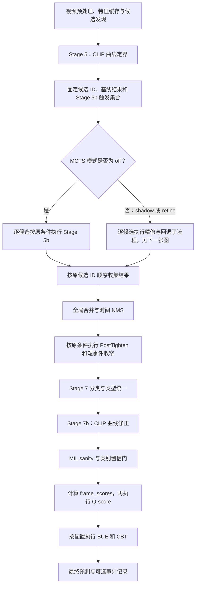
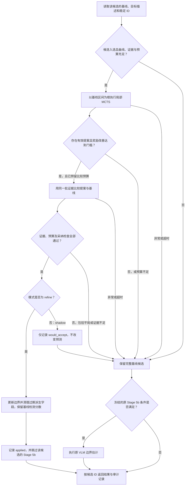

# v2 融合 MCTS 的实施设计

> 状态：设计方案，尚未实现或运行融合实验。本文的新增接口、配置、文件和命令均为拟议内容。
> 核对日期：2026-10-13；仓库 HEAD：`4c94256c`，分支 `main`。以当前工作区源码为依据，行号为本次核对时位置，后续请按函数名定位。
> 实施目录：`vad_v2/vad-6-8.13-169/video_anomaly_detection/`；v1 用于对照。
> 数值说明：下文新提出的权重、预算和阈值是首轮开发验证的起点，未证明能提升 mAP；应在开发集确定后冻结，再做独立评测。
> 接口复核：已对照 Stage 5 后的实际消费者补充 §19。结论是可保留后续阶段顺序，但原方案仍需明确字段生命周期、稳定候选 ID、PostTighten 的置信度变化及 Stage 5b 跳过对照；这些规则现已并入本文。尚无融合实现可供端到端验证。

## 1. 目标与建议方案

保留 v2 的 CLIP 曲线定界作为每个候选的基线解，在 Stage 5 后新增有限预算的 MCTS 边界搜索。MCTS 提出新的时间区间，经过证据检查才替换基线边界；失败、证据不足、预算耗尽或没有更好解时保留基线。

核心分工：

- CLIP：生成初始边界，并提供覆盖整段的类别分数曲线、峰值和边界局部变化。
- MCTS：在有限的局部范围内尝试不同边界组合，分配搜索预算。
- VLM：检查提案是否仍对应原目标事件，及裁掉的内容中是否还有该事件。
- v2 后续流水线：继续完成合并、NMS、分类、置信过滤、Q-score、BUE 和 CBT。

初版不以 MCTS 搜索奖励覆盖检测置信度，不因 MCTS 判否而删除原候选。这样可以单独研究“边界提案是否有用”，但仍不能保证最终检测数量、置信度或 mAP 不变：边界变化会影响合并、NMS、分类取帧和 Q-score。

**接受新边界后，旧对比度只能作为基线证据记录，不能冒充新边界的质量分数**。采纳时将它存入旁路基线记录，并从新预测字典移除；新边界质量单独记录，Stage 5b 通过冻结的基线触发集合及显式采纳 ID 决定是否执行。具体字段生命周期见 §7.2、§19。

## 2. 已核实的现有路径

### 2.1 v1

入口：[v1 pipeline.py](../../vad_v1/video_anomaly_detection/pipeline.py)，`MultiAnomalyVAD.detect()` 的 Stage 5，约第 250 行。

```text
候选最多 3 个
  → 每个候选两侧各外扩候选时长的 75%
  → 构造 TemporalBoundaryMCTS
  → search(search_start, search_end)
  → 并发收集结果；异常或空结果可能使该候选消失
  → 类别相关 CLIP 边界修正
  → 合并、短事件收窄、分类、置信过滤
```

旧 MCTS 输出的 `confidence` 直接来自 `leaf_reward`，包含缩短区间的奖励。

### 2.2 v2

入口：[pipeline.py](video_anomaly_detection/pipeline.py)，`_detect_impl()`，约第 850 行。

```text
抽帧、运动过滤、CLIP/MIL/VideoMAE 等
  → VLM 扫描候选，最多保留 3 个
  → _clip_boundary_detection()
  → Stage 5b：指定低 CLIP 类别且 boundary_contrast < 0.15 时 VLM 定界
  → global_merge → temporal_nms
  → _post_merge_boundary_tightening → narrow_short_events
  → 分类 → unify_anomaly_types → clip_score_curve_correction
  → MIL sanity → 类别置信过滤
  → frame_scores → Q-score → BUE → CBT
  → DetectionResult
```

`TemporalBoundaryMCTS` 目前仅导入，没有在这条主路径实例化。配置中的模拟次数和最大深度不会自行启动搜索。

v2 与 v1 还存在后处理和置信度策略等差异，两个版本整体 mAP 的差距不能单独归因于是否使用 MCTS。本方案需在同一 v2 基线内做开关对照。

## 3. 新增 MCTS 的准确位置

### 3.1 整体接入流程



本图从存在候选的路径开始；高置信 Normal 或无候选的原早退路径仍保留。后处理节点表示保留调用顺序，各方法内部仍按原条件触发。

### 3.2 单候选的精修、采纳与回退



只在 `_detect_impl()` 的 Stage 5 调用处增加一次 MCTS。不要把它放进同步函数 `_clip_boundary_detection()`：该函数还被 `_post_merge_boundary_tightening()` 复用，放进去会造成重复搜索、同步异步接口混乱和预算失控。

首版接入策略：

| 模式 | MCTS 是否运行 | 是否采用提案 | Stage 5b |
|---|---|---|---|
| `off`，默认 | 否 | 否 | 原逻辑 |
| `shadow` | 对选中候选运行 | 否，只记录 `would_accept` | 所有候选按原逻辑 |
| `refine` | 对选中候选运行 | 通过门槛才采用 | 已采用者跳过；其余按原逻辑 |

`shadow` 用于检查调用是否真正生效、搜索是否合理及成本，并不等于已测得融合后的最终 mAP。在线服务的随机性也可能使独立两次运行输出不同；模式等价测试应使用固定 mock 或请求缓存。

## 4. 文件修改清单

以下路径均相对实施目录。

| 文件 | 类型 | 修改内容 | 定位点 |
|---|---|---|---|
| `pipeline.py` | 修改 | Stage 5 后调用精修协调器；控制 Stage 5b；返回审计记录；保存阶段快照 | `_detect_impl()`，约 680、850、854、970 行 |
| `config.py` | 修改 | 扩展 `MCTSConfig`，增加校验和 CLI 映射 | `MCTSConfig` 45；`VADConfig.from_args` 188；`load` 254 |
| `run.py` | 修改 | 提供相同含义的新 CLI 参数，保存有效配置 | argparse 入口，约 95、127 行 |
| `batch_evaluate.py` | 修改 | 同步 CLI；配置指纹、结果目录隔离、审计信息落盘 | `run_batch` 85；`process_one_video` 57 |
| `temporal_mcts.py` | 修改 | 新融合入口；根/范围分离；动作合法性；奖励、缓存、早停、输出契约 | 详见 §8 |
| `mcts_refiner.py` | **新增** | 候选筛选、预算、构造搜索器、提案采纳、回退、trace 汇总 | `MCTSBoundaryRefiner.refine_candidates()` |
| `mcts_boundary_scorer.py` | **新增** | 类别曲线局部评分、时间加权均值、证据充分性、奖励计算 | `BoundaryEvidenceScorer` |
| `token_compressor.py` | 修改 | 新增边界证据选帧入口，保留首尾内外帧及真实时间戳 | 新 `select_boundary_evidence()`；原 `select_keyframes()` 保持原调用行为 |
| `models.py` | 修改 | 定义提案/trace 数据契约；`DetectionResult` 增加可选 `mcts_trace` 并序列化 | `DetectionResult` 107；`to_dict` 147 |
| `anomaly_expert.py` | 独立修复项 | 修复旧 `score_segment()` 的采样索引到峰值时间映射；新融合路径优先读全曲线 | `score_segment` 352，峰值换算约 388 |
| `post_processor.py` | 审计模式必要适配 | 追溯最终检测来源，合并时传递候选 ID 集合；NMS 记录抑制关系 | `global_merge` 28；NMS 保留获胜者 ID，不把被抑制者并为边界贡献者 |
| `tests/test_mcts_refiner.py` | **新增** | 采纳/回退、模式、预算及候选隔离 | 见 §14 |
| `tests/test_temporal_mcts.py` | **新增** | 动作、重复状态、早停、reward 与输出 | 见 §14 |
| `tests/test_mcts_boundary_evidence.py` | **新增** | 时间戳、边界选帧、曲线评分、缺帧 | 见 §14 |
| `tests/test_config.py`、`tests/test_models.py` | 修改 | 配置穿线、旧 JSON 兼容、trace 序列化 | 现有测试文件 |
| `iteration_logs/analysis_mcts_fusion.py` | **新增** | 按视频比较完整 ON/OFF 结果、统计成本及阶段边界存活率 | 见 §15 |
| `README.md`、`PROJECT_DOCUMENTATION.md` | 实现后更新 | 说明实际启用方式、流程和输出 | 本设计先建立文档链接 |

`frame_scorer.py:get_category_scores()` 已提供类别曲线，可以直接复用。`factory.py:build_vad()` 已传入整个配置及 VLM 客户端，通常不需要改变外部签名。`llm_protocol.py` 的 `generate(prompt, images, ...)` 可用于新增提示词，首版也无需改接口。

## 5. 配置、预算与参数穿线

建议使用一个 `mode` 字段，避免 `enabled` 与 `shadow` 两个布尔值出现矛盾组合。此前讨论中的 `mcts_refine_enabled` 在正式方案中由 `mcts.mode` 取代。

| 拟议字段 `config.mcts.*` | 首轮设置 | 用途 |
|---|---|---|
| `mode` | `"off"` | `off / shadow / refine` |
| `action_set` | `"shrink"` | `shrink` 为首轮；`shrink_shift` 为单独实验 |
| `simulations` | 保留配置默认 12；实验显式传 8 | 根评估之外的树循环上限 |
| `max_depth` | 4 | 每条路径深度上限 |
| `max_candidates_per_video` | 2 | 每视频实际搜索上限 |
| `max_vlm_evaluations_per_candidate` | 10 | 含根评估、节点评估、最终成对比较 |
| `max_vlm_evaluations_per_video` | 20 | 每视频 MCTS 专属逻辑请求预算 |
| `timeout_seconds_per_candidate` | 90 | 包括客户端限流重试等待；超时保留基线 |
| `trigger_policy` | `"low_contrast"` | 首版仅该触发策略；`wide` 后续单独实验 |
| `contrast_threshold` | 0.15 | 针对现有 `boundary_contrast` 标度，需验证 |
| `search_padding_ratio` | 0.25 | 基线区间每侧外扩比例 |
| `max_endpoint_shift_ratio` | 0.25 | 相对于基线段长的单端总位移上限 |
| `step_ratio` | 0.10 | 局部边界动作起始步长；后续随深度缩小 |
| `min_interval_seconds` | 0.5 | 几何有效性的最低长度；不是奖励目标 |
| `max_images_per_evaluation` | 16 | 包含左右外侧上下文的送图上限 |
| `context_seconds` | 2.0 | 节点边界外侧的取证范围 |
| `max_boundary_gap_seconds` | 1.0 | 非视频首尾处，最近内/外帧离边界的最大允许距离 |
| `min_unique_evaluations` | 4 | 新早停策略要求的不同区间评估数 |
| `patience` | 3 | 连续若干新状态未改善最优目标后可停止 |
| `min_reward_gain` | 0.02 | 根与候选使用新奖励时的最小改善量 |
| `max_curve_quality_drop` | 0.05 | 允许语义证据修正曲线时的最大局部曲线退化 |
| `trace_enabled` | false | 输出精简审计信息；开发实验显式开启 |

旧 `padding_ratio=0.75`、`early_stop_agree`、`early_stop_min_sim` 可保留以兼容旧配置，但新 `refine()` 不读取这些遗留字段。当前 `_clip_boundary_detection()` 实际将候选两侧各扩展 50%，不是由旧 `padding_ratio` 控制；不要仅修改配置注释就假定主路径变化。

穿线路径必须完整：

```text
run.py / batch_evaluate.py 参数
  → VADConfig.from_args
  → MCTSConfig 校验
  → MultiAnomalyVAD.config.mcts
  → 每次 detect 的精修上下文 / 每个候选的搜索器
  → 实验配置 JSON 与哈希
```

验证模式枚举、正数预算、非负阈值及预算关系。客户端 `max_frames` 小于必需证据帧数时跳过精修并给出原因，不允许客户端静默删掉有时间标签的关键帧。

现有 `run.py` 与 `batch_evaluate.py` 的抽帧率、模型及 MCTS 模拟次数默认值不同；实验需显式指定或统一有效配置。`VADConfig.load()` 已支持从 `mcts` 子字典加载，但不能据此认为两个 CLI 已支持任意 JSON 配置文件参数。

## 6. pipeline.py 的接入与协调器职责

### 6.1 接入伪代码

以下展示控制流；`refine_candidates()` 等是待新增接口。

```python
import copy

clip_results = self._clip_boundary_detection(
    candidates, video_data, videomae_category
)
# 在任何精修筛选或重排之前分配稳定 ID，并冻结基线。
seed_ids = tuple(range(len(clip_results)))
baseline_by_id = {
    sid: copy.deepcopy(clip_results[sid]) for sid in seed_ids
}
source_by_id = {
    sid: copy.deepcopy(candidates[sid]) for sid in seed_ids
}
stage5b_eligible_ids = {
    sid for sid in seed_ids
    if videomae_category in LOW_CLIP_CATEGORIES
    and baseline_by_id[sid].get("boundary_contrast", 1.0) < 0.15
}
all_anomalies = clip_results
applied_ids = set()
mcts_trace = None

if self.config.mcts.mode != "off":
    # 每视频创建；运行状态不挂在共享的 self 上。
    refiner = MCTSBoundaryRefiner(
        config=self.config.mcts,
        llm_client=self.llm_client,
        frame_sampler=self.frame_sampler,
        category_priors=CATEGORY_DURATION_PRIORS,
    )
    outcome = await refiner.refine_candidates(
        seeds_by_id=copy.deepcopy(baseline_by_id),
        source_candidates_by_id=source_by_id,
        video_data=video_data,
        category=videomae_category,
        frame_scorer=self.frame_scorer,
    )
    # 实现中用显式契约校验；失败时记录原因并整批回退到基线。
    assert set(outcome.candidates_by_id) == set(seed_ids)
    assert outcome.applied_ids <= set(seed_ids)
    all_anomalies = [outcome.candidates_by_id[sid] for sid in seed_ids]
    applied_ids = outcome.applied_ids
    mcts_trace = outcome.trace

# 触发条件读取冻结的基线；不能依赖改边界后遗留或缺失的 contrast。
if videomae_category in LOW_CLIP_CATEGORIES:
    vlm_refined = []
    for sid, anom in zip(seed_ids, all_anomalies):
        if sid in applied_ids:
            vlm_refined.append(anom)
        elif sid in stage5b_eligible_ids:
            vlm_refined.append(await self._vlm_boundary_estimation(
                anom, video_data, videomae_category
            ))
        else:
            vlm_refined.append(anom)
    all_anomalies = vlm_refined

# 接原来的 global_merge / NMS / 分类 / 后处理。
```

`shadow` 返回原基线结果，`applied_ids` 必须为空；审计可记录 `would_accept=true`。`off` 不构造精修器、不选帧、不额外调用 VLM。

当前 `_clip_boundary_detection()` 对输入候选逐个返回，输出长度及顺序对应输入；实施时必须检查这个前提。精修器即使按对比度排序运行，也按 `candidate_id` 回填所有候选，包括未搜索和搜索失败者。不能将“实际搜索顺序”当作原列表下标。`trace_enabled=false` 时 `outcome.trace=None`，但运行用的采纳 ID 和基线信息仍必须存在。

### 6.2 候选筛选

在有有效类别曲线、合法区间和边界证据的前提下，首版选具有有限数值 `boundary_contrast` 且小于 `contrast_threshold` 的候选。缺失/NaN 不自动填 0 或 1 来参加 MCTS，记录 `missing_baseline_contrast` 并回退。原 Stage 5b 对缺字段取 1.0 的逻辑仅用于精确复现原触发规则，不代表缺失对比度等同于高质量边界。低对比度也不能等同于边界错误。

按低对比度优先、起点时间和原索引作为固定次序截断到预算上限。不得使用 GT 类别、GT 时间段或测试集 IoU 来选择要运行 MCTS 的候选。

过宽触发、多个峰值触发、多尺度边界分歧触发分别作为后续实验。当前 CLIP 方法只返回最佳边界，若需要多尺度分歧诊断，必须增加可选诊断返回，而不是凭已有 `boundary_contrast` 推测分歧程度。

### 6.3 候选描述与类别

传给 MCTS 的目标描述取原候选 `description`，缺失时回退到当前预测类别。类别使用已产生的预测值，不在每个节点重新切换到 CLIP 最强类别，以免从原事件跳到邻近另一事件。

MCTS 适配器本身不改变类别输出；后面的集成分类仍可能改变最终类别。当前 `TemporalBoundaryMCTS._extract_results()` 会优先使用 expert 的 `predicted_type`，融合入口要去掉这一覆盖行为。各后续阶段实际读取的类别来源见 §19.5，不能一并改为 MCTS 目标类别。

### 6.4 单候选容错与并发

每个候选独立保存基线副本。格式错误、缺帧、API 异常、超时、无可达新状态均返回 `applied=false`，不让一个候选失败导致整段视频失败。尊重调用方取消任务的语义，不吞掉取消信号。

批处理已并发运行多视频且共享 `vad`。首版每视频内部按固定顺序处理候选，避免再次无界 `gather`。树、缓存、计数、trace 和随机数状态都必须属于单视频/单候选，不保存为共享 pipeline 的可变成员。

## 7. 数据契约与字段适配

### 7.1 融合搜索输入

建议新增 `TemporalBoundaryMCTS.refine(...)`，保留旧 `search(t_start, t_end)` 的行为，避免调用方因返回类型变化出错。新入口需要：

```python
await mcts.refine(
    seed=baseline_candidate,
    search_bounds=(search_min, search_max),
    category_curve=curve,
    timestamps=video_data["timestamps"],
    target_category=category,
    target_description=description,
    config=mcts_config,
    budget=per_video_budget,
)
```

输入区间约定统一为 `[t_start, t_end)`，单位秒。`category_curve[i]`、`timestamps[i]`、`all_frames[i]`、`clip_features[i]` 必须指向同一帧。

### 7.2 返回提案

定义 `MCTSProposal`，与最终 `AnomalySegment` 分开：

```text
candidate_id、baseline_start/end、proposed_start/end
baseline_reward、proposal_reward、reward_components
baseline_curve_quality、proposal_curve_quality
target_present、evidence_valid、pairwise_verdict
depth、visits、unique_evaluations、cache_hits、stop_reason
would_accept、applied、reason
```

不要返回一个名为 `confidence` 的搜索奖励，也不要让 pipeline 用 `all_anomalies.extend(mcts_results)` 重建全部候选。协调器应复制基线字典并仅替换通过检查的边界。

接受后字段处理：

| 字段 | 处理 |
|---|---|
| `t_start/t_end` | 换成提案边界 |
| `confidence/coarse_score/anomaly_type/description` | Stage 5 适配器保留该候选的 v2 基线值；不承诺后续永远不改 |
| `depth/visits` | 可记录采纳节点统计；完整统计放 trace |
| `boundary_contrast` | 未采纳者原样保留；已采纳者从活动预测字典移除，原值保存在旁路基线记录中 |
| `proposal_curve_quality/search_reward` | 仅诊断；与旧 contrast 和置信度分开命名 |
| `frame_indices`（若存在） | 已采纳者移除该派生字段；取帧按新边界与真实 timestamps 重新计算 |

已采纳者通过稳定 `applied_ids` 跳过 Stage 5b。当前 merge、NMS 不读取 `boundary_contrast`；PostTighten 可在重新执行 CLIP 定界时生成一个新的同名分数，因此这个生命周期与后续消费者兼容。原基线信息属于精修运行上下文，即使关闭 trace 输出也不能丢失。

移除旧 `frame_indices` 是因为候选发现曾保存粗区间帧索引，CLIP 定界复制候选字典时可能原样带入；它不一定匹配 CLIP 新边界，更不能用于 MCTS 新边界。当前后续分类按 `get_segment_frames()` 重新取帧，适配器也应如此。MCTS 新节点的内部帧索引与历史候选索引分开管理。

`confidence` 保留基线数值是“在 Stage 5 固定检测排序分数”的实验规则：其中旧 CLIP 边界奖励已成为基线评分的一部分，不能宣称这是新边界的重新校准置信度。若研究重新校准，应另增实验，并先提取能够评分固定区间的函数；不能重新调用会改边界的 `_clip_boundary_detection()` 冒充只重算置信度。

### 7.3 输出与追溯

`DetectionResult` 新增可选 `mcts_trace`；`None` 时不输出该键。早退路径在诊断模式下记录 `skipped_reason`，如 `normal_early_return`、`no_candidates`，避免“没有日志”被误判为正常执行。

现有 `global_merge()` 会重建字典，pipeline 最终投影及 `AnomalySegment.to_dict()` 也会丢弃任意新字段，所以 trace 必须单独汇总到 `DetectionResult`。

为兑现后处理可解释性的要求，审计模式必须用 `source_candidate_ids` 集合标记来源，合并取并集、NMS 单独记录被抑制 ID，投影前保存对应关系到 trace。ID 在视频内稳定，由原候选顺序产生；不要用四舍五入后的边界浮点数作身份。元数据序列化成排序后的列表，避免集合写 JSON 失败或顺序不稳定。

merge 保留的 `depth/visits` 目前来自置信度获胜者，不能解释成合并后整个区间的搜索统计。图像证据、搜索节点和最终检测之间通过来源集合追溯，而非复用合并字典上的单个 `depth`。

## 8. temporal_mcts.py 的逐项适配

### 8.1 现有函数与修改对照

| 现有位置 | 已有行为 | 融合入口需要的行为 |
|---|---|---|
| `__init__`，65 | 超参数硬编码；动作仅两个 shrink | 可接配置与证据评估器；运行状态逐候选独立 |
| `_shrink_ratio`，111 | 首层 40% 的大步收缩 | 小步局部搜索；步长与真实采样分辨率相容 |
| `_execute_shift_*`，143/155 | 20% 平移，受 `original_t_*` 限制 | 独立搜索范围；边界裁剪后无变化则非法 |
| `_create_child`，167 | 每节点最多 8 帧通用 CLIP 评分 | 全类别曲线切片、真实时间戳；不重复编码 |
| `_is_action_valid`，214 | shrink 检查长度，其余默认 true | 检查搜索域、位移、长度、证据、重复和 no-op |
| `selection`，232 | UCB 选择子节点 | 保留 UCB 思路，排除已耗尽子树，不能反复选无新动作的深度上限节点 |
| `expansion`，266 | 仅两个 shrink 执行器 | 动作列表、执行器、合法性和引导逻辑同时适配 |
| `_select_action_with_expert`，290 | VLM 首尾布尔值优先，其次通用 CLIP 峰值 | 基于目标类别曲线与内外证据排序所有合法动作 |
| `simulation`，325 | VLM 评估，缓存完整 reward | 缓存原始证据；用统一新目标计算 reward |
| `_parse_response/_build_prompt`，414/434 | 简单 yes/no 正则、无逐帧时间标签 | 校验结构化 JSON、区间归属与真实时间戳 |
| `backpropagation`，455 | 更新访问数和动作价值 | 继续保留树路径统计；无效评估不作为高质量证据 |
| `search`，491 | 搜索范围就是根区间 | 新 `refine` 分开定义种子、搜索范围和根节点 |
| `_extract_results`，585 | 最大 leaf_reward 输出，reward 当 confidence | 新提案选择包括基线；返回专用提案结构 |
| `serialize_tree`，629 | 只记少量节点状态 | 增加规范状态 ID、证据摘要、reward 分项及终止原因 |

### 8.2 根区间与可移动范围必须分开

设 CLIP 基线 `B0=[s0,e0)`，长度 `D0=e0-s0`：

```text
根节点 = B0
搜索域 S = [max(0, s0 - p×D0), min(video_duration, e0 + p×D0)]
所有动作的单端总位移不超过 max_endpoint_shift_ratio×D0
```

节点至少记录 `seed_start/end`、`search_min/max`、当前 `t_start/end`、帧/证据索引、深度、动作历史。不要继续让 `original_t_start/end` 同时表示根区间和搜索边界。

原因：根若占满“原始范围”，旧 shift 会被裁回同一区间。即便把动作名加进列表，也不能真正移动根节点。

### 8.3 两动作首版与四动作扩展

| 动作 | 区间变化，步长为 Δ | 优先尝试的证据 |
|---|---|---|
| `shrink_left` | `[s+Δ,e)` | 起点之后一段仍是背景，左侧可裁 |
| `shrink_right` | `[s,e-Δ)` | 终点之前已恢复背景，右侧可裁 |
| `shift_left` | `[s-Δ,e-Δ)` | 左侧外部仍有目标事件、右侧内容冗余 |
| `shift_right` | `[s+Δ,e+Δ)` | 右侧外部仍有目标事件、左侧内容冗余 |

首轮 `action_set=shrink` 检验收缩精修；通过后再启用 `shrink_shift`。实现四动作时同时更新 `self.actions`、`expansion` 的执行器、合法性判断和动作排序。

四动作仍不能把种子变成长于 `D0` 的区间。需要补回事件两端时，后续可增加 `expand_left/right`，另做消融；不能声称仅启用 shift 就具备任意边界扩展能力。也可以研究“较宽根 + 显式保留 B0”的另一设计，但不要在首版同时引入。

建议每深度步长：`Δ(d)=max(局部时间分辨率, step_ratio×D0/(1+0.3d))`，再映射到合法时间网格。网格由真实时间戳、种子端点和搜索域端点构成；无可移动网格点则动作无效，不伪造亚帧证据。

例：种子 `[10,20)`、搜索域 `[7.5,22.5)`，取 Δ=1 秒：四动作分别得到 `[11,20)`、`[10,19)`、`[9,19)`、`[11,21)`。根可平移，因为搜索域独立于种子。

### 8.4 重复状态、循环与叶节点

对每个提案先计算规范边界 ID，再判断是否与父节点相同、是否在当前祖先路径中出现。左移后右移回原点应被禁止；不同路径到同一状态可复用证据，但不能把两个树节点共用同一个可变父指针和访问统计。

达到深度上限时动作置空并标记该节点不能扩展。选择阶段需要向其他尚可扩展分支回退；整棵树没有新状态时以 `tree_exhausted` 停止。否则旧逻辑可能不断评估同一个深度上限节点，并把缓存命中算作“连续一致”。

### 8.5 动作引导与 UCB 的边界

保留原 UCB 选择已展开分支的机制。expert 用于**未尝试动作的顺序**：为每个合法后继区间计算廉价曲线质量，再结合 VLM 关于两端冗余/外部延续的证据排列。

这样 shift 不会因旧规则只优先 shrink 而长期得不到探索。分数相同时按固定动作顺序，或使用每候选独立且可记录的随机种子。若以后改为 PUCT 并把曲线质量变成先验概率，需要另列算法变更，不能只改名称。

## 9. expert 与抽帧的适配

### 9.1 复用目标类别全曲线

通过 `frame_scorer.get_category_scores(video_data, category)` 得到 `q_i=P(category)/(P(category)+P(Normal)+ε)`。在当前区间按真实时间戳切片，返回：

- 区间内时间加权平均分、峰值所在的全局帧索引及其真实时间戳。
- 起点前后、终点前后的分数变化。
- 区间内外对比度和证据缺失标记。

不要用已覆盖检测置信度的 `compute_frame_scores()` 输出作为 MCTS 输入，它在后处理中依赖预测区间本身，会形成反馈。

旧 `anomaly_expert.score_segment()` 用异常类别 top-3 概率和与 Normal 比较，得到通用异常分数，可能追踪到相邻另一类事件。新搜索固定目标类别，有效曲线不可得时首版跳过 MCTS，不静默换成其他类别。

### 9.2 旧 peak_time 的具体问题

`score_segment()` 最多均匀取 8 帧后，`peak_frame_idx` 是这 8 帧中的局部索引；目前换算分母却是 `len(frames)-1`，还假设帧在整个区间均匀分布。超过 8 帧或运动过滤导致时间不均匀时会失真。

例如原输入 20 帧，选出的第 8 帧异常最高，当前会把索引 7 除以 19，而不是使用这张图对应的实际时间。正确实现应保留采样后的全局索引 `sampled_global_indices`，然后查 `timestamps[sampled_global_indices[argmax]]`。

若单独修复该旧接口，可加可选 `timestamps` 参数并测试所有索引路径；缺少时间戳时明确是近似值。融合主路径读取全曲线，可绕开该问题；不要让 expert 的公共修复在 `mode=off` 时悄悄改变其他阶段的行为。

### 9.3 新增边界证据选帧

默认预处理先目标 2 FPS 抽帧，再运动过滤；静止区可能只留约 2 秒一帧。MCTS 从这个帧池再次选图，增加搜索深度不会补回丢失的视觉证据。

给 `SemanticFrameSampler` 新增独立入口：

```python
evidence = frame_sampler.select_boundary_evidence(
    video_data, interval, search_bounds,
    category_curve, max_images, context_seconds,
)
# 返回结构示意：
evidence = {
    "frames": ...,
    "global_indices": ...,
    "timestamps": ...,
    "roles": ...,
    "coverage": ...,
}
```

按优先级保留：起点外侧/内侧、终点内侧/外侧的最近证据帧，区间内部的均匀覆盖帧，目标类别高分帧。角色可重叠，图片去重后仍保持对应关系；最后按时间排序。

边界证据帧不可被语义去重删除。原 `select_keyframes()` 的代表帧选择不保证首尾保留，不能直接用于回答边界问题。对非边界的额外帧才允许沿用语义去重，且不改变旧调用者行为。

检查边界内外证据距离、唯一帧数量和区间内部覆盖。非视频首尾缺少外部帧时将该侧标为 `unknown`；涉及该侧的动作不能仅凭模型猜测被采纳。真正的视频起止可标为截断事件，不能强求不存在的视频外部证据。

首版在证据不足时保留基线。按需重新解码边界邻域为更密帧属于第二阶段独立改进：需要新的局部帧池、时间戳和 CLIP 特征索引，不能把新帧直接插入全局数组导致现有缓存错位。

### 9.4 提示词与客户端上限

沿用 `llm.generate(prompt, images)`，提示词逐项列出每张图的真实时间戳、待评估区间及目标描述；明确有些图在区间外，模型不能因上下文有异常就判区间内有异常。

不要只问 `starts_at_beginning/ends_at_end`。这两个值为 yes 可能意味着事件被截断，不能直接奖励“边界准确”。拟议返回：

```json
{
  "target_present_inside": true,
  "target_confidence": 0.85,
  "start_status": "well_bounded",
  "end_status": "excess_background",
  "evidence_image_indices": [2, 3, 5]
}
```

边界状态限定为 `well_bounded / excess_background / event_cut / unknown`。严格校验布尔类型、有限数值范围、枚举与图片索引；无法解析时不按“缺失字段默认 yes”处理。

选出的图数必须小于等于客户端 `max_frames`。现有 `llm_client.py` 可能再次均匀删帧；若发生，提示词时间标签与实际图片会错配。新选帧入口要提前匹配上限，使客户端不再删帧。非均匀时间帧使用图片序列，不假装成固定 FPS 视频。

## 10. 奖励函数：统一比较种子与提案

旧奖励是 `0.4×通用CLIP分 + 0.4×VLM置信度 + 0.3×(1-长度比例) + 边界奖励`，仅在 VLM 判有异常时有效。收缩越多奖励越大，可能将完整事件压成最显著的瞬间。

新融合路径移除无条件“越短越好”的项。根节点和所有提案使用同一目标，建议首版：

```text
证据无效：evaluation_valid=false，该节点不可采纳
VLM 明确区间内没有目标事件：R=0
否则：R = 0.50×P + 0.25×B + 0.20×C + 0.05×F
```

- `P`：VLM 对区间内目标事件的置信度，是模型信号而非已校准概率。
- `B`：首尾边界证据质量；`well_bounded=1`、`excess_background=0.5`、`event_cut=0`，两侧均值。`unknown` 另标证据不足，不能凭固定分填补后采纳受影响的端点。
- `C`：类别曲线的内外对比度归一到 `[0,1]`。
- `F`：类别期望时长的软约束，位于期望区间内取 1，过短取 `D/min_dur`，过长取 `max_dur/D`。它不是硬性要求所有事件都达到类别最短时长。

`C` 的具体定义：按真实时间戳对 `q(t)` 做分段线性积分并除以覆盖时长，求区间内均值 `qin`，左右外环均值 `qleft/qright`；外环宽度取 `context_seconds`，可用的左右两侧等权平均得到 `qout`，`C=clip((qin-qout+1)/2,0,1)`。遇到超过允许缺口的插值片段标记证据不足，不能让一个孤立帧代表很长时间。两侧均无有效外环时跳过曲线支持的精修；一侧为真实视频边界时可使用另一侧。

原 `_score_boundary_proposal()` 同时返回 `contrast` 与 `combined=contrast×duration_fit`，但当前 Stage 5 比较的是 `prop['contrast']`。因此不能把现有 `boundary_contrast` 当作上述新 `R` 或新 `C`，也不能假设它已经包含 duration fit。

这些权重需要开发集验证，并用消融确认 VLM 证据确实提供额外信息。只用与 CLIP 基线同一条曲线挑提案，可能只是换一种阈值搜索，不能由此宣称 MCTS 带来语义收益。

## 11. 采纳门槛与最终比较

先从树内选出满足几何/证据条件且 `Rproposal >= Rbaseline + min_reward_gain` 的最佳提案。如果无此提案，则保留基线，不额外发最终比较请求。

最终采纳须同时满足：

1. 区间合法、位移在预算内，边界图像覆盖充分；不能移动到另一个事件。
2. 区间内目标存在，没有新出现的事件截断证据；基线评估失败时不进行 reward 差值判断，直接回退。
3. 目标类别曲线质量下降不超过 `max_curve_quality_drop`。允许一定容差，给 VLM 纠正 CLIP 的空间。
4. 使用基线与提案的联合证据帧做一次 VLM 成对比较，判断同一事件的哪个区间同时更完整、背景更少。
5. 成对比较明确选择提案，输出可定位到已发送帧的证据；平局、两者不确定、缺帧或解析错误都保留基线。

成对比较不把“CLIP 原结果”和“MCTS 新结果”透露为优劣标签。用可复现的 A/B 排列，记录映射并将模型输出转换回真实候选。需要覆盖两个区间四端的内外证据；若图数上限无法覆盖，返回 `comparison_insufficient_evidence`。

最终比较也计入预算，协调器必须预留 1 次请求；剩余预算不足时不采用未经比较的提案。它是额外的语义检查，仍会出错，不能当作真实标签。图和提示词中不传 GT。

## 12. 缓存、停止条件与成本

### 12.1 缓存键

旧 `(round(start,1), round(end,1))` 可能把不同区间混为同一键。改用视频身份、目标类别/描述哈希、规范区间 ID、实际送图 ID/顺序、模型与提示词版本。

缓存原始结构化回答和视觉证据摘要，reward 由当前明确的种子/范围/配置重新计算。新入口禁止复用旧 `reward_base`。持久缓存还需模型版本、图像内容指纹、解码参数、温度和配置指纹。

### 12.2 停止条件

停止条件包括模拟上限、唯一评估/请求预算、树耗尽、超时，以及以下稳定条件：达到最少不同区间评估数、根节点的所有合法动作至少探索过一次后，连续 `patience` 个不同新状态未将最优奖励提升至少 `min_reward_gain`，且这段时间最佳规范区间 ID 不变。缓存重复访问不递增该计数；这是一项预算启发式，不保证全局收敛。

不要用旧“连续 4 次 anomaly_present 相同”判收敛：多个不同边界都可能包含异常；重复命中缓存更不代表边界收敛。

### 12.3 成本口径

8 次树循环最多产生 8 个新节点评估，另有 1 次根评估和 1 次最终比较，故首轮每候选最多 10 次逻辑 VLM 请求；两个候选最多 20 次。缓存、证据不足或早停会降低实际次数。这些是 MCTS 的新增预算，原扫描、Stage 5b 回退和分类的请求仍计入视频总成本。

`llm_client.call_count` 在一次 `generate()` 开始时加 1，而其内部最多可能尝试 5 次 API 请求，因此它不是重试次数或准确账单计数。批处理多视频共享客户端，按全局计数差得到的视频成本还可能串入其他视频的请求。

MCTS 使用本地预算记录逻辑请求、缓存命中、送图数与耗时；需要真实 API 尝试数/计费 token 时，再给客户端增加按请求上下文归属的指标，并与旧 `[COST]` 字段区分。统计时不要把这 20 次上限写成 HTTP 请求或收费的硬上限。

## 13. 与后处理相互作用及对照臂

在 Stage 5 采纳边界不等于最终输出使用同一边界：

| 后续阶段 | 可能影响 |
|---|---|
| global_merge / NMS | 改变候选合并、数量、排序和保留对象 |
| PostTighten | 非 LOW_CLIP 类别且长度超过期望最大值的 1.2 倍时再次 CLIP 定界；置信度取旧值与重算值的最大值，可能升高 |
| 短事件收窄 | 按运动峰值再定位；其分支条件可能因 MCTS 时长变化而切换 |
| 集成分类 / 类型统一 | 取帧和长度权重可能改变类别结果 |
| CLIP curve correction | 继续修正边界 |
| MIL sanity / 置信门 | MIL sanity 可将置信度乘 0.7，再按视频级类别取门槛；Stage 5b 本身不写主 confidence，但可经边界改变影响之后的 merge/PostTighten |
| frame_scores / Q-score | 预测覆盖位置变化会改变帧分数及最终排序 |
| BUE / CBT | 再扩展或收紧边界，可能抹去也可能加强 MCTS 效果 |

首版**保留 PostTighten、短事件收窄、Stage 7b 曲线修正、BUE 和 CBT 的原条件及顺序**，不为 MCTS 检测额外跳过。审计模式逐阶段深拷贝记录 `post_clip / post_mcts / post_stage5b / post_merge / post_nms / post_tighten / post_short / post_classify / post_curve / pre_conf_gate / post_conf_gate / pre_qscore / post_qscore / post_bue / final`；包含边界、置信度、类别、来源 ID 及该阶段的触发/跳过原因。后续跳过重定界的研究独立设置双臂策略，不混进首次融合。

`frame_scores` 在 Q-score、BUE、CBT 之前计算，描述的是该时点的预测覆盖与本地信号，不能宣称与最终扩展/收紧后的 anomalies 严格对应。首轮两臂保持这个生成时机，trace 记录 `frame_scores_stage=post_conf_gate`；若以后改变时机，须作为单独改动重新评测 AUC 和排序。对 BUE/CBT 保存快照必须复制数值，不能保留会被就地修改的字典引用。

**不能像终端算子一样仅保存 `pre_mcts_boundaries`，然后将它按下标替换到最终 anomalies 来还原 OFF。** 合并/NMS 后数量与顺序可能不同，最终置信度也可能变化。必须比较完整结果：

- OFF 臂：同一 Stage 5 基线，执行原 Stage 5b 和完整后续流程。
- ON 臂：同一基线，运行 MCTS，按采纳状态执行 Stage 5b，再执行完整后续流程。

实现配对评测时，将 Stage 5 后的尾部抽成 `_finish_from_stage5(...)` 一类内部方法，ON/OFF 各传独立深拷贝的候选和会被修改的数据。只读图像/特征可共享；按臂使用独立缓存命名空间或已验证的只读缓存，不能共用可变结果字典。

尾部仍可能调用分类 VLM。只有请求内容完全相同才复用同一响应；因为边界改变而产生不同图像/提示词时，必须分别请求并记录。配对设计减少上游噪声，不能完全消除不同请求的 VLM 波动。

在这个双臂工具完成前，可以先运行两个独立结果目录做完整 OFF/ON 比较，但要标明跨运行噪声，不能称为严格相同证据的配对实验。

跳过已采纳候选的 Stage 5b 属于融合策略的一部分，完整 ON-OFF 差值同时包含 MCTS 边界变化和该分支替换的影响。要分清来源，增加 §19.6 的“同采纳集合、只跳过 Stage 5b”对照；不能把融合整体提升全部归功于树搜索。

## 14. 必须覆盖的验证

本节是未来实现的验收要求，本次文档编写未执行这些算法测试或调用模型 API。

| 测试 | 必须验证的结果 |
|---|---|
| 默认关闭回归 | 固定 mock/缓存下，预测字段与改动前一致；零 MCTS 请求；不序列化 trace |
| shadow 回归 | 固定上游与尾部响应时预测与 OFF 相同，但存在独立提案记录；Stage 5b 不被跳过 |
| 已采纳提案 | 只更换 Stage 5 边界；该候选 Stage 5b 跳过；coarse_score/类别/置信度不被 reward 覆盖 |
| 未采纳/异常/超时 | 原候选保留，满足原条件时 Stage 5b 仍执行，其他候选继续 |
| 四动作 | 四个执行器都能被选择；位移/长度符合定义，根节点确实能 shift |
| 循环和 no-op | 左右平移返回祖先时被阻止；边界夹紧后无变化时无新请求 |
| 深度和树耗尽 | 不反复评估最大深度节点，仍探索其他分支；全部耗尽时退出 |
| 不规则时间戳 | 20 帧下采样 8 帧的峰值回到正确全局时间；不存在等间隔假设 |
| 边界证据 | 内外关键帧不会被去重；时间标签与发送图一一对应；短片、视频首尾、缺帧正确处理 |
| 奖励偏差 | 合成的长平台事件被过度裁短时不因长度奖励获胜；根与提案标度相同 |
| 目标漂移 | 相邻另一类别的高峰不能把目标类别替换掉；同类多事件需语义比较或回退 |
| JSON 解析 | 缺字段、字符串伪布尔、越界置信度、NaN、无效帧索引不会被当成通过 |
| 缓存与预算 | 不同目标/视频/提示词不串缓存；最终比较计入预算；缓存命中不充当新证据 |
| 并发隔离 | 两个视频同步检测时树、预算、trace 相互独立 |
| 后处理对照 | ON/OFF 从同一候选快照出发，深拷贝无污染；改变合并关系仍正确评测 |
| 序列化 | trace 不依赖 anomaly 字典透传；旧 JSON 能读取；无检测路径有正确诊断 |
| 候选重排 | 内部按对比度执行后通过稳定 ID 回填；采纳集合不会错用到另一候选；shadow 集合为空 |
| 边界派生字段 | 已采纳者不保留旧 contrast/旧 frame_indices；未采纳者完整保留；Stage 5b 读取冻结的触发集合 |
| 缺失评分字段 | MCTS 不使用默认 0.8 补造 coarse_score；字段不足则跳过精修；不把缺失 contrast 当测量值 |
| PostTighten 置信度 | 固定 CLIP mock 能使置信度升高并改变门控；LOW_CLIP 类别按原条件跳过 |
| trace 生命周期 | merge 来源取并集、NMS 抑制单列、最终投影前保留关联；快照不会跟着 BUE/CBT 就地变化 |
| 分类来源 | 视频类别门与最终预测类别分开；开启完整分类时按既有逻辑运行；BUE/CBT 读取检测类别 |
| 分支消融 | 同一实际采纳集合的 skip-only 对照与 ON 只在 Stage 5 边界上不同，然后分别执行完整尾部 |

尽量采用人工构造时间曲线和固定 VLM 回答验证行为，不在单测中下载大模型或调用付费 API。真实视频只用于独立冒烟和质量评测。

现有 `tests/test_config.py` 仍断言默认置信门为 0.72，而当前 `ScoringConfig` 为 0.50，说明测试含历史期望。实现前先保存现有失败基线，核对过时断言再单独修正，不能为让 MCTS 改动通过而随意改生产默认值。

## 15. 实验矩阵与数据要求

| 实验 | 目的 |
|---|---|
| A：原 v2 / mode=off | 当前基线 |
| B：shadow | 验证触发、节点、成本、失败与 would_accept 记录 |
| C：refine + shrink | 测边界收缩精修收益 |
| D：refine + shrink_shift | 单独评估 shift 的增量 |
| E：相同预算的均匀/贪心局部提案 + 同一评分/比较器 | 区分 MCTS 搜索策略与新增 VLM 调用本身的收益 |
| F：使用曲线评分的搜索，不增加语义证据 | 评估语义判断在完整方法中的作用；这不是部署默认策略 |
| G：相同实际采纳集合，仅跳过其 Stage 5b，保留 CLIP 边界 | 区分跳过原 VLM 定界与 MCTS 边界提案的效果；仅用于离线诊断 |

每个实验报告完整测试集合（含 Normal）、最终 AP@0.3/0.5/0.7 与 mAP、分组结果、帧 AUC、误报、预测数量变化、候选采纳率、后处理后边界变化保留率、API 逻辑请求数、送图数和耗时。

在开发集选择触发规则、奖励权重和采纳阈值；冻结后评测。固定上游模型、候选数量、后处理配置及数据名单。不以只含异常的子集改善代替完整数据结论，也不从不同历史目录的总 mAP 推断因果。

新增 `analysis_mcts_fusion.py` 读取 `--ref/--new/--label-path/--fps`，核对视频名单、配置指纹、缺失结果，然后调用现有 `compute_temporal_map()`，按视频重采样重新计算两臂 AP 差值。重复采样同一视频时赋予独立合成 ID，避免字典键覆盖样本。

原 `analysis_bootstrap_ab.py` 可参考，但其中 `ROOT`、`LABEL_PATH` 写死为 macOS 路径，`--paired-json` 又假定终端边界按下标对应，不适合直接用于本次 Stage 5 对照。新工具接收实际路径并读取完整 OFF/ON 结果，不能照抄历史 mAP 门槛和噪声常数作为此次晋升标准。

运行产物建议：

```text
results/mcts_fusion_<experiment_id>/
  manifest.json             # 代码版本、有效配置哈希、模型、视频集合、提示词版本
  off/<video_id>.json       # 完整 OFF 结果
  on/<video_id>.json        # 完整 ON 结果
  traces/<video_id>.json    # 候选和树摘要、阶段快照
  evaluation_off.json
  evaluation_on.json
  comparison.json
```

现有 `process_one_video()` 发现结果文件存在就跳过。每种配置使用独立目录；恢复运行前验证指纹和视频名单，防止打开 MCTS 后实际上读取旧结果。最终报告需包含失败/跳过视频，不能只比较成功交集而隐去质量问题。

## 16. 分步实施顺序

1. **配置与无操作接入**：添加 mode、参数映射、输出契约和协调器骨架；验证 off 及 shadow 的固定响应等价性。
2. **时间戳和边界证据**：实现类别曲线评估器、选帧入口、结构化提示词及缓存；用合成数据验证峰值和边界覆盖。
3. **两动作融合搜索**：实现新 refine 入口、种子/范围分离、统一奖励、预算和早停；原 search 保持兼容。
4. **采纳与回退**：加入最终成对比较、Stage 5b 控制和 trace；检查完整尾部执行。
5. **配对评测工具**：保存相同上游候选，ON/OFF 分别跑尾部；记录最终收益与新增成本。
6. **四动作扩展**：接入 shift、去重和循环约束，和两动作方案做相同预算比较。
7. **后续可选研究**：局部密集解码、expand 动作、多尺度分歧触发、后处理避让；逐项消融，不与首版混合发布。

新功能默认关闭。只有完整评测显示质量收益与成本可接受后，再讨论默认启用范围。增加 MCTS 不会自动恢复 Stage 4 未发现的候选，也不能挽救高置信 Normal 早退的视频；这是边界精修的作用范围。

## 17. 实现后的命令示例

以下新参数当前还不存在，**完成上述实现后**才能使用。命令在项目根目录执行，设备与数据路径根据本机设置；Windows 示例用 PowerShell。将模型、抽帧和分段参数显式指定，避免单视频与批量默认值不同。

```powershell
# 单视频，先观察提案；输入视频需替换为实际路径。
python vad_v2/vad-6-8.13-169/video_anomaly_detection/run.py --video_path D:/data/example.mp4 --output_file D:/data/example_mcts_shadow.json --model qwen-vl-plus --fps 2 --segment_duration 6 --fps_sample 3 --clip_model ViT-L-14 --device cpu --mcts_mode shadow --mcts_action_set shrink --mcts_simulations 8 --mcts_max_depth 4 --mcts_trace

# 正式采纳时，仅将模式改为 refine，并使用新的输出文件。
python vad_v2/vad-6-8.13-169/video_anomaly_detection/run.py --video_path D:/data/example.mp4 --output_file D:/data/example_mcts_refine.json --model qwen-vl-plus --fps 2 --segment_duration 6 --fps_sample 3 --clip_model ViT-L-14 --device cpu --mcts_mode refine --mcts_action_set shrink --mcts_simulations 8 --mcts_max_depth 4 --mcts_trace

# 新增单测以及受影响的配置和序列化测试。
python -m pytest vad_v2/vad-6-8.13-169/video_anomaly_detection/tests/test_temporal_mcts.py vad_v2/vad-6-8.13-169/video_anomaly_detection/tests/test_mcts_refiner.py vad_v2/vad-6-8.13-169/video_anomaly_detection/tests/test_mcts_boundary_evidence.py vad_v2/vad-6-8.13-169/video_anomaly_detection/tests/test_config.py vad_v2/vad-6-8.13-169/video_anomaly_detection/tests/test_models.py
```

批量入口需提供相同新参数，并保存解析后的有效配置。若希望命令直接接收完整 JSON 配置，另新增明确的加载及 CLI 覆盖优先级，避免配置文件与 argparse 默认值互相覆盖。

## 18. 完成条件

- [ ] `off` 固定响应回归通过，旧输出格式兼容。
- [ ] `shadow` 能产出真实搜索记录且不跳过原 Stage 5b。
- [ ] 类别曲线、真实时间戳、边界证据帧和发送图像完全对齐。
- [ ] 基线也参与新奖励评估；旧缩短奖励不进入融合评分。
- [ ] shrink/shift 动作按配置完整注册，无 no-op、祖先循环或无效叶节点重复搜索。
- [ ] 所有失败路径保留基线候选，搜索奖励与检测置信度分离。
- [ ] Stage 5b 使用稳定候选 ID 和基线触发集合；已采纳边界的过期对比度及粗帧索引不再流入消费者。
- [ ] MCTS 预算含根评估和最终比较；多视频运行状态隔离。
- [ ] ON/OFF 保存完整最终结果，不以 Stage 5 快照伪造 OFF。
- [ ] 明确保留原后处理再定界，并记录 PostTighten、Q-score 等的置信度变化；提供 Stage 5b skip-only 诊断对照。
- [ ] mAP、每个 IoU 阈值、误报、成本和与同预算简单搜索的比较均有记录。
- [ ] 文档和 CLI 明确哪些动作与模式实际可用，实验结果不混用旧输出目录。

本方案涉及的源码入口：[pipeline.py](video_anomaly_detection/pipeline.py)、[temporal_mcts.py](video_anomaly_detection/temporal_mcts.py)、[anomaly_expert.py](video_anomaly_detection/anomaly_expert.py)、[token_compressor.py](video_anomaly_detection/token_compressor.py)、[frame_scorer.py](video_anomaly_detection/frame_scorer.py)、[config.py](video_anomaly_detection/config.py)、[models.py](video_anomaly_detection/models.py)、[post_processor.py](video_anomaly_detection/post_processor.py)、[llm_client.py](video_anomaly_detection/llm_client.py)、[evaluate.py](video_anomaly_detection/evaluate.py)。

## 19. Stage 5 后的数据耦合复核

### 19.1 结论及三项要求的对应情况

**设计上可以接入并保留后续阶段，但原稿存在契约未写严的地方；不能把“保留后续阶段”解释为“后续行为和结果不变”。** 本次复核补全规则，尚未实现融合代码，不能宣称运行时已无冲突。

| 待满足要求 | 原稿情况 | 本次明确的处理 |
|---|---|---|
| 搜索奖励与检测置信度分开 | 已覆盖，但“保留置信度”的作用范围不够明确 | 仅 Stage 5 适配器固定基线 confidence；允许原 PostTighten、MIL sanity、Q-score 按既有逻辑改变后续 confidence |
| coarse_score、boundary_contrast 等字段适配 | 已描述复制基线，但容许旧 contrast 随新边界流转、按下标标记采纳存在误用风险 | 固定候选 ID，冻结 Stage 5b 触发集合；已采纳者使边界派生字段失效；coarse_score 保留真实基线来源 |
| 明确是否继续 CLIP 再定界 | 已说明沿用，未列完整触发和置信度副作用 | 明确保留 PostTighten/Stage 7b/BUE/CBT 等，并记录逐阶段边界、分数与触发原因 |

上面三项在修订后的设计中有明确约束。实现验收仍要完成 §14 的 mock 和集成测试，再做完整双臂评测。

### 19.2 置信度：保留哪一时点，哪些阶段会变化

当前有效路径如下：

```text
c_clip：Stage 5 由 coarse_score 与边界奖励产生
  → c_mcts_adapter = c_clip（融合适配规则）
  → Stage 5b 不改主 confidence，只新增 vlm_confidence
  → merge 取获胜者/最大 confidence；NMS 用 confidence 排序
  → PostTighten 可能设为 max(旧值, CLIP 重算值)
  → MIL sanity 可能乘 0.7
  → 类别门过滤
  → Q-score 可能再次调低 confidence，改变最终 mAP 排序
```

代码依据：`pipeline.py` 1732–1738、1930、1981、923、927–929、412 行；`post_processor.py` 的 `global_merge()` 和 `temporal_nms()`。

由此可见，Stage 5 分数不变并不保证类别门输入不变。PostTighten 的触发取决于新时长和合并结果，可能提高分数后跨过类别门。Q-score 在类别门之后运行，其调整不会反过来影响已完成的该门过滤，但会影响最后置信排序。单检测或 Q 值无差异时，当前 Q-score 会用全 1 的归一值，未必改变分数，不能一概而论。

统一规则的含义是“两臂在相同阶段采用同一套评分与过滤策略”。如果要求整个尾部数值冻结，就需要修改 merge、PostTighten、MIL/Q-score 等，是另一个实验，不能再声称保留了完整原后处理。

### 19.3 字段与消费者生命周期

| 数据 | Stage 5b | merge/NMS | PostTighten | 更后面的阶段 | 融合处理要求 |
|---|---|---|---|---|---|
| `t_start/t_end` | 决定取图、VLM/CLIP 边界融合 | 决定合并/抑制 | 决定是否再定界 | 分类取图、帧覆盖及后处理 | 有限数，`0 <= start < end <= duration` |
| `confidence` | 原样传递 | 排序和最大值 | 可能重算并取 max | MIL、置信门、Q-score、mAP | 不使用 leaf_reward 替换 |
| `coarse_score` | 字典复制保留 | 合并取最大；缺失时原代码有 0.8 回退 | 用于重新 CLIP 打分并保留 | 最终投影可能移除 | 适配器保留原值，不能新增默认 0.8 冒充扫描证据 |
| `boundary_contrast` | 分支触发；VLM 定界内也用来加权 | 不读取；合并常丢弃 | CLIP 重算可产生新值 | 当前终端链不读取 | 旧值归属基线；已采纳者移除旧值并显式跳过 Stage 5b |
| `frame_indices` | 原方法按新时间戳取图 | 非必要输入 | 原 CLIP 方法按时间戳查曲线 | 分类重取区间帧 | 采纳时移除遗留粗区间索引；MCTS 内部自行重建 |
| `anomaly_type` | 原分支由视频级类别决定 | 同类/异类合并条件 | 决定时长先验和 LOW_CLIP 跳过 | 可被 Stage 7 覆盖，BUE/CBT 优先使用 | MCTS 不覆盖，分类来源分开记录 |
| `depth/visits` | 可透传 | 合并选一个获胜者的统计 | 可能透传 | 最终保留 | 仅是某搜索节点统计，不代表合并区间整体 |
| 候选来源 ID/trace | 控制正确候选的 bypass | 需显式并集/抑制记录 | 需继续传递 | 投影前转存 | 不能依赖任意额外字段自动透传 |

`_clip_boundary_detection()` 的“无模型/无类别曲线”回退分支本来就可能没有 `boundary_contrast`，原 Stage 5b 会按默认 1.0 不触发。融合不能以“补齐字段”为由替全流程填 0，否则连未启用 MCTS 的原行为也可能被改变。新模块只在自己的契约满足时搜索，原路径缺字段情况按原语义保留。

已采纳候选的分支先由 `applied_ids` 决定，所以移除旧 contrast 不会因 `.get(..., 1.0)` 意外绕过应该执行的分支。未采纳候选则保持整个基线 payload，并按冻结的原触发条件运行 Stage 5b。任何 ID 缺失、重复、额外候选或数量不匹配都视为适配失败，回退到完整基线并记录原因。

### 19.4 再定界：必须保留的确切条件

| 阶段 | 当前条件 | 当前作用 | 本方案 |
|---|---|---|---|
| Stage 5b | `videomae_category in LOW_CLIP_CATEGORIES` 且基线 contrast < 0.15 | VLM 与 CLIP 边界结合；记录 vlm_confidence | 只对实际采纳 MCTS 的候选跳过；其余保持原分支 |
| PostTighten | 检测类别不属于 LOW_CLIP，且段长 > `1.2 × expected_max` | 调 `_clip_boundary_detection()`；有效结果可改边界并提高 confidence | 保留，不能因 MCTS 标记自动绕过 |
| 短事件收窄 | 视频级类别在 SHORT_EVENT 集合，内部还检查段长及运动峰值 | 依据运动能量再定位 | 保留 |
| Stage 7b | 视频级类别有效且非 Normal；段长超过传入的 max_dur 等条件 | CLIP 半峰边界修正 | 保留 |
| BUE | 开关及自身类别曲线/质量/范围条件满足 | 就地向外扩展 | 保留 |
| CBT | 开关及检测类别、过宽条件满足 | 就地向内收紧 | 保留 |

因此最终产物应称为“CLIP 初始化 + MCTS 精修 + v2 后处理”，不能把最终所有边界都标成纯 MCTS 输出。为研究 MCTS 边界本身，可以另报告 `post_mcts` 中间指标，但最终模型比较必须以整条链的输出为准。

### 19.5 其它已发现的数据与解释风险

1. **类别来源不统一但属于既有设计**：Stage 5、Stage 5b、短事件分支、Stage 7b、类别置信门及 frame_scores 使用视频级 `videomae_category`；PostTighten、BUE、CBT 会优先取检测 `anomaly_type`。默认跳过完整分类时通常一致，打开完整分类后可能不同。缓存应继续按类别隔离，trace 记录 `search_category`、`gate_category`、最终类别和各算子实际使用类别，不能复用错误类别曲线。
2. **分类“mAP 中立”的历史注释不可无条件套用**：`_ensemble_classify()` 注释称类别字符串不影响 class-agnostic mAP，但当前 BUE/CBT 读取检测类别，分类可能经边界变化间接影响 mAP。两臂须固定分类开关；启用完整分类时，也需将其尾部影响纳入评测。
3. **frame_scores 与最终边界并非同步生成**：当前先算帧曲线、再 Q-score/BUE/CBT。因此 frame AUC 和最终区间 mAP 对应不同生成时点。保持两臂相同顺序并标注时点，不在 ON 臂单独重算帧曲线。
4. **快照污染**：Q-score、BUE、CBT 会就地改字典；保存列表引用或共享 ON/OFF 字典可能让两个快照一起改变。保存独立标量快照，只有只读特征共享。
5. **合并会丢失上下文**：merge 重建 dict，trace 以及候选的旧 frame_indices/contrast 不应靠原样透传来解释结果。尤其 `depth/visits` 仅选获胜者；它不证明其他被合并候选也经过搜索。
6. **首版抽帧证据限制仍存在**：静态区约 2 秒才有一帧时，1 秒的边界证据门槛可能导致精修大量跳过。需要报告跳过率及原因；不能把“模式已开启”当作融合已实际生效。

### 19.6 区分 MCTS 边界与跳过 Stage 5b 的效果

冻结同一上游种子和同一次搜索得到的实际采纳集合 `I`，建立三条完整尾部路径：

| 路径 | Stage 5 边界 | Stage 5b | 用途 |
|---|---|---|---|
| `original_off` | 全部 CLIP 基线 | 全部按原条件 | 实际 v2 基线 |
| `skip_only` | 全部 CLIP 基线 | 对 I 跳过，其余原条件 | 测分支替换本身的影响 |
| `mcts_on` | I 使用 MCTS，其余基线 | 对 I 跳过，其余原条件 | 完整融合策略 |

三者各自运行完整后续链。`mcts_on - original_off` 是整个融合策略效果；`mcts_on - skip_only` 是在相同 bypass 集合下更改 Stage 5 边界的效果；`skip_only - original_off` 显示取消原 VLM 定界的影响。

`I` 来自无 GT 的同一次搜索，不能分别重跑得出不同集合，也不能根据 GT 改选。`skip_only` 是条件于该实际采纳集合的离线消融，不是可独立部署的预测策略。若 I 中没有满足原 Stage 5b 条件的候选，skip-only 与 OFF 应完全一致（固定响应下）。

后续研究“跳过 PostTighten/Stage 7b”时也需让相应的诊断对照臂执行相同跳过规则，避免把删除原算子的收益错归给 MCTS。

### 19.7 本次复核实际验证及范围

本次没有融合代码可运行，采用了源码消费者检查，并从现有文件抽取生产函数，用人工输入及固定 CLIP 返回值做了小型验证，无模型下载及 API 调用：

- `global_merge()`：同类区间 `[0,4)`、`[6,10)` 在 gap=2 时合为 1 段；仅改边界为 `[0,3)`、`[7,10)` 后变为 2 段，两个 confidence 完全未改。证明只改边界也会改变检测数量。
- 同一次合并后，原字典中的 `boundary_contrast` 和自定义 `source_candidate_ids` 均不在新 dict 中。证明审计字段需要显式处理。
- `_post_merge_boundary_tightening()`：人工设置 Shooting 的期望最大时长为 10 秒、输入段长 20 秒、旧分数 0.50，固定 CLIP 提案为 0.56；生产方法取 max 后分数变为 0.56，可越过 Shooting 当前的 0.52 类别门。这里只验证控制流，不代表真实视频会得到此分数。
- 将检测类别换为 LOW_CLIP 中的 Shoplifting 后，同样输入保持 20 秒和 0.50，确认该类按原条件跳过 PostTighten。

以上能证明耦合与契约风险确实存在，不能证明设计实施后的 mAP、稳定性或收益。最终验收仍以实现后的完整测试与固定配置的 ON/OFF/skip-only 结果为准。
