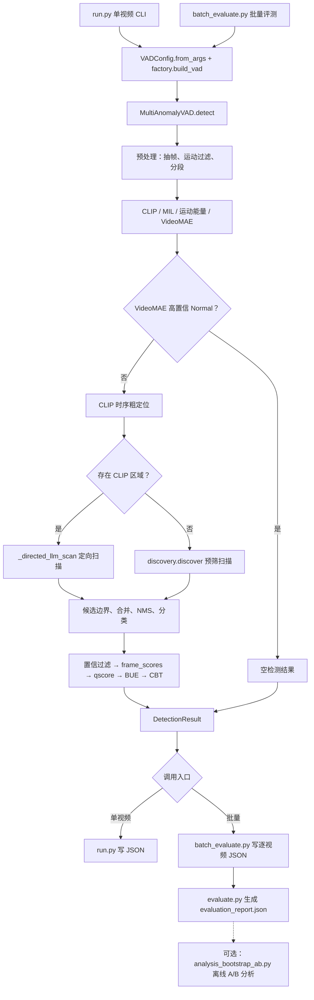
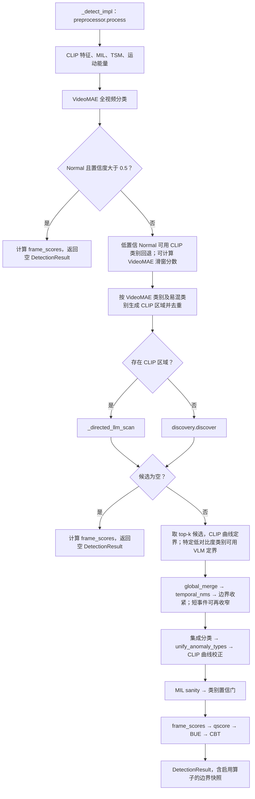
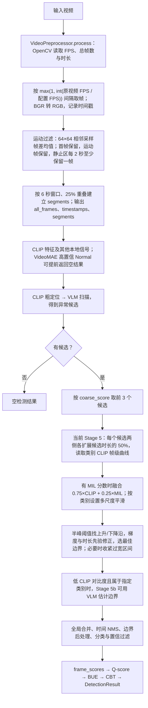
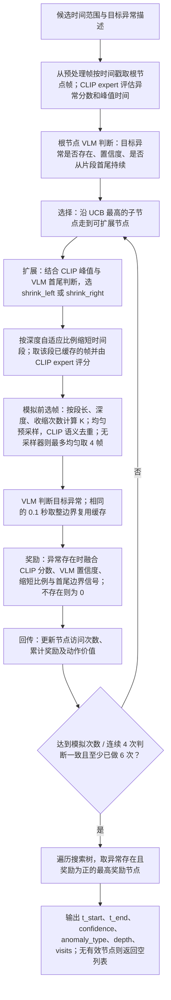
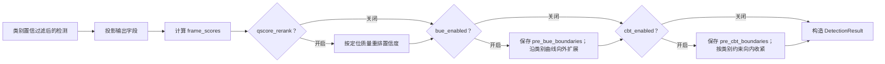
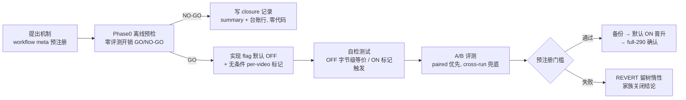

# 视频异常时序定位系统 — 项目全景文档

> 版本基线：committed pipeline = **v137 + Q-Score + BUE + CBT + CBT-recal（全部默认开启）**，full-290 mAP ≈ 0.173，hard-88（Shooting/RoadAccidents/Shoplifting/Explosion）mAP ≈ 0.118。
> 数据集：UCF-Crime（13 个异常类别 + Normal），评测在 `/Users/zzl/Movies/ucf-crime`（HuggingFace parquet 布局）。
> 本文档对应代码状态：分支 `v6-8.13-169`，2026-08-18。

---

## 目录

专项分析：[V2 单视频 CLIP 定位完整流程与 Q-score → BUE → CBT 实验证据](V2_CLIP_LOCALIZATION_ANALYSIS.md)（按当前源码核对，含抽帧、语义选帧、定界、后处理及实验口径限制）。

1. [项目目标与总体思路](#1-项目目标与总体思路)
2. [顶层目录结构](#2-顶层目录结构)
3. [端到端总流程](#3-端到端总流程)
4. [单视频流水线逐阶段详解](#4-单视频流水线逐阶段详解)
   - [Stage 5 边界判断：当前路径与历史 MCTS](#41-stage-5-边界判断当前路径与历史-mcts)
5. [后处理终端槽（deterministic post-VLM 算子链）](#5-后处理终端槽deterministic-post-vlm-算子链)
6. [逐文件作用说明](#6-逐文件作用说明)
7. [特性开关总表（config flags）](#7-特性开关总表config-flags)
8. [数据与评测协议](#8-数据与评测协议)
9. [迭代治理体系（workflow / FM 纪律 / 台账）](#9-迭代治理体系)

---

## 1. 项目目标与总体思路

**任务**：给定一段监控视频，输出其中异常事件的**时序区间** `[t_start, t_end]`、类别与置信度（temporal anomaly localization），评测指标为时序 mAP（IoU@0.3/0.5/0.7）。

**总体思路**（training-free 为主 + 少量本地监督小模型）：

- **不训练主干模型**。以 CLIP（ViT-L-14, open_clip）做帧级语义特征，以商用 VLM（阿里 DashScope 的 qwen-vl 系列）做片段级异常判读，两者互补：CLIP 负责"便宜的全程曲线"，VLM 负责"贵但准的片段判断"。
- **本地小模型做辅助信号**：MIL snippet 打分器（自训，`model_mil.pth`）、VideoMAE UCF-Crime 14 类分类器（HF 现成权重）、运动能量（帧差）、以及最新加入的 SNH 视频级 P(normal) 逻辑回归头（`model_snh.json`）。
- **所有后处理都是确定性算子**：VLM 调用全部完成后，候选区间经过一条固定的算子链（qscore → CGR → CCR → BUE → CBT → CNV → SNH……）逐步变换，每个算子由独立 flag 门控、默认关闭时可证明字节级无影响。
- **研究方式**：每个改进以"版本号 vNNN + 机制缩写"为单位，先离线预检（零评测开销的 GO/NO-GO 门），再实现 flag（默认 OFF），再 A/B 评测（paired bootstrap），过预注册门槛才晋升默认开启，全程留台账。

---

## 2. 顶层目录结构

```
/Users/zzl/PycharmProjects/vad/
├── video_anomaly_detection/     # ★ 主包（全部流水线代码 + 训练脚本 + 模型产物）
│   ├── pipeline.py              # 主编排器（5308 行，见 §4/§5）
│   ├── anomaly_discovery.py     # VLM 扫描/发现层（directed scan + FCCS）
│   ├── config.py                # VADConfig 单一事实源（5 组子配置 + 全部 flag）
│   ├── run.py                   # 单视频 CLI 入口
│   ├── batch_evaluate.py        # 批量评测 harness（UCF-Crime）
│   ├── evaluate.py              # 四级指标（frame AUC / temporal mAP / video-level / category acc）
│   ├── models.py                # 类型化 I/O 契约（Segment/AnomalySegment/DetectionResult/VideoData）
│   ├── factory.py               # build_vad() 依赖装配
│   ├── llm_protocol.py          # LLMClient Protocol（可 mock 的抽象）
│   ├── llm_client.py            # DashScope OpenAI 兼容客户端（重试/计费计数）
│   ├── video_preprocessor.py    # 抽帧 + 运动过滤 + 6s 段网格
│   ├── frame_scorer.py          # CLIP 类别曲线 + 融合 frame_scores
│   ├── anomaly_expert.py        # CLIP 封装：13 类×6 prompt 表 + 学习权重融合
│   ├── mil_model.py             # MILAnomalyScorer 网络 + 两套损失
│   ├── mil_inference.py         # 独立 MIL 推理 CLI（非主流水线路径）
│   ├── videomae_classifier.py   # VideoMAE 14 类分类器封装
│   ├── temporal_mcts.py         # DyFo 式时序边界 MCTS（遗留，已不被调用）
│   ├── token_compressor.py      # SemanticFrameSampler（CLIP 余弦聚类选代表帧）
│   ├── post_processor.py        # 纯函数：global_merge / NMS / narrow_short_events
│   ├── snh_features.py          # SNH 16 维特征（train/eval 共用，防 skew）
│   ├── extract_features.py      # 离线 CLIP 特征导出（MIL 训练用 .npy）
│   ├── train_mil.py             # → model_mil.pth
│   ├── train_mil_v6.py          # → model_mil_v6.pth（抗坍缩损失）
│   ├── train_prompt_weights.py  # → prompt_weights.json
│   ├── model_mil.pth / model_mil_v6.pth   # MIL 权重产物
│   ├── model_snh.json           # SNH 逻辑回归头（权重/tau/scaler）
│   ├── prompt_weights.json      # 13 类×6 prompt 学习权重
│   ├── vad_logger.py            # 统一日志
│   ├── tests/                   # pytest 单元测试（mock，不依赖 CLIP/API）
│   ├── iteration_logs/          # ★ 研究档案：summary_v*.md、session_v97_ledger.md、分析脚本
│   └── results/                 # 包内结果目录（少量）
├── results/                     # ★ 全部评测产物：batch_eval_vNN[_xxx]/ + 同名 .log
├── features/                    # MIL 训练用缓存特征 train/(1610) test/(290) .npy
├── vad_data/                    # 研究资料（论文 pdf/md、开题报告等；非数据集）
├── DR-MCTS/  DyFo_CVPR2025/  LLaVA-Scissor/   # 外部参考仓库（设计借鉴来源）
├── academic-research-skills*/   # 与本项目无关的写作技能插件目录
├── run_v27.sh / run_v50.sh / run_v142.sh / run_mil_v6_train.sh  # 历史启动脚本
└── .qoder/workflows/            # vad-team-map20-vNN.js 迭代编排 workflow
```

数据集本体不在仓库内：`/Users/zzl/Movies/ucf-crime`，采用 HF parquet 布局（`data/test-*.parquet`，列含 `video_path, category, annotation_start/end1/2`）。

---

## 3. 端到端总流程



**一句话版本**：视频 → 抽帧与本地信号（CLIP/MIL/VideoMAE/运动）→ 高置信 Normal 早退或 VLM 扫描 → 候选定界、合并去重与分类 → qscore/BUE/CBT → 输出结果；批量入口随后评测，A/B 分析另行离线运行。

---

## 4. 单视频流水线逐阶段详解

入口：`MultiAnomalyVAD.detect(video_path, context)`（`pipeline.py:1711`）——它只是一个 `[COST]` 计数包装（快照 `llm_client.call_count` 与 `clip_call_count`），真正逻辑在 `_detect_impl`（`pipeline.py:1749`）。



关键点：

- **[COST] 计量**：每视频一行 `[COST] video=… vlm_calls=… clip_calls=… elapsed_s=…`，恒定开启，是延迟优化的漂移免疫度量。
- **扫描分支**：有 CLIP 区域时 `_directed_llm_scan` 定向扫描；没有区域时 `discovery.discover` 从分段网格预筛候选。当前代码没有 FCCS 全覆盖分支。
- **早退路径**：VideoMAE 高置信判 Normal，或扫描后没有候选时，计算 `frame_scores` 后直接返回空检测；CBT 开启时记录空检测标记。
- **paired 快照**：`DetectionResult` 在对应算子开启时携带 `pre_bue_boundaries` 和 `pre_cbt_boundaries`，供离线重建 flag-OFF 对照臂。

### 4.1 Stage 5 边界判断：当前路径与历史 MCTS

后续融合设计见 [v2 融合 MCTS 的实施设计](MCTS_FUSION_DESIGN.md)：包含文件修改清单、Stage 5 接入、动作/奖励/抽帧适配、回退及评测方案；该文档描述待实现方案。

**版本区分**：当前 `pipeline.py` 的 Stage 5 调用 `_clip_boundary_detection()`，从 v50 起不再调用 `TemporalBoundaryMCTS.search()`。`temporal_mcts.py`、MCTS 配置及 CLI 参数仍保留；下面第二张图说明这段历史实现的算法流程，不能当作当前运行路径。



默认抽帧目标为 2 FPS，但代码通过整数帧间隔采样，实际采样率取决于原视频 FPS。`get_segment_frames()` 按时间戳选择 `[t_start, t_end)` 内的已保留帧；若该范围没有帧，则取最接近中点的一帧。边界判断使用这些帧的时间戳，不会重新从原视频解码。

历史 MCTS 若被单独调用，对**每个候选**分别执行以下搜索：



历史实现中，收缩比例为 `0.4 / (1 + 0.3 × depth)`，收缩后区间须长于 0.5 秒。`SemanticFrameSampler` 的目标帧数随段长和收缩次数变化，并以 CLIP 相似度做语义去重；这是向 VLM 送图的二次选帧，区别于最开始的视频抽帧。`TemporalBoundaryMCTS` 类内默认 12 次模拟、最大深度 5；当前配置文件中虽有模拟次数 12、最大深度 4 等字段，但主流水线不会据此启动 MCTS。

---

## 5. 后处理终端槽（deterministic post-VLM 算子链）

候选经过分类、MIL sanity 和类别置信过滤后，按下图顺序执行 `pipeline.py` 中的后处理；当前代码实现的终端开关为 qscore、BUE 和 CBT，三者默认开启。



**顺序依据**：先固定候选数量并计算 `frame_scores`，再由 qscore 调整置信度；BUE 记录原边界并向外扩展，CBT 随后记录 BUE 后的边界并按类别向内收紧。当前代码没有 CGR、CCR、CNV、SNH 等终端调用。

---

## 6. 逐文件作用说明

### 6.1 核心流水线

| 文件 | 行数 | 作用 |
|---|---|---|
| `pipeline.py` | 5308 | 主编排器 `MultiAnomalyVAD`。串起全部阶段（§4）与终端算子链（§5）；包含 `_qscore_rerank`(L1436)、`_bue_boundary_union_extension`(L1489)、`_cbt_category_boundary_tighten`(L3059)、`_cgr_motion_relocate`(L3748)、`_ccr_curve_relocate`(L3843)、`_cnv_cascade_null_veto`(L3309)、`_snh_veto`(L3561)/`_snh_p_normal`(L3457)/`_snh_load_model`(L1187)、`_cgr_ab_arm_off_replay`(L2483) 等全部机制实现 |
| `anomaly_discovery.py` | 844 | VLM 扫描层。`scan_segment`(L418) 绝对整段 prompt；`_comparative_call`(L260) 批内多段相对比较（FCCS）；`scan_full_coverage`(L741) 全覆盖扫描（8 段×2 帧/批，长视频 16×1）；`discover`(L576) directed 兜底（CLIP 预筛 ≤`max_scan_segments`=6，FSD 在 L644 劈半）；KFD-U 均匀散布选帧（`_kfd_spread_select` L165）替代 first-k 截断（L317）；TCP prompt 块（L31-34）；`probe_continuation`(L477) CEX 延续投票；`fsd_split_segment`(L51) 3s 半段 |
| `run.py` | 384 | 单视频 CLI：构建 DashScope 客户端 → `VADConfig.from_args` → `build_vad` → `detect` → 写 JSON。所有 flag 均有 `--no_*` 反向开关 |
| `batch_evaluate.py` | 487 | 批量评测 harness"v5: dual-VLM"。从 HF parquet 选样（`random_state=42`，`--max_per_category`/`--categories` 过滤），单进程内 `asyncio.gather`+Semaphore 并发（纪律：≤2），逐视频 JSON（含 `frame_scores`），汇总写 `evaluation_report.json`。已存在 JSON 则跳过（廉价续跑）。全部版本 flag 透传 |
| `config.py` | 509 | **单一事实源** `VADConfig`（L330）= Preprocess(fps=2, 6s 段, 25% 重叠, 运动阈值 1.0/间隔 2s) + CLIP(ViT-L-14/openai) + MCTS(遗留参数) + Scoring(权重与全部机制 flag) + Discovery(clip_threshold=0.3, max_scan=6, candidate_top_k=3, FCCS/KFD/TCP/FSD)。`from_args`(L371) 显式逐 flag 穿线（历史 FM5 激活失败的根因修复） |
| `models.py` | 259 | **类型化 I/O 契约**（非 ML 模型）：`Segment`、`AnomalySegment`、`DetectionResult`（含全部 paired 快照字段）、`VideoData`（dict 子类，键含 all_frames/timestamps/segments/clip_features/motion_energy/mil_scores/cat_scores_*） |
| `factory.py` | 48 | `build_vad(config, detect_client, classify_client)` 依赖装配；classify 缺省回落 detect 客户端 |
| `llm_protocol.py` | 46 | `LLMClient` Protocol（`async generate(prompt, images, …)`），流水线与供应商解耦，测试可 mock |
| `llm_client.py` | 133 | `DashScopeLLMClient`：OpenAI 兼容模式接阿里云 DashScope（qwen-vl-plus/qwen3-vl-plus/qwen-vl-max）；帧→JPEG(q80)→base64 data-URI；仅 429 指数退避重试（5 次）；`call_count` 供 [COST]；temperature=0 保可复现；密钥只读 `DASHSCOPE_API_KEY` |
| `vad_logger.py` | 52 | "vad" 根 logger（stdout+可选文件），子 logger 安全获取 |

### 6.2 信号与模型

| 文件 | 作用 |
|---|---|
| `video_preprocessor.py` | `VideoPreprocessor.process()`(L47)：cv2 按 fps=2 抽帧 BGR→RGB；运动过滤（64×64 帧差均值 <1.0 的静止帧每 2s 才保留 1 帧，L80）；按 25% 重叠切 6s 段网格（L104） |
| `frame_scorer.py` | `FrameScorer.get_category_scores`(L41)：logits = 帧特征 @ 文本特征ᵀ × clamp(exp(logit_scale),≤100)，14 列 softmax，返回 cat/(cat+normal) 逐帧类别曲线（按视频+类别缓存）；`compute_frame_scores`(L63)：0.35·CLIP + 0.15·VideoMAE 滑窗 + 0.10·归一运动 + 检测置信覆盖 + 高斯平滑(σ=1.5×fps)；`clip_score_curve_correction`(L120)：半峰只收缩边界 |
| `anomaly_expert.py` | CLIP 封装。`CATEGORY_PROMPTS`(L64)：13 类 × 6 条手写监控风格 prompt + 6 条 Normal；`_precompute_text_features`(L180)：逐 prompt L2 归一后按 **prompt_weights.json 学习权重**融合为 (14,768) 文本特征（权重数≠prompt 数时自动回落均匀平均——v181 PTE 预检正是利用此回落）；另有 `precompute_video_features`、`get_category_distribution`、`batch_score_segments` |
| `mil_model.py` | `MILAnomalyScorer`(L39)：(B,32,768)→(B,32) snippet 异常分；空洞时序卷积块 + 自注意力 + top-k=3 特征幅值 MIL 聚合；`MILLoss`(RTFM 式) 与 `MILLossV6`（加 range/variance hinge 抗坍缩） |
| `train_mil.py` / `train_mil_v6.py` | 分别产出 `model_mil.pth` / `model_mil_v6.pth`（同架构不同损失）。**流水线只加载 `model_mil.pth`**（pipeline.py:1418） |
| `mil_inference.py` | 独立 MIL 推理 CLI（非主流水线路径） |
| `videomae_classifier.py` | 封装 `OPear/videomae-large-finetuned-UCF-Crime`（14 类）。用于：全视频类别（5-crop TTA）、滑窗 Normal 概率信号、逐段重分类 |
| `temporal_mcts.py` | DyFo 式时序边界 MCTS（shrink_left/right 动作 + CLIP 引导）。**遗留代码**：pipeline 有 import 但零调用点，v50 起被 CLIP 边界检测取代 |
| `token_compressor.py` | `SemanticFrameSampler`：按动态 K 抽样后做 CLIP 余弦贪心聚类（τ=0.90），每簇取最有代表性帧；供扫描与 MCTS 共用 |
| `post_processor.py` | 纯函数：`global_merge`（IoU 0.3 / 同类 gap 2s）、`unify_anomaly_types`（置信×时长投票）、`narrow_short_events`（>15s 段向运动峰收窄，60% 下限）、`temporal_nms` |
| `snh_features.py` | `compute_snh_features`(L67)：16 维视频级特征 = MIL 统计 5 维（max/top3/top8 均值/std/>0.5 比例）+ top-1 类别曲线 4 维（maxz/上分位突出度/均值/std）+ 全 13 类 max-of-maxz 1 维 + Normal 曲线 3 维 + 运动 3 维；全部按视频自身 median/MAD×1.4826 做 z 化。train/eval 共用以防分布偏移 |
| `extract_features.py` | 离线导出：每视频 32 个均匀 snippet 的中间帧 CLIP 特征 → (32,768).npy（`features/train|test/`，MIL 训练输入） |

### 6.3 模型产物（非代码）

| 文件 | 内容 |
|---|---|
| `model_mil.pth` | `MILAnomalyScorer` 权重（train_mil.py，MILLoss）。流水线推理：CLIP 帧特征 mean-pool 成 32 snippet → 一次前向 → `mil_scores`，供 MIL sanity 门 / CNV / SNH 使用 |
| `model_mil_v6.pth` | 同架构 v6 损失版本（抗坍缩）。目前仅研究用 |
| `model_snh.json` | SNH 逻辑回归头：feature_order(16)、scaler_mean/scale、16 权重、bias −0.473、**tau=0.7894**、clip ±50；训练集 CV AUC 0.996（v176） |
| `prompt_weights.json` | 13 类 × 6 条 prompt 的学习融合权重（train_prompt_weights.py，v93，train 视频级标签训练） |

### 6.4 评估与研究工具

| 文件 | 作用 |
|---|---|
| `evaluate.py` | 四级指标 + CLI。**GT 加载**自动识别 parquet/legacy 文本（-1 表空段；Normal 零段）。L1 帧级 AUC/AUPR（30fps GT 帧号）；L2 **时序 mAP：IoU 阈值 [0.3,0.5,0.7]**，全局按置信度排序 + 逐视频贪心最佳 IoU 匹配 + 11 点 AP；L3 视频级检测指标准确率/P/R/F1/AUC；L4 类别准确率 |
| `iteration_logs/analysis_bootstrap_ab.py` | ★ 标准裁决统计（v141 起）：视频级匹配 bootstrap A/B，输出 point_delta/CI90/P(Δ>0)。三种模式：cross-run `--new/--ref`（±0.019 VLM 方差告警）；`--paired-log --marker X --paired-mode conf|window`（从日志标记行精确重建 flag-OFF 臂，零 VLM 噪声）；`--paired-json FIELD`（从 JSON 快照字段重建） |
| `iteration_logs/analysis_v19_snh_featextract.py` / `..._train.py` | SNH 训练侧：train 集特征离线抽取（pipeline 级精确复现 CLIP/MIL/运动）→ 训练 `model_snh.json` |
| `iteration_logs/analysis_v180_snhp_precheck.py` | v180 SNH-P 离线预检（MIL argmax 覆盖 92 次 firing → NO-GO） |
| `iteration_logs/analysis_v181_pte_precheck.py` | v181 PTE 离线预检（train 集 GT 窗口曲线突出度 → NO-GO） |
| `iteration_logs/analysis_v18_pwtc_precheck.py` | v18 prompt-weight 曲线预检（"v18 recipe" 的出处） |
| `iteration_logs/analysis_v142_*` 家族 | BUE 的边界几何/覆盖率/bootstrap 系列裁决脚本 |
| `iteration_logs/analysis_v164_cbt290_offline.py` 等 | CBT @290 离线重建裁决 |
| `iteration_logs/session_v97_ledger.md` | ★ 版本台账：每 loop 一行（loop/version/title/mAP/AP@0.5/0.7/延迟/kept + 稠密裁决理由） |
| `iteration_logs/summary_vNN_*.md` | ★ 每轮迭代总结（机制、门控、数字、FM 证据、家族开闭结论），v145→v181 |
| `tests/` | pytest（mock，无需 CLIP/API）：config 默认值与 from_args、models 序列化契约、post_processor 纯函数、token_compressor 帧数数学、frame_scorer 守卫、EUBC 合成曲线不变量 |

### 6.5 根目录其它

| 条目 | 作用 |
|---|---|
| `run_v27.sh` / `run_v50.sh` / `run_v142.sh` | 历史评测启动脚本（v142 起固定 harness、并发 2、可续跑） |
| `run_mil_v6_train.sh` | MIL v6 训练启动（MPS） |
| `v27_plan.md` | v27 时代迭代计划 |
| `features/` | MIL 训练缓存特征：train/1610 + test/290 个 (32,768) .npy |
| `results/` | 每次评测一个 `batch_eval_<版本>_<harness>/`（逐视频 JSON + evaluation_report.json）+ 同名顶层 `.log`；是本仓库全部结论的原始证据 |
| `vad_data/` | 研究资料（论文、MCTS 笔记、开题报告）；**不是数据集** |
| `DR-MCTS/` `DyFo_CVPR2025/` `LLaVA-Scissor/` | 外部参考仓库：分别是 MCTS 离策评估、DyFo（本流水线 MCTS 设计的灵感来源，CVPR2025）、视频 LLM token 压缩 |
| `academic-research-skills*/` | 与本项目无关的学术写作技能插件 |
| `.qoder/workflows/vad-team-map20-vNN.js` | 迭代编排 workflow（见 §9） |

---

## 7. 特性开关总表（config flags）

 committed = **默认 ON**；其余全部默认 OFF 且保持 OFF（字节级无影响的失败机制留在树中作惰性代码）。

| Flag | 版本 | 默认 | 机制一句话 | 状态 |
|---|---|---|---|---|
| `qscore_rerank` | v111/v124 | **ON** | frame_scores 上的 Q=边界锐度/峰值对比/中心拟合重排置信度 | committed |
| `bue_enabled` | v142 | **ON** | 沿类别曲线把边界向外生长到内外对比度极值（并集式、有上限） | committed |
| `cbt_enabled` + `cbt_recal` | v155/v160 | **ON** | BUE 后向峰值锚点内收；recal 用逐类 GT-p75 上限（RA 4.5s 等） | committed（hard-88 主战力） |
| `classify_skip_class_agnostic` | v137 | **ON** | 类别明确时跳过 qwen3-vl-plus 分类调用 | committed（省延迟） |
| `full_coverage_comparative_scan` | v97 | OFF | FCCS 全覆盖比较扫描 | 已测量关闭 |
| `event_unit_boundary_contraction` (EUBC) | v100 | OFF | 事件单元边界收缩 | 未激活即弃 |
| `event_continuation_extension` (ECE) | v105 | OFF | 事件延续扩展 | 关闭 |
| `cex_extend` | v141 | OFF | 延续探测扩展 | 关闭 |
| `cgr_enabled` / `ccr_enabled` / `cgr_ab_diag` | v167-169 | OFF | 运动峰/曲线候选重定位 | **v16 精确配对证伪，家族关闭** |
| `cnv_veto` | v172 | OFF | 级联零假设视频级否决 | v17 关闭（伤 GT） |
| `snh_veto` (+`snh_protect`) | v179/v180 | OFF | 监督 P(normal)≥tau 全视频否决 | v21 关闭于 G4；v180 保护规则离线 NO-GO，**视频级否决家族双侧关闭** |
| `kfd_uniform_keyframes` | v173 | OFF | 批内关键帧均匀散布 | v18 关闭 |
| `tcp_prompt` | v177 | OFF | 时序对比 prompt | v20 关闭（prompt 不可引导该 VLM） |
| `pte_curves` | v181 | 未实现 | 类别曲线 prompt 集成 | **离线 NO-GO，零代码** |
| `fsd_cats` | v182 | OFF | Shoplifting/RoadAccidents 3s 细扫 | 实现+自检完成，A/B 因机器 ID 事故中断待续 |

历史黑名单（10 个禁止家族，见各 workflow meta）：曲线内重排 / VLM 合并批 / scan-tail / 逐视频归一化 / dense-append / 本地算力修剪 / boundary-growth(=BUE 本身) / scan_segment 绝对置信门 / Normal-FP-for-mAP / 32-snippet 上的 MIL 重定位。

---

## 8. 数据与评测协议

### 8.1 数据

- **数据集**：UCF-Crime，`/Users/zzl/Movies/ucf-crime`，HF parquet 布局；GT 为 30fps 帧号区间（`annotation_start/end1/2`，-1 表空段），Normal 视频零段。
- **训练资产**：`features/train`(1610) 与 `features/test`(290) 的 (32,768) CLIP 特征用于 MIL/SNH；`prompt_weights.json` 用 train 视频级标签。
- **已知分布内警告**：`model_mil.pth` 与 SNH 都在同一 train split 上训练，其 train 集指标（如 SNH CV AUC 0.996）对 test 的迁移需实测（v21 已确认迁移成立：Normal 0.993 vs Arson 0.002）。

### 8.2 评测 harness

| Harness | 构成 | 用途 |
|---|---|---|
| full-290 | `--max_per_category 999`，无 `--categories` | 晋升判据（绝对 mAP 地板 0.16454） |
| hard-88 | `--categories Shooting,RoadAccidents,Shoplifting,Explosion`（88 视频） | 机制迭代的敏感测试床（基线 0.11806） |
| smoke | 每类 1-2 个视频 | 自检测试（标记计数、字节级 OFF 等价） |

- 评测一律 `batch_evaluate.py`，并发 2（16GB 内存 swap 抖动教训），`evaluation_report.json` + 逐视频 JSON + 顶层同名 `.log` 三件套。
- 指标：时序 mAP@[0.3,0.5,0.7] 为主；辅以 frame AUC、视频级指标、Normal 视频误报率（FA rate）。

### 8.3 统计裁决

- **paired-log**（首选，零 VLM 噪声）：机制以"conf 0.4→0.0 但检测保留"的可逆标记写日志，`--paired-log --marker X --paired-mode conf` 精确重建 OFF 臂。
- **paired-json**：JSON 内快照字段（`pre_bue_boundaries` 等）索引对齐重建。
- **cross-run**：机制改变 VLM 输入时无法配对，只能新鲜 REF 对照，预注册 ±0.019 VLM 方差告警。
- 门槛示例（FA 目标）：paired ΔmAP ≥ −0.003 ∧ abs ≥ 0.16454 ∧ Normal FA 相对降 ≥ 25% ∧ GT 误伤 ≤ 1。

#### 8.3.1 噪声地板（实测，非估计）

跨-run 裁决的不可用性有硬证据。**同一份 flag 串逐字相同**的两次 hard-88 运行：

| 运行 | 配置 | mAP |
|---|---|---:|
| `batch_eval_v167_full` | BUE+CBT+recal+CGR | 0.12246 |
| `batch_eval_v169_ab88` | 同上（+纯诊断开关） | 0.09743 |
| | **同配置跨-run 离散度** | **0.02503** |

这比检出目标（+0.008）大 3 倍。推论：**任何以小于约 0.02 的跨-run delta 得出的 REVERT 结论，等于从未测试过该机制**。这是 §8.3 把 paired 列为首选、并在 FM 纪律中规定"paired 字段未落盘则 loop 作废、不得降级为 cross-run"的实测依据。290 尺度噪声较小（预注册 ±0.019 告警），但仍与多数候选效应同阶。

#### 8.3.2 双臂（dual-arm）仪表 —— 精确配对，零 VLM 噪声

v16 建立的最强裁决工具，代码以 `cgr_ab_diag` 形式留在树内（默认 OFF），**对任何未来的终端槽算子可复用**。

**为什么成立**：§5 的算子链全部位于所有 VLM 调用**下游**，只读缓存的 motion energy 与 CLIP 类别曲线 → 是确定性后处理。因此两臂可在**同一次评测内**同时算出：

- **arm-OFF** = 对进入该算子前的检测快照，回放其余算子链（即已提交流水线的产出）
- **arm-ON** = 正常路径（该次 run 的真实输出）

同样的视频、同样的 VLM 采样、同样的检测条数 → 两臂只差**一次函数调用**，正确性由构造保证，跨-run 噪声被完全消除。产物写入索引对齐字段（`ab_arm_off_boundaries`，必要时并写 arm-OFF confidence），直接交给现成工具：

```bash
python3.14 iteration_logs/analysis_bootstrap_ab.py \
  --new results/<dir> --paired-json ab_arm_off_boundaries --min-delta 0.008 --min-p 0.90
```

**适用性判据（关键）**：算子必须在 VLM 之后且确定性。已核实：

| 机制 | VLM 调用 | 双臂可用 |
|---|---|---|
| ECE / EUBC / CBT / BUE / qscore / CNV / SNH | 0 | ✅ |
| CEX | 有（二元"事件是否延续"探测） | ❌ 两臂需不同 VLM 调用 |
| FSD | 有（改 scan 网格，位于 VLM 上游） | ❌ |

**实现陷阱（会静默出错）**：`_cgr_motion_relocate` / `_bue_boundary_union_extension` / `_cbt_category_boundary_tighten` 均**就地修改** `a['t_start']` / `a['t_end']`。若两臂共用同一批 dict，会互相污染，**且数字看起来仍然合理**。必须在每臂前 `copy.deepcopy`，并在自检中证明两臂独立（该算子 fire=0 的视频两臂必须逐位相同；fire=1 的必须不同）。

**对置信度否决类算子（CNV/SNH）的额外注意**：它们改 confidence 而不改边界，因此仅比较 `ab_arm_off_boundaries` 会得到**恒为 0 的假空值**——必须并写并比较 arm-OFF confidence。

### 8.4 运行完整性 —— 失败视频会静默抬高 mAP（v26 实测暴露）

**`evaluation_report.json` 不携带覆盖完整性信息，而失败视频会把 mAP 抬高。** 引用任何 290 数字前必须先验 `timing.failed == 0`。

机制：`compute_temporal_map` 遍历传入的全部 GT，缺失预测经 `pred.get(video_id)` 返回 `None` 后其 GT 段本应计为漏检；但 `evaluate()` 传入的 GT 已被限制到**有预测文件的视频**，于是失败视频**连同其 GT 一起从分母消失**。失败若集中在难类别，抬高尤为剧烈。

v26 实测（24/290 失败，集中于 19 Shoplifting + 5 Shooting）：

| 口径 | mAP |
|---|---:|
| 报告值 / 仅按已产出视频计分 | **0.17673**（偏高，不可引用） |
| 按完整 290 GT 计分（失败=漏检） | **0.16052**（真实值下界） |
| **补齐 24 个缺口后的真值（290/290，0 失败）** | **0.16682** |

**这组数字是本陷阱的完整实证**：真值 0.16682 落在补齐前的区间 [0.16052, 0.17673] 内；被抬高的报告值比真值高 **+0.00991**。若当初直读 0.17673 与权威基线 0.17254 比较，会得到 **+0.0042 的「提升」，而真实结果是 −0.0057——方向相反**。同一份预测两个口径相差 0.0162，比历史上任何单个已确认增益都大。

补齐仅耗 17.9min（24 视频 / 89.5s 每视频 / 并发 2），且 24 个原 `Connection error` 视频**全部一次通过**——失败是瞬时接口问题，不是视频不可处理。因此遇到 `failed > 0` 时正确动作永远是**续跑**，而不是接受当前报告。

**核查方法**（任何 290 对比前执行）：

```python
import sys; sys.path.insert(0, 'video_anomaly_detection')
import evaluate
gt   = evaluate.load_ground_truth('/Users/zzl/Movies/ucf-crime/data', split='test')
pred = evaluate.load_predictions('results/<dir>')
missing = [k for k, v in gt.items() if v.get('segments') and k not in pred]
print('missing anomaly videos:', len(missing))
print('vs FULL GT :', evaluate.compute_temporal_map(gt, pred, iou_thresholds=[.3,.5,.7])['mAP'])
```

**续跑语义**：`process_one_video` 对已存在的逐视频 JSON 直接 SKIP，因此对同一 `--output_dir` 重跑只补缺口，不重算已完成视频（24 个缺口约 45min）。补齐后 `evaluation_report.json` 以 290/290 重写，方可比较。

**建议的硬门（尚未实施）**：在 `batch_evaluate.py` 增加与既有 `[ECE-GATE]` 同形的检查——`failed > 0` 时拒绝写 `evaluation_report.json`，或写入 `coverage_complete: false`。该改动触及评测器，按治理规则需单独预注册。

**观测到的失败模式**：DashScope `Connection error`，v26 中 8.3%（24/290）。失败在类别上**非均匀**（Shoplifting 21 个里失败 19 个），因此失败不是随机缺失，不能假设其对 mAP 的影响可忽略。

### 8.5 权威基线登记表（引用数字请只用本表）

| 运行目录 | 配置 | succ/fail | 缺失异常视频 | 可引用 mAP | 状态 |
|---|---|---|---:|---:|---|
| `batch_eval_full290_bue` | BUE only | —/0 | 0 | **0.15114** | ✅ 完整 |
| `batch_eval_v160_full` | BUE+CBT+cbt_recal | 290/0 | 0 | **0.17254** | ✅ **权威 290 基线** |
| `batch_eval_v26_full290` | 同 v160（默认值裸跑） | 290/0 | 0 | **0.16682** | ✅ v160 的独立复现（Δ−0.0057，噪声内） |
| `batch_eval_v144c_bue65ref` | BUE only，65 视频 | —/— | — | 0.21932 | ✅ 65-harness REF |
| `batch_eval_v155_full` | +CBT，hard-88 | —/— | — | 0.09970 | ✅ hard-88 |
| `batch_eval_v169_ab88` | +CGR+双臂诊断，hard-88 | 88/0 | 0 | armON 0.09743 / armOFF 0.10231 | ✅ 精确配对 |

hard-88 基线 0.11806（v160-recal 估计）与 full-290 地板 0.16454 为晋升门槛所引用的值。

### 8.6 运行时画像（v26 实测，并发 2 / 16GB）

| 项 | 值 |
|---|---|
| full-290 墙钟 | 8.49h |
| 单视频均时 | 229.36s |
| 最慢 5 例 | **全部为 Normal 视频**；峰值 `Normal_Videos_210_x264` 2115.2s（180s 视频） |
| 接口失败率 | 8.3% |

延迟与视频时长**不成正比**（2115s 处理耗时对应 180s 视频，而 3600s 的 `Normal_Videos_935` 只用 1907.8s），说明瓶颈在 VLM 往返次数与重试，而非解码量。据此估算：full-290 约 8–9h，hard-88 约 2–4h，规划评测排期请以此为准；并发固定 2（16GB 机器 swap 抖动教训，见 §8.2）。

---

## 9. 迭代治理体系



**FM 纪律**（历次事故沉淀）：FM2 计数冻结（机制不得改变检测条数，除非显式设计）；FM5 标记必须实际触发；FM17 per-video 标记无条件出现（含早退路径）；FM18 必须报绝对 mAP；FM20 数字必须有 grep 证据；FM21 标记字符串精确匹配；paired 字段未落盘则该 loop 作废（不得降级为噪声 cross-run 裁决）。

**workflow 编排**：`.qoder/workflows/vad-team-map20-vNN.js` 把上述协议写成可执行 JS（agent 阶段编排、structured-output schema、launcher+watcher 模式避免 180s 停滞看门狗、永不并发两个评测、永不修改 evaluate.py 与 analysis_bootstrap_ab.py）。

**版本现状**（截至 2026-08-24，台账 89 行）：

- v180 SNH-P、v181 PTE：离线 NO-GO（零评测开销的诚实关闭）。
- v182 FSD：实现与自检完成、REF88 对照已跑完；FSD88 臂与 bootstrap 裁决因运行时机器 ID 事故中断，可按既有断点续跑。
- **v183–v200：连续 18 个版本零晋升。** v183–v195 多为 research/precheck NO-GO（v25 closure：视频级标签无法验证候选局部质量；缺少独立的 train 局部化监督与可审计的零测试重叠门）；v196–v200（VLC / DSV / MCS / FDS / SVA）均已实测且 `kept=false`，其中 v196/v197/v200 走的是 paired 裁决——纪律正确，但结论为负。
- v26 REF290：committed 基线复现，**24/290 失败导致 INCONCLUSIVE**，详见 §8.4 与 `iteration_logs/summary_v26_full290-ref_20260824.md`。

**当前可引用的已提交成果**：v137 + qscore + BUE + CBT + cbt_recal，权威 full-290 = **0.17254**（`batch_eval_v160_full`，290/0 失败）。

**对下一步的含义**：连续 18 版零晋升，且失败原因已从"机制无效"转为"**缺少可审计的局部化监督来验证任何学习式定位器**"。因此优先级建议是先做**零-API 的 oracle 上界分解**（按 FM13"先定上界"），量化候选生成 / 边界 / 置信度排序三层各自还剩多少 headroom，再决定是否投入评测算力——而不是继续产出第 19 个候选机制。另一条低成本高价值路径：用 §8.3.2 双臂仪表**重裁决那些当年以次于噪声地板的跨-run delta 被 REVERT 的既有机制**（ECE / EUBC / CNV / SNH 均已核实为双臂可用且代码在树内），可能从现有代码里直接捞回一个真实增益，无需新点子。
