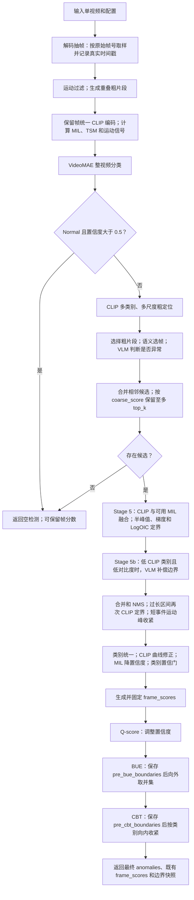

# V2 单视频 CLIP 异常定位：代码流程与 Q-score → BUE → CBT 效果分析

> 分析日期：2026-10-14。范围：本目录实际源码，重点是 `video_anomaly_detection/pipeline.py` 的 `_detect_impl` 调用链，以及 `iteration_logs` 中已经完成的实验记录。目录名包含 169，但代码头部已有 v208 清理说明，不能把所有历史实验开关当作当前运行路径。
>
> 本文是静态代码分析与历史评测证据核对，未重新运行模型、调用 VLM 或复现全量评测。代码行号用于定位，后续编辑可能使其变化。文中的指标增益均标明比较口径。

## 1. 先明确“CLIP 替代 MCTS”替代了什么

V2 用 **CLIP 类别分数曲线上的多尺度阈值定界与对比度搜索**，替代 Stage 5 中反复执行“选择—扩展—模拟—回传”的 MCTS。当前主调用在 [pipeline.py](video_anomaly_detection/pipeline.py) 第 850 行：

```python
all_anomalies = self._clip_boundary_detection(
    candidates, video_data, videomae_category)
```

这不意味着整个系统仅使用 CLIP。实际仍有 VideoMAE 视频分类、MIL 辅助分数、VLM 候选确认、部分类别的 VLM 边界补偿和多次后处理。`temporal_mcts.py` 的存在以及兼容性的 MCTS 配置字段，不代表正常单视频路径执行 MCTS。

最终定位也不只由 Stage 5 决定：合并后收紧、运动峰收紧、曲线修正、BUE、CBT 都可能改变时间边界。末端三个算子的分工为：

| 算子 | 主要解决的问题 | 修改内容 | 不修改的内容 |
|---|---|---|---|
| Q-score | “有异常”的高置信度不等于“定位准确”的高置信度 | 检测 `confidence`，从而影响评测排序 | 边界、检测数量、类别、已生成的帧分数 |
| BUE | 早期候选窗口或收缩步骤截掉异常前后部分 | 向外扩展时间区间 | 置信度、数量、类别、帧分数 |
| CBT，含 recal | 特定类别的检测窗口过宽，背景稀释时序 IoU | 向内收紧时间区间 | 置信度、数量、类别、帧分数 |

## 2. 实际端到端流程



### 2.1 代码导航

| 入口或职责 | 代码位置 |
|---|---|
| 单视频 CLI 和配置装配 | [run.py](video_anomaly_detection/run.py)，`main` 第 48 行；[config.py](video_anomaly_detection/config.py)，`VADConfig.from_args` |
| 主编排 | [pipeline.py](video_anomaly_detection/pipeline.py)，`detect` 第 642 行、`_detect_impl` 第 680 行 |
| 解码、抽帧、运动过滤、粗分段 | [video_preprocessor.py](video_anomaly_detection/video_preprocessor.py)，`process` 第 47 行 |
| CLIP 特征预计算 | [anomaly_expert.py](video_anomaly_detection/anomaly_expert.py)，`precompute_video_features` 第 237 行 |
| 语义选帧 | [token_compressor.py](video_anomaly_detection/token_compressor.py)，`compute_target_frames`、`select_keyframes` 第 78 行 |
| VLM 扫描与候选构建 | [anomaly_discovery.py](video_anomaly_detection/anomaly_discovery.py)，`scan_segment`、`discover`、`_merge_adjacent` |
| 粗定位、定向扫描、精定位 | [pipeline.py](video_anomaly_detection/pipeline.py)，第 1244、1411、1488 行 |
| 合并、NMS、短事件处理 | [post_processor.py](video_anomaly_detection/post_processor.py) |
| 类别曲线、输出帧分数、曲线收紧 | [frame_scorer.py](video_anomaly_detection/frame_scorer.py)，第 41、63、120 行 |
| Q-score / BUE / CBT | [pipeline.py](video_anomaly_detection/pipeline.py)，第 368、421、996 行；调用顺序第 953 行起 |
| 结果结构与评测 | [models.py](video_anomaly_detection/models.py)、[evaluate.py](video_anomaly_detection/evaluate.py)，时间段 mAP 第 308 行附近 |

### 2.2 配置基准：不要混淆两种采样率

`PreprocessConfig` 默认：解码采样 `fps=2`、粗片段 6 秒、重叠比例 0.25、运动阈值 1.0、静态区最低保留间隔 2 秒。`CLIPConfig` 默认模型 `ViT-L-14/openai`，关键帧目标采样率 `fps_sample=3.0`，`min_frames=3`、`max_frames=200`、语义去重阈值 0.90。

`fps` 控制从原视频提取多少帧；`fps_sample` 控制已经提取的片段帧中，最多选择多少关键帧发送给 VLM。后者不能补回前者丢失的帧。

**运行入口的默认值并不完全一致。** 当前 `run.py` 命令行默认 `fps=4`、`segment_duration=8.0`、`clip_model=ViT-B-32`、`fps_sample=2.0`，再传给 `VADConfig.from_args`。因此，“V2 一定 2 fps、6 秒、ViT-L-14”只适用于相应配置，不能直接套到所有单视频命令。复现实验应保存最终生效配置。

## 3. Stage 1：抽帧、过滤、分段和共享特征

### 3.1 从视频得到带真实时间戳的帧

`VideoPreprocessor.process` 的主要步骤：

1. 读取原视频帧率、总帧数，计算时长。
2. 计算 `sample_interval = max(1, int(video_fps / self.fps))`。
3. 原始帧号满足采样间隔时执行 `cap.read()`，其余帧执行 `cap.grab()`；保存帧从 BGR 转为 RGB。
4. 每张保存帧的时间戳为 `原始帧号 / video_fps`，而不是重新按目标 fps 编号。

由于整数取整，实际抽帧频率不一定恰好等于目标 fps。后续定位应以 `timestamps` 为准。

### 3.2 运动过滤发生在 CLIP 全帧编码之前

先把抽样图像缩小到 64×64，计算相邻抽样帧的平均绝对差。第一帧保留；后续满足“运动分数超过阈值”或“距离上一次保留帧已到最低保留间隔”时保留。

静态区因此更稀疏，运动区更密集。`all_frames`、`timestamps` 和后面的 `clip_features` 按保留帧一一对应，**时间间隔通常不均匀**。

### 3.3 生成重叠粗片段

默认 6 秒片段、25% 重叠，对应 4.5 秒步长，例如 `[0,6)`、`[4.5,10.5)`。用二分查找将时间区间映射到 `frame_indices`。已有片段时，会跳过短于名义片段长度 30% 的末尾残段。

这些片段只是 VLM 发现阶段的扫描单元，不是最终异常区间。`get_segment_frames` 也按时间戳切片，空切片时会用区间中点附近帧兜底。

### 3.4 一次编码，多处复用

CLIP 对所有保留帧按批次编码，默认编码批大小 32，并归一化特征，缓存为 `video_data['clip_features']`。粗定位、定界、语义去重、帧评分和 BUE/CBT 可复用这些特征。

同时计算辅助信号：

| 信号 | 生成方式 | 后续用途 |
|---|---|---|
| MIL | 至少 32 帧时，按保留帧索引分成 32 段，段内平均 CLIP 特征送入 MIL；最后一段含余数 | Stage 5 融合；全视频正常性检查 |
| TSM novelty | 对已有 CLIP 特征计算视觉新颖度 | 调制 Stage 5 的边界置信奖励 |
| motion energy | 帧差运动信号 | 短事件粗定位、运动峰收紧、输出帧分数 |

MIL 的 32 段是按帧数划分；运动过滤后，它们不必对应等长的物理时间段。这里没有 MCTS 模拟，也没有逐节点重复编码。

## 4. Stage 2–4：从类别和曲线生成异常候选

### 4.1 VideoMAE 决定视频类别与早退

主流程先做整视频分类。若类别是 `Normal` 且置信度大于 0.5，直接返回空异常列表，后面的定位和末端修正不会执行。低置信度的 `Normal` 可回退到 CLIP 异常类别。

可用时还执行 VideoMAE 滑窗扫描，窗口为 32 帧、步长 16 帧，结果用于连续帧分数。类别保存在 `videomae_category`，会影响粗定位、Stage 5 曲线选择、时长先验和后续置信门。

### 4.2 CLIP 的“类别相对异常曲线”是什么

见 `FrameScorer.get_category_scores`。对归一化图像特征 `f_i` 和类别文本特征 `e_c`：

```text
logit_scale = min(exp(model.logit_scale), 100)
p_i = softmax(logit_scale × f_i × text_features.T)
r_c(i) = p_i(c) / (p_i(c) + p_i(Normal) + 1e-8)
```

文本空间含 13 个异常类别和 Normal。`r_c` 表示该帧在“目标类别与 Normal”之间的相对支持度，不是模型经校准的“真实发生概率”，也不同于 `1 - p(Normal)`。曲线按视频与类别缓存。

后面要区分三种数据：

| 名称 | 含义 |
|---|---|
| `r_c` / category scores | CLIP 类别相对曲线；Stage 5、BUE、CBT 的主要输入 |
| `coarse_score` | VLM 发现候选时给出的异常置信度 |
| `frame_scores` | CLIP、VideoMAE、运动和已接受检测置信度融合后的输出曲线；Q-score 的输入 |

### 4.3 Stage 3：多尺度 CLIP 粗定位

`_clip_temporal_localization` 根据 VideoMAE 类别及混淆候选类别分别定位：

1. 检查曲线可分性：范围小于 0.08 或变异系数小于 0.03 时，认为信号不足；Explosion、RoadAccidents 可尝试运动定位，其余返回空粗定位。
2. 对这两种运动敏感类别，粗定位曲线可融合 `0.6 × CLIP + 0.4 × 归一化运动`。
3. 根据类别 `preferred_smooth=s`，使用 `[max(0.5,0.5s), s, 2s]` 三个平滑尺度，卷积窗口转为不少于 3 的奇数。
4. 使用“均值 + 0.3×标准差”寻找高分区；覆盖不足时按高分排名放宽阈值。
5. 形成连续高分区，合并间隔小于 3 秒的区间，两侧各加 2 秒上下文，保留至少 3 秒的区间。
6. 多尺度结果按峰值等规则排序，IoU 大于 0.5 时去重，每类别最多保留 5 个粗区域；多类别结果再去重。

此处的区域是**扫描导航**。并非每个 CLIP 高峰都直接成为检测，也不是 Stage 5 的精确边界。

### 4.4 Stage 4：CLIP 引导 VLM 扫描

存在粗区域时走 `_directed_llm_scan`：先加入与粗区域重叠的原始分段，再补充一般异常分数较高且尚未覆盖的分段，补充目标数为 `max(2, int(0.2 × 分段数))`。

扫描预算为：

```text
max_scan = min(max(10, 分段数 // 5), 18)
```

实际扫描数不会超过可用片段数。当前实现超预算后直接截取列表前部；它不是把两类来源合并后全局按分数重排。该函数计算了 `adaptive_thresh`，但没有用它过滤定向扫描列表。

不存在 CLIP 粗区域时走 `AnomalyDiscovery.discover`：有 CLIP 时按自适应阈值预筛、补足最低通过比例，并受默认 6 个扫描片段的预算约束；没有 CLIP 时使用其降级扫描路径。

### 4.5 发送给 VLM 前如何选帧

调用链为：

```text
scan_segment
  → _sample_keyframes
    → SemanticFrameSampler.select_keyframes
      → compute_target_frames
      → 均匀预采样
      → 条件满足时 CLIP 语义去重
```

采样器仍保留 MCTS 通用接口：

```text
fps_effective = fps_sample × (1 + 0.5 × n_shrinks)
depth_max = max(min_frames, int(max_frames / (1 + 0.3 × depth)))
K = max(min_frames, min(ceil(duration × fps_effective), depth_max))
K = min(K, 当前可用帧数)
```

但 V2 的发现调用没有传搜索状态，因此 `depth=0`、`n_shrinks=0`；这里不会发生按树深度或收缩次数演化的采样。

若帧数已经不超过 K，直接返回全部帧，**不会再执行去重**。否则按帧索引均匀预采样 K 帧；有 CLIP 时用缓存特征做相似度聚类，每簇保留代表帧，必要时补到最小帧数。无 CLIP 或去重失败，返回均匀预采样结果。整个 `frame_sampler` 不存在时，`_sample_keyframes` 才退化成最多均匀取 4 帧。

运动过滤后，按帧索引均匀不等于按物理时间均匀。默认解码 2 fps、关键帧目标 3 fps 时，不少短片段会直接走“全部帧返回”，不能假定每次调用都进行了语义压缩。

### 4.6 VLM 响应怎样成为候选

VLM 返回 `is_anomalous`、`confidence`、`description`。实际 `_parse_response` 条件为 `is_anomalous and confidence > 0.3`，应以代码为准，而不是文件头中历史的 0.2 注释。

候选继承粗片段起止时间和帧索引，以 VLM confidence 作为 `coarse_score`。相邻候选间隙不超过 2 秒时合并，置信度取最大值；之后按 `coarse_score` 保留默认 `candidate_top_k=3`。无候选则早退，BUE/CBT 不能凭空恢复漏掉的异常。

## 5. Stage 5：CLIP 曲线怎样给出精确边界

### 5.1 扩大搜索窗口，但不建立搜索树

候选为 `[s,e]`、长度 `D=e-s` 时，搜索窗口为：

```text
[max(0, s-0.5D), min(视频时长, e+0.5D)]
```

例如候选 `[20,26]` 秒，搜索范围为 `[17,29]` 秒。通过时间戳二分取得该窗口内的类别曲线。缺 CLIP/有效类别曲线时保留粗候选；窗口不足 4 帧时保留粗候选并设 `boundary_contrast=0`。

Stage 5 使用传入的 `videomae_category`。即使 Stage 3 曾用其他混淆类别找到扫描区域，也不代表 Stage 5 自动对每个候选切换成该来源类别。

### 5.2 有 MIL 时先融合

当前实现为：

```python
mil_interp = np.interp(
    np.linspace(0, 1, len(seg_scores)),
    np.linspace(0, 1, len(mil_scores)),
    mil_scores,
)
fused_scores = 0.75 * seg_scores + 0.25 * mil_interp
```

无 MIL 时直接使用 CLIP 曲线。需要注意：这段代码将**整视频 MIL 序列缩放到每个局部候选窗口**，没有按局部窗口在视频中的真实时间位置裁剪 MIL。它是当前算法的实际行为，不应描述为“已正确对齐的局部 MIL 融合”。

### 5.3 多尺度平滑与半峰值 crossing

继续使用类别相关的三个平滑尺度。对每条平滑曲线 `S`：

```text
baseline = percentile(S, 20)
threshold = (max(S) + baseline) / 2
above = S >= threshold
```

以第一次向上 crossing 确定起点、最后一次向下 crossing 确定终点；没有某侧 crossing 时使用窗口边缘。没有 crossing 且多数点高于阈值时，可使用整个窗口。

因此，这不是“只取最高峰所属的一个连通区间”：多个高峰之间的低谷也可能被包进最终区间，产生偏宽结果。

### 5.4 梯度细化和对比度评价

`_score_boundary_proposal` 在边界附近约 1 秒对应的索引范围内，寻找起点最大正梯度和终点最负梯度；若导致顺序无效则回退。

其对比度为：

```text
contrast = mean(区间内平滑分数)
           - [mean(区间左侧分数) + mean(区间右侧分数)] / 2
```

缺少某侧背景时该侧按 0 处理。函数还计算 `duration_fit` 和 `combined=contrast×duration_fit`，但当前 Stage 5 选择分支比较的是 `prop['contrast']`，**没有使用 combined 选择最佳尺度**。不能照搬该函数旧注释，声称当前已经按时长拟合分数优化。

### 5.5 过宽时再做 LogOIC 收紧

若该尺度产生的区间超过类别 `expected_duration` 上限：以平滑曲线峰值为中心枚举不同半宽，最大化“内部均值减去外部距离加权均值”。背景权重为 `1/log(2+距离)`，背景范围是当前局部搜索窗口。

三个尺度最终按 contrast 取最优。结果短于 `min_segment` 时围绕中心扩展；仍超过最大时长两倍时尝试 `_clip_boundary_single_scale` 兜底。

### 5.6 边界置信度怎样生成

以 `c=coarse_score`、`b=best_score` 表示：

```text
confidence = min(1,
    0.8c + 0.2c × min(1, b/0.5) × tsm_mod × onset_mod)
```

`tsm_mod` 根据视觉变化调制，`onset_mod` 根据“起点后高于起点前、终点前高于终点后”的方向性调制。它们在此只改置信奖励，不直接移动边界。

设计意图是保留 VLM 对异常存在性的判断，再给边界清晰的候选加分。实现中 `b` 没有统一截断到非负，所以不能严格声称所有结果置信度都在 `[0.8c,c]`。

输出保留原候选信息并更新 `t_start`、`t_end`、`confidence`、`coarse_score`、`anomaly_type`、`boundary_contrast`。保留下来的旧 `frame_indices` 不会自动变成新区间的完整索引，应避免下游把它误当作新边界对应帧。

## 6. Stage 5 后还有哪些定位和筛选

| 执行顺序 | 当前行为及条件 | 对后面有何影响 |
|---|---|---|
| Stage 5b VLM 边界补偿 | Shoplifting、Stealing、Arson、Burglary，且 `boundary_contrast < 0.15` | 可以替换或融合 CLIP 边界 |
| 全局合并 | 同类重叠或间隙不超过 2 秒可合并；不同类别按重叠规则处理 | 区间可变长，置信度取最大；部分自定义字段丢失 |
| NMS | 默认 IoU 阈值 0.3，优先高置信度 | 删除重复区间 |
| PostTighten | 非低 CLIP 类别，合并后长度超过类别上限 1.2 倍时再调 CLIP 定界 | 合并后再次移动边界；置信度保留新旧最大值 |
| 短事件收紧 | Explosion、RoadAccidents 的过长区间，按运动峰缩窄 | 边界再变 |
| 集成分类及类别统一 | 默认 `classify_skip_class_agnostic=True`，跳过集成 VLM 分类子树并复用 VideoMAE 类别 | 类别影响 BUE/CBT 和其他先验 |
| CLIP 曲线后校正 | 区间超过类别预期最大时长且曲线有区分性时收缩 | 边界再变 |
| MIL sanity | 全视频 MIL 最大值小于 0.3 | 所有候选置信度乘 0.7 |
| 类别置信门 | 用 `videomae_category` 查 `CATEGORY_CONF_GATES`，回退默认 0.50 | 删除低置信度检测 |
| 生成帧分数 | 用通过置信门的检测覆盖连续曲线 | 形成 Q-score 输入和最终帧分数 |
| Q-score → BUE → CBT | 三个末端算子，默认均开启，CBT-recal 也开启 | 形成最终片段结果 |

Stage 5b 的 `_vlm_boundary_estimation` 在候选两侧加约 30% 长度，按时间均匀选择期望的 8–12 个位置，取对应保留帧并附真实时间戳。VLM 未确认异常或输出无效时保留原结果；原 CLIP 区间过长且 VLM 置信度大于 0.4 时可采用 VLM 边界，否则按 CLIP contrast 与 VLM confidence 加权融合。`vlm_confidence` 不等于自动覆盖主 `confidence`。

### 6.1 输出 frame_scores 如何计算

默认基础信号为：

```text
base = 0.35 × 类别CLIP曲线
     + 0.15 × 插值后的VideoMAE滑窗分数（可用时）
     + 0.10 × 归一化运动（可用时）
```

在检测时间区间内，将其与该检测置信度逐点取最大值；最后高斯平滑，默认 `sigma=max(1,1.5×fps_est)`。这个曲线包含检测结果反馈，不能当作完全独立的纯 CLIP 证据。

代码先计算 `frame_scores`，再执行 Q-score、BUE、CBT，后面不重新生成曲线。因此返回的最终片段边界、置信度，可能与曲线平台的范围和高度不同。这是当前数据契约，而不是三个算子同时更新了所有输出。

## 7. Q-score：改善“谁排在前面”

### 7.1 为什么要加

VLM `coarse_score` 主要回答片段是否有异常；Stage 5 也保留其较大权重。一个包入大量背景、边界不准确的检测，仍可能得到很高置信度，提前占据评测排序。

项目 [evaluate.py](video_anomaly_detection/evaluate.py) 将所有视频的检测按 confidence 全局降序排序，在 IoU 0.3、0.5、0.7 下分别匹配 GT、计算 AP，再平均为 mAP。该时间段评测不要求预测类别相等，属于 class-agnostic 定位评测。因此，固定边界时改变 confidence，也可能改变 AP。

### 7.2 具体算法

在**已有输出 frame_scores** 上计算三个归一化指标：

```text
contrast = clip((区间内峰值 - 区间外均值) / 全视频曲线极差, 0, 1)
sharpness = clip((起点绝对梯度 + 终点绝对梯度) / (2 × 全局最大绝对梯度), 0, 1)
center_fit = clip(1 - 2 × abs(峰值时间 - 区间中心) / 区间长度, 0, 1)
Q = (contrast + sharpness + center_fit) / 3
```

再对**同一视频内多个检测的 Q** 做 min-max 归一化，得到 `Qn`：

```text
confidence_new = confidence_old × (0.5 + 0.5 × Qn)
```

单检测或所有 Q 相等时，`Qn` 全设为 1，置信度保持不变。默认设置下其他检测最多被减半；这里没有显式对列表 `sort`，评测器读取新置信度后才体现排序变化。

例如两个原始置信度均为 0.9 的检测，若归一化质量分别为 1 和 0，则变为 0.9、0.45。若后者是定位不准的假阳性，排序下降有助于 AP；若质量估计错了，也可能损伤 AP。

### 7.3 日志证明了什么

依据 [v114 Q-score 配对裁决](video_anomaly_detection/iteration_logs/ideas/loop1_v114_qscore-invivo-verdict_20260724.md)，对新生成的同一组 **65 视频检测**进行确定性重打分：

| 指标 | Q-score OFF | Q-score ON | 差值 |
|---|---:|---:|---:|
| mAP | 0.15013 | 0.15632 | +0.00619 |
| AP@0.3 | 0.22162 | 0.23563 | +0.01401 |
| AP@0.5 | 0.11858 | 0.12121 | +0.00263 |
| AP@0.7 | 0.11019 | 0.11212 | +0.00193 |

即 mAP 增加 **0.619 个百分点**，三个 IoU 阈值方向均为正。它说明这批检测上的置信排序有所改善，不说明边界移动了，也不是完整 290 视频上的独立 Q-score 消融。

它不增加 VLM 调用；但“无新增模型调用”不等于零计算成本。视频内归一化也不是跨视频概率校准，单检测视频无收益，曲线质量不佳时无法保证改善。

## 8. BUE：修复“窗口截得太短”

### 8.1 为什么需要向外扩展

上游候选起源于有限长度的扫描窗口，且经过多次收缩。CLIP/VLM 可能只定位到异常最明显的一部分，遗漏前奏或持续阶段。继续收紧无法解决这种覆盖不足。

BUE 是 Boundary-Union Extension：在只读类别 CLIP 曲线上寻找更合适的支持窗口，再与当前窗口取覆盖两者的并集区间。它不依赖输出 `frame_scores` 中的检测覆盖平台。

### 8.2 实际执行步骤

1. 优先使用检测自己的 `anomaly_type`，缺失时回退视频类别。读相应类别曲线，默认用 3 个采样点的窗口平滑。
2. 用时间戳间隔中位数将秒数换成索引长度。搜索窗默认下限 6 秒，上限 `min(40秒, 0.8×视频时长)`，并有整数索引最小长度兜底。
3. 在当前检测内部找到平滑曲线峰值，作为 anchor。
4. 做 closure gate：阈值为“当前区间内峰值 + 全视频平滑曲线第 20 百分位”的一半。如果当前两端分数都低于阈值，则认为信号已经闭合，跳过扩展。
5. 枚举包含 anchor 的窗口。每侧外环宽度默认等于候选窗口长度，计算：

```text
OIC = 窗口内部均值 - 两侧外环的合并均值
```

外环靠视频边缘被截断时，按实际样本数加权。使用前缀和加速均值计算。

6. 选 OIC 最大的窗口 `[u,v]`，更新为：

```text
new_start = min(old_start, u)
new_end   = max(old_end, v)
```

最后裁剪到视频范围，不收缩旧窗口，不增加新检测，不改 confidence。

示意：旧窗口 `[30,36]`，搜索窗 `[27,42]`，输出 `[27,42]`；旧窗口 `[25,38]`、搜索窗 `[30,42]`，输出 `[25,42]`，不是直接替换为 `[30,42]`。后者保留旧窗口的左侧覆盖。

**实现边界：**40 秒和 0.8T 限制的是枚举窗口，不是最终并集；代码没有对并集再次施加该长度上限。BUE 也没有要求“并集后的 OIC 必须超过原区间 OIC”。因此，保证的是向外的几何单调性，不是 IoU 或准确率单调提高。

### 8.3 实测效果与不确定性

[v9 汇总中的 BUE@290 晋升记录](video_anomaly_detection/iteration_logs/summary_v9_v145-v146_20260801.md) 给出 **290 视频配对比较**：

| 指标 | 数值 |
|---|---:|
| BUE OFF mAP | 0.12949 |
| BUE ON mAP | 0.15114 |
| 日志报告配对增益 | +0.02164，约 2.164 个百分点 |
| 90% bootstrap 区间 | [-0.0010, +0.0502] |
| bootstrap 中增益为正的比例 | 0.938 |

显示正向点估计，但区间仍跨 0；不能写成“90% 区间证明必然提升”。表中舍入后的 ON-OFF 为 0.02165，与日志的 0.02164 相差 0.00001，应保留舍入解释。

函数注释还记录过跨缓存的 REPLACE 平均 -0.0065、UNION 平均 +0.0378，支持保留原覆盖的设计选择；这不是上述全量 290 的独立新增收益，不能相加。

BUE 能修复附近覆盖不足，但不能创建遗漏候选，也不能保证修复严重错位的峰锚。对已偏宽的区间再扩展会降低 IoU，这正是后面需要有选择地执行 CBT 的原因。

## 9. CBT 与 recal：修复“短事件窗口过宽”

### 9.1 为什么不是所有类别都收紧

时序 IoU 为交集时长除以并集时长。假设真实事件 4 秒，预测完整覆盖它但长达 24 秒，则 IoU 只有 `4/24≈0.167`，三个评测阈值都不能通过。若正确收紧为包含该事件的 6 秒区间，IoU 可变为约 0.667。

这是说明机制的假设例子，不是具体实测样本。前提是峰锚对应真实事件，否则向内收紧可能把原有交集也删掉。

日志对 hard-88 的分析指出 RoadAccidents 有明显过宽现象，部分诊断中的预测长度约为 GT 的 6.6 倍。CBT 因此只覆盖四个经实验选择的类别，不对所有异常统一压短。

### 9.2 默认参数与触发条件

来源：[pipeline.py](video_anomaly_detection/pipeline.py) 的 `CBT_CAPS`，以及 [config.py](video_anomaly_detection/config.py) 第 119 行起。

| 类别 | 原 CBT cap，秒 | 当前 recal cap，秒 | 当前触发：长度严格大于，秒 |
|---|---:|---:|---:|
| RoadAccidents | 6.0 | 4.5 | 4.95 |
| Explosion | 13.0 | 13.0 | 14.30 |
| Shoplifting | 10.0 | 9.0 | 9.90 |
| Shooting | 14.0 | 13.5 | 14.85 |

原触发系数为 1.5；recal 改为 1.1，同时更新 cap。当前 `cbt_enabled=True`、`cbt_recal=True`。关闭 recal 时恢复原 cap 和 1.5 触发系数。

`cap` 同时影响是否触发和搜索半宽上限，但不是“所有输出都严格不超过 cap”：触发以下区间不动，且索引长度到真实秒数的换算受非均匀采样影响。

### 9.3 执行步骤

1. 读检测自己的类别，缺失时回退视频类别；不在四类 cap 表内则跳过。
2. 长度不超过 `trigger×cap` 时跳过。
3. 读取类别 CLIP 原始相对曲线，不使用 Q-score 的融合输出曲线，也不沿用 BUE 的三点平滑曲线。
4. 在**BUE 输出的当前区间内部**找最高峰。
5. 以该峰为中心，枚举从类别 `min_segment` 对应半宽到 cap 对应半宽的窗口。
6. 最大化 LogOIC：窗口内部均值减去整个视频外部的加权均值，外部距离权重为 `1/log(2+距离)`。
7. 将最优窗口与输入区间取交：`new_start=max(old_start,u)`、`new_end=min(old_end,v)`。
8. 只有新区间有效、严格更短、且不少于类别最短时长时才更新。

CBT 的几何性质是向内收缩；它与 BUE 使用不同曲线处理、不同背景范围、不同门控，**不是数学上的互逆运算**，不会简单撤销 BUE。

### 9.4 实测：哪些收益可以归因

**初版 CBT 的 hard-88 证据。** [v155 实验记录](video_anomaly_detection/iteration_logs/ideas/loop1_v155_cbt-category-boundary-tightening_20260802.md) 报告：88 视频配对增益 +0.05446，90% 区间 `[+0.01823,+0.09651]`，bootstrap 正增益比例 0.997；131 个边界记录中 65 个窗口发生变化。该子集结果支持过宽边界修复具有实际价值。

同一记录中的跨运行参考 mAP 0.04928、ON mAP 0.09970，相减是 +0.05042，**并非配对 +0.05446**。两者不能混写为同一对 OFF/ON。

**当前 CBT 加 recal 的 full-290 证据。** 后来的 [v14 晋升核对](video_anomaly_detection/iteration_logs/summary_v14_164-v166_20260809.md) 及 [离线重建脚本](video_anomaly_detection/iteration_logs/analysis_v164_cbt290_offline.py) 使用 v160_full 的 `pre_cbt_boundaries` 重建同批结果的关闭分支：

| 项目 | 数值 |
|---|---:|
| 同批结果，无 CBT 的 mAP | 0.14971 |
| 同批结果，CBT 加 recal 的 mAP | 0.17254 |
| 配对增益 | +0.02283，即 2.283 个百分点 |
| 后续核对报告的 bootstrap 正增益比例 | 0.918 |

该证据支持 **当前参数化 CBT 相对不执行 CBT** 的收益。与另一次 BUE 基线 0.15114 相比得到约 +0.02140，属于跨运行比较，不应替代上述配对 +0.02283。

**recal 单独带来多少？** [v160 记录](video_anomaly_detection/iteration_logs/ideas/loop1_v160_cbt-recal-per-category-caps_20260802.md) 中 hard-88 从 v155 的 0.09970 到 0.11806，增加 0.01836，但这是跨运行结果。`pre_cbt_boundaries` 保存的是执行 CBT 之前的边界，不能单凭该字段恢复“原 cap 的 CBT”输出。因此，不能把 +0.02283 宣称为 recal 单独的增益。要分离它，需对相同 pre-CBT 检测和类别曲线分别执行原 cap 与 recal cap，再完整评测。

### 9.5 扩展到所有类别并没有继续提高

[v203 CBT-ALL 记录](video_anomaly_detection/iteration_logs/summary_v203_cbt_all_20260825.md) 将四类收紧扩展到 13 类，配对 full-290 结果为：

| OFF：已有四类 CBT | ON：所有类别 CBT | 配对差值 | 90% 区间 | 正增益比例 |
|---:|---:|---:|---|---:|
| 0.17053 | 0.15599 | -0.01454 | [-0.048528,-0.003862] | 0.011 |

这一实验已回退。它说明“更多类别做相同收紧”并不自然更好；长事件或峰值不代表完整事件的类别可能被误裁。当前四类门控是机制的一部分，不能在解释中省略。

## 10. 为什么采用 Q-score → BUE → CBT 这个顺序

### 10.1 三步分别控制排名、覆盖、紧致度

Q-score 先根据上游已经接受的检测及固定输出曲线调整置信度。随后 BUE 尝试补回遗漏上下文，最后 CBT 对特定类别的过宽结果再收紧。

它们解决的误差维度不同：Q-score 不修边界，BUE 不改善严重错位的候选来源，CBT 不增加漏掉的检测。这种互补是组合的原因，但不是每个视频都受益的保证。

### 10.2 为什么 CBT 在 BUE 后

如果先收紧再扩展，BUE 可能重新加入 CBT 刚去掉的背景。当前顺序让 CBT 对扩展后的过宽结果作最后约束，同时其他类别仍可保留 BUE 的覆盖收益。

但 `CBT(BUE(x))` 不等于 `BUE(CBT(x))`。BUE 可引入新的更高峰，改变 CBT anchor，甚至把后续收缩引向错误时间位置。

[v14 汇总](video_anomaly_detection/iteration_logs/summary_v14_164-v166_20260809.md) 就记录了 Shoplifting 的运动峰偏早，候选虽到达真实事件附近，却被后续 CBT 收回较早位置的问题；Explosion 的候选重定位也出现过经过后续链后退化。这些是保留后续阶段时必须考虑的真实耦合。

### 10.3 为什么 Q-score 在前面，以及代价

当前位置在类别置信门之后，Q-score 不会因为降分而再次删检测，也不改变已经完成的 NMS。它处理的是 BUE/CBT 前的窗口质量。

代价是最终边界变了，置信度没有针对新边界重新校准；`frame_scores` 也保持原样。如果把 Q-score 移到最后，或边界变化后重新生成帧曲线，那就是一个新的实验配置，不能继续直接引用现有增益。

### 10.4 哪些性质能从代码直接确定

| 性质 | 当前实现的结论 |
|---|---|
| 三步是否新增 VLM 调用 | 不新增；主要复用曲线和数组计算 |
| 三步是否改变检测数量 | 不改变已经通过置信门的数量 |
| 数量不变是否代表 FP 不变 | 不代表；边界变化可能让 TP/FP 在某 IoU 阈值下互换，排序也影响匹配 |
| BUE/CBT 是否提升帧级 AUC | 在同一上游输出、直接使用已返回 frame_scores 的严格配对比较中，不会改变该曲线或其 AUC |
| 最终 score 是否仍都高于类别置信门 | 不一定；Q-score 降分后没有二次置信门 |
| 最终区间是否已对 BUE 后的新重叠重新 NMS | 没有；并集扩展可能增加检测之间重叠 |
| 类别是否无关紧要 | 评测可忽略类别，但曲线、先验、置信门和 CBT 触发依赖类别 |

## 11. 怎样正确阅读迭代增益

### 11.1 可以引用的证据总表

| 机制 | 样本与比较方式 | mAP 改善 | 能支持的结论 |
|---|---|---:|---|
| Q-score，v114 | 65 视频，同批检测确定性重打分 | +0.00619 | 该批检测排序改善，边界不变 |
| BUE 晋升 | 290 视频配对 | +0.02164 | 覆盖扩展的正向点估计，90% 区间仍跨 0 |
| 初版 CBT，v155 | hard-88 配对 | +0.05446 | 四个难类中过宽窗口修复有效 |
| CBT 加 recal，v14 回查 v160_full | 290 视频，同批 pre-CBT 重建 | +0.02283 | 当前 CBT 参数相对无 CBT 有收益 |
| recal 对比初版 CBT | hard-88，跨运行 | +0.01836 | 方向性证据，不能单独确定纯 recal 效应 |
| CBT 扩展到 13 类，v203 | 290 视频配对 | -0.01454 | 盲目推广类别收紧有害，已回退 |

这些数字**不能相加得到组合总增益**：样本集、上游配置、运行批次和基线都不同，BUE 与 CBT 还存在非线性交互。要测完整三件套，应对同一上游输出比较 `000` 与 `111`，并保留中间或完整 2³ 消融分支。

### 11.2 已发现的记录口径问题

1. v114 的 headline 表把 ON 的 mAP 与 OFF 的 AP 混在一起；本文采用其明确标注的 deterministic A/B 表。
2. v155 的跨运行参考差值与配对差值不同；本文分别说明，不把 0.04928 当作配对 OFF。
3. v160 的早期记录和后续晋升核对在 bootstrap 正增益比例上存在 0.922/0.918 差别；本文全量晋升口径采用后续 v14 的 0.918，并不将其解释为 recal 单独效果。
4. “full” 在部分早期记录中指完整 65 视频子集，并非全量 290。hard-88 又只覆盖四个难类，三个规模不能直接横向比较绝对 mAP。
5. 类似 65 视频 BUE 基线 0.21932 与早期 0.15632 的差值，混入跨运行和版本差异，不作为 BUE 独立增益。
6. bootstrap 的 `P(delta>0)` 是重采样中差值为正的比例，不应直接解读为机制为真的后验概率。

### 11.3 关闭中间算子必须重放下游

当前保存 `pre_bue_boundaries` 与 `pre_cbt_boundaries`，但两者不是任意消融的现成最终输出。

- 关闭最后的 CBT：在同一批结果中恢复 `pre_cbt_boundaries`，在当前数量、顺序、confidence 都保持的条件下，可重建无 CBT 分支。
- 关闭中间的 BUE、保留 CBT：必须从 `pre_bue_boundaries` 重新执行 CBT。直接把旧边界写回最终结果，会同时丢掉 CBT 在另一条输入上的作用。
- 比较 CBT 原参数与 recal：必须从相同 pre-CBT 边界分别运行两套 cap/trigger，不能把 pre-CBT 直接当作“原参数 CBT”。

[v169–v170 总结](video_anomaly_detection/iteration_logs/summary_v16_v169-v170_20260813.md) 记录了一个典型教训：读取不正确阶段的快照曾得到显著正增益，正确重放 BUE/CBT 后实际效果转为负值。中间几何变化必须在完整后续链上裁决。

## 12. 实现限制与后续分析需要注意的问题

### 12.1 CBT 参数来源限制了泛化结论

初版 CBT 与 recal 的记录明确涉及 UCF-Crime 测试 GT 的时长分位数。推理时不读取当前视频 GT，不代表开发过程中没有利用测试标签调参。现有收益可作为项目内部实验结果，但不能不加说明地声称是独立、未见测试集上的泛化增益。

[v14 汇总](video_anomaly_detection/iteration_logs/summary_v14_164-v166_20260809.md) 也明确要求发表前将 CBT cap 转为训练集来源。严谨做法是仅用训练/验证集估计类别时长先验，固定后再一次性评测保留测试集。

### 12.2 静态审阅发现的实现风险

| 问题 | 位置与影响 | 若后续修复，应怎样验证 |
|---|---|---|
| MIL 时间对齐 | Stage 5 把完整 MIL 曲线拉伸到每个局部窗口，可能引入错误时间证据 | 给 MIL snippet 保存真实时间中心，按候选时间戳插值；固定上游结果做边界消融 |
| 不均匀采样按统一 fps 换算 | Stage 3/5 平滑、BUE/CBT 长度换算使用索引及平均/中位间隔 | 用真实时间窗口或统一时间网格，并比较短事件边界误差 |
| 注释与实际选择目标不一致 | `_score_boundary_proposal` 计算 combined，但调用方比较 contrast | 先区分文档修正与算法改动；启用 combined 需另做消融 |
| TSM 异常降级分支的变量作用域 | `_bl95` 仅在有效 TSM 分支内导入，后续 onset 计算无条件使用 | 在 TSM 缺失或长度不足时，可能出现 `UnboundLocalError`；将导入置于无条件位置并覆盖降级分支 |
| 候选类别来源与定界类别可能不同 | Stage 3 多类别找到区域，Stage 5 默认仍用视频类别 | 记录来源类别、定界类别、最终类别，才能定位误差来源 |
| 最终区间与帧分数不同步 | frame_scores 在末端三步之前计算 | 明确评测使用哪个输出；重算帧分数属于新机制，不能视为无行为变化 |
| 后置扩展可能增加重叠 | BUE/CBT 后没有再 NMS | 统计最终检测间 IoU 与重复匹配损失；新增 NMS 会改变数量，需独立评测 |
| 早退与候选缺失 | VideoMAE Normal 早退、VLM 未通过、top-k 截断 | 分开统计候选漏检与边界失配；末端修边界无法代替召回改进 |

这些是代码可见的限制或静态风险，不是本次已复现的运行故障；本次仅写文档，没有修改上述实现。

### 12.3 建议保存的单视频诊断链

定位问题时，最好按同一个检测身份记录：原始候选 → Stage 5 → VLM 补偿 → 合并/NMS → PostTighten → 曲线修正 → 置信门 → Q-score → BUE → CBT，并保存各阶段时间、confidence、类别、实际采样时间戳、曲线来源。

评测同时报告候选召回、IoU 分布、各阈值 AP、平均区间长度、触发率和运行成本。这样才能判断一次增益来自更好的候选、更准的边界还是更合理的排序，而不是仅根据最终 mAP 猜测机制。

## 13. 资料索引

- 当前执行链：[pipeline.py](video_anomaly_detection/pipeline.py)、[config.py](video_anomaly_detection/config.py)。
- 抽帧与语义采样：[video_preprocessor.py](video_anomaly_detection/video_preprocessor.py)、[token_compressor.py](video_anomaly_detection/token_compressor.py)。
- 候选与曲线：[anomaly_discovery.py](video_anomaly_detection/anomaly_discovery.py)、[frame_scorer.py](video_anomaly_detection/frame_scorer.py)。
- Q-score 正式裁决：[loop1_v114_qscore-invivo-verdict_20260724.md](video_anomaly_detection/iteration_logs/ideas/loop1_v114_qscore-invivo-verdict_20260724.md)。
- BUE 全量晋升：[summary_v9_v145-v146_20260801.md](video_anomaly_detection/iteration_logs/summary_v9_v145-v146_20260801.md)。
- CBT 初版：[loop1_v155_cbt-category-boundary-tightening_20260802.md](video_anomaly_detection/iteration_logs/ideas/loop1_v155_cbt-category-boundary-tightening_20260802.md)。
- CBT-recal：[loop1_v160_cbt-recal-per-category-caps_20260802.md](video_anomaly_detection/iteration_logs/ideas/loop1_v160_cbt-recal-per-category-caps_20260802.md)。
- CBT 全量重建及晋升：[summary_v14_164-v166_20260809.md](video_anomaly_detection/iteration_logs/summary_v14_164-v166_20260809.md)。
- 下游重放陷阱：[summary_v16_v169-v170_20260813.md](video_anomaly_detection/iteration_logs/summary_v16_v169-v170_20260813.md)。
- CBT 扩展失败对照：[summary_v203_cbt_all_20260825.md](video_anomaly_detection/iteration_logs/summary_v203_cbt_all_20260825.md)。

与历史 MCTS 的融合是另一项设计议题，见 [MCTS_FUSION_DESIGN.md](MCTS_FUSION_DESIGN.md)；该设计文档中的拟议路径不应与本文描述的当前已执行 CLIP 路径混淆。
